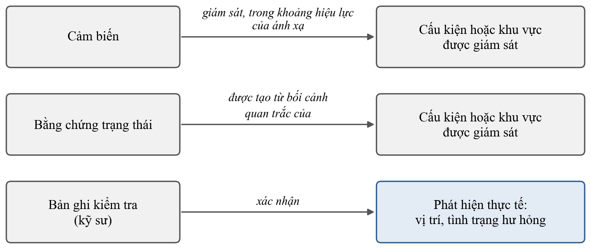

# CHƯƠNG 4. TỔNG QUAN VỀ TRUY VẾT BẰNG CHỨNG VÀ HỖ TRỢ KIỂM TRA – BẢO TRÌ

<!-- Bản rút gọn 02/10/2026 (bản v2: tag tieuluan-v2-20261002). -->

Chương này xét lớp thông tin của chuỗi: bằng chứng kỹ thuật được liên kết với cấu kiện, hồ sơ kiểm tra và trạng thái hành động theo cách nào để người quản lý truy xuất và kiểm lại được căn cứ của một quyết định. Các mục 4.1 đến 4.5 tổng quan nghiên cứu và chuẩn theo trình tự mà một mô hình truy vết cần: phân biệt các mức liên kết, yêu cầu thông tin và định danh, bằng chứng theo thời gian, ràng buộc toàn vẹn cùng câu hỏi năng lực, và hỗ trợ hành động. Mục 4.6 trình bày phương pháp kiểm chứng của Mục tiêu 2; công cụ hiện thực được đặt ở cuối mục.

## 4.1. Từ liên kết dữ liệu đến truy vết kiểm chứng được

Liên kết, tích hợp, trực quan hóa và truy vết đôi khi được dùng gần nhau nhưng ứng với các mức năng lực khác nhau. Để không phóng đại ý nghĩa của các triển khai đã có, chương này phân biệt bốn mức (Bảng 4.1). Cột thứ ba ghi phần mà mỗi mức còn để ngỏ.

Bảng 4.1. Phân biệt các mức liên kết thông tin trong quản lý tài sản

| Mức | Nội dung | Phần chưa được xác lập chỉ từ mức này |
|:---|:---|:---|
| Tích hợp cảm biến – BIM | Dữ liệu hoặc siêu dữ liệu cảm biến được liên kết với đối tượng trong mô hình | Hồ sơ kiểm tra, lịch sử hành động, nguồn của một quyết định |
| Trực quan hóa trên BIM | Giá trị, cảnh báo hoặc trạng thái được hiển thị trên mô hình | Tính toàn vẹn của quan hệ dữ liệu bên dưới |
| Liên kết hồ sơ – cấu kiện | Hồ sơ kiểm tra, khiếm khuyết hoặc sửa chữa được gắn với cấu kiện | Khả năng truy ngược về bằng chứng ban đầu |
| Truy vết bằng chứng – hành động | Bằng chứng, cấu kiện, hồ sơ và trạng thái hành động được nối bằng quan hệ kiểm tra được | Độ chính xác kỹ thuật của bằng chứng đầu vào |

Trong tiểu luận, truy vết là khả năng duy trì và truy xuất quan hệ giữa các bản ghi qua thời gian và qua hệ thống, để đi được từ một bằng chứng tới cấu kiện liên quan và từ một hồ sơ hay trạng thái hành động ngược về căn cứ ban đầu. Điều kiện đầu tiên là tách các loại thông tin thành những thực thể riêng. Cấu kiện là đối tượng đại diện cho tài sản; cảm biến là nguồn thu dữ liệu; bằng chứng trạng thái là kết quả của một quá trình xử lý và đánh giá; hồ sơ kiểm tra là bản ghi nghiệp vụ do người có trách nhiệm tạo tại một thời điểm; hành động là một quá trình có trạng thái thay đổi theo thời gian. Nếu gộp chúng thành thuộc tính của cùng một đối tượng, mỗi thay đổi ở một loại sẽ ghi đè lịch sử của các loại còn lại. Các hệ thống quản lý tài sản dựa trên BIM cũng tổ chức dữ liệu vận hành và hồ sơ bảo trì thành bản ghi có quan hệ với đối tượng mô hình \[6\], \[34\], \[36\].

Tích hợp cảm biến – BIM vì vậy chưa phải truy vết bằng chứng. Tích hợp trả lời câu hỏi dữ liệu nằm ở cấu kiện nào; truy vết còn phải trả lời bằng chứng được tạo trong điều kiện nào, được dùng cho quyết định nào và bởi ai.

## 4.2. Yêu cầu thông tin và mô hình định danh

Yêu cầu thông tin của chuỗi xuất phát từ phía quản lý tài sản, không suy ra được từ mô hình thiết kế \[24\]. Với bài toán của luận án, yêu cầu đó là các câu hỏi của người quản lý ở Mục 1.3. Mô hình định danh phải cho phép trả lời các câu hỏi này mà không dựa vào tên gọi thủ công.

Liên kết dữ liệu cảm biến với BIM đã được thực hiện theo hai hướng, và luận án kế thừa cả hai. Hướng thứ nhất mở rộng chính lược đồ dữ liệu: Theiler và Smarsly mở rộng IFC để mô hình hóa nút cảm biến, mạng cảm biến và quan hệ của hệ theo dõi trạng thái với cấu kiện chịu lực, kèm kiểm tra bằng các trường hợp dữ liệu không hợp lệ tạo có chủ ý \[2\]. Hướng thứ hai duy trì một lớp ánh xạ giữa hệ cảm biến và mô hình, như ánh xạ giữa các hệ định danh \[4\] hoặc dùng *GlobalId* làm khóa nối tới cơ sở dữ liệu chuỗi thời gian \[5\]. Ở lớp biểu diễn quan trắc, từ vựng SSN của W3C có khái niệm triển khai (`ssn:Deployment`), tức một hệ được triển khai cho một mục đích trên một nền tảng; phần quy định của khái niệm này chưa có thuộc tính thời gian \[@GHAZGWUN\]. Cùng với \[2\], đây là tiền lệ trực tiếp cho ánh xạ cảm biến – cấu kiện. Phần luận án bổ sung là khoảng hiệu lực bắt buộc của ánh xạ và ràng buộc thời điểm đo phải nằm trong khoảng đó (ràng buộc C3, Phụ lục B).

Quan hệ cảm biến – cấu kiện và quan hệ bằng chứng – cấu kiện là hai quan hệ khác nhau. Quan hệ thứ nhất mô tả nguồn đo phục vụ cấu kiện nào và có thể thay đổi khi cảm biến được tháo, thay thế hoặc tái bố trí. Quan hệ thứ hai gắn với một bản ghi được tạo tại một thời điểm từ một tập dữ liệu cụ thể, và phải giữ nguyên kể cả khi cấu hình cảm biến sau đó thay đổi. Một bất thường trong tín hiệu cũng có thể đến từ cấu kiện lân cận hoặc điều kiện vận hành; vị trí và nguyên nhân hư hỏng được xác lập qua kiểm tra của kỹ sư. Mỗi ánh xạ vì vậy cần có thời gian hiệu lực và phiên bản mô hình, để một bằng chứng cũ không bị đọc theo một ánh xạ mới. Tính duy nhất của *GlobalId* bên trong một mô hình cũng chưa bảo đảm tính liên tục của định danh qua phiên bản và công cụ \[33\]; hệ thống vận hành phải quản lý quan hệ giữa các hệ định danh thay vì giả định một mã duy nhất luôn ổn định.

## 4.3. Bằng chứng theo thời gian và hồ sơ kiểm tra

Li và cộng sự cung cấp một ví dụ rõ về quản lý khiếm khuyết và sửa chữa dựa trên BIM: hệ thống dùng mã khiếm khuyết, liên kết với vị trí cấu kiện, lưu dữ liệu kiểm tra, bản ghi sửa chữa và trạng thái hoàn thành \[34\]. Kim và cộng sự liên kết dữ liệu công việc quản lý vận hành với đối tượng IFC \[6\], còn Wan và cộng sự gắn hồ sơ bảo trì với cấu kiện và đưa người quản lý vào bước rà soát kết quả sửa chữa \[78\]. Piras và cộng sự tích hợp BIM với hệ quản lý bảo trì có hỗ trợ máy tính (CMMS) bằng chuẩn mở, trong đó *GlobalId* được duy trì khi tài sản được đăng ký vào hệ quản lý bảo trì \[36\]. Luận án kế thừa việc đưa hồ sơ kiểm tra vào BIM và liên kết BIM với CMMS từ các tiền lệ này. Trong vận hành, BIM hiếm khi là hệ duy nhất: dữ liệu cảm biến, công việc bảo trì, kiểm tra và tài liệu thường nằm ở các nền tảng khác nhau, nên liên kết xuyên hệ thống quan trọng hơn việc dồn mọi dữ liệu vào một tệp mô hình.

Hai điểm vẫn còn mở. Thứ nhất, một trạng thái hiện tại như "đã hoàn thành" chưa tương đương với lịch sử trạng thái: người quản lý cần biết hồ sơ được tạo khi nào, ai rà soát, ai chuyển trạng thái và dựa trên bằng chứng nào. Đó là khác biệt giữa một trường trạng thái và một chuỗi sự kiện quản lý. Thứ hai, điều hướng hai chiều giữa BIM và CMMS trên giao diện khác với truy vết hai chiều có kiểm chứng. Người dùng có thể đi từ BIM sang CMMS rồi quay lại mà vẫn không biết một yêu cầu kiểm tra được sinh ra từ bằng chứng nào, hoặc bằng chứng đó có hiệu lực tới đâu. Truy vết đòi hỏi quan hệ ở hai phía cùng biểu diễn một liên hệ có định danh và phát hiện được khi liên kết bị đứt.

Như vậy, các nghiên cứu về kiểm tra – bảo trì đã xác lập ba năng lực: dữ liệu khiếm khuyết và kiểm tra gắn được với cấu kiện BIM; hồ sơ sửa chữa và trạng thái công việc số hóa được; và định danh duy trì được khi thông tin đi giữa BIM và hệ quản lý bảo trì. Ba năng lực này là nền cần thiết. Để trở thành mắt xích của chuỗi bằng chứng, hồ sơ kiểm tra còn cần quan hệ tường minh với căn cứ đã làm phát sinh hoạt động kiểm tra và với trạng thái xử lý sau đó.

Nguồn gốc dữ liệu mô tả một bản ghi được tạo từ đâu, qua quá trình nào và bởi tác nhân nào. PROV-O cung cấp từ vựng tổng quát cho thực thể, hoạt động, tác nhân và các quan hệ sinh ra, sử dụng hoặc phái sinh \[69\]. Trong xây dựng, nguồn gốc dữ liệu đã được dùng để ghi nguồn và lịch sử của dữ liệu BIM \[16\] và để tăng độ tin cậy của dữ liệu song sinh số cho quản lý tài sản \[43\]. Luận án kế thừa khái niệm này và áp vào bản ghi vận hành: bằng chứng nào tạo ra yêu cầu kiểm tra, hồ sơ nào sinh ra sau kiểm tra và hành động nào được ghi nhận sau đó. Vì thông tin vận hành thay đổi liên tục, truy vết trong quản lý tài sản là truy vết theo thời gian: nó phải dựng lại được quan hệ giữa các bản ghi tại một thời điểm đã qua. Yêu cầu phiên bản xuất hiện ở ba phía của chuỗi. Ở phía bằng chứng, người dùng cần biết phiên bản dữ liệu, chuỗi xử lý và giao thức đánh giá. Ở phía BIM, cần biết bằng chứng được liên kết với phiên bản mô hình nào và tại thời điểm nào. Ở phía hồ sơ, cần duy trì lịch sử tạo, rà soát và cập nhật. Nếu hệ thống không quản lý phiên bản hoặc thời điểm của các thay đổi, một bản ghi cũ sẽ mất bối cảnh.

Tính thời gian là điểm cần nhấn mạnh. Một bằng chứng có thể hợp lệ tại thời điểm t1 nhưng không còn phù hợp tại thời điểm t2, sau khi kết cấu được can thiệp, ánh xạ cảm biến thay đổi hoặc điều kiện lắp đặt khác đi. Truy vết vì vậy phải cho phép đọc lại quan hệ giữa các bản ghi tại đúng thời điểm của một quyết định.

## 4.4. Ràng buộc toàn vẹn và câu hỏi năng lực

Một chuỗi dữ liệu có thể tồn tại về cấu trúc nhưng vẫn sai về quan hệ: một hồ sơ tham chiếu tới cấu kiện không tồn tại, một bằng chứng thiếu nguồn cảm biến, hoặc một liên kết ngược không khớp liên kết thuận. Hagedorn và cộng sự dùng ràng buộc SHACL để kiểm quan hệ xuyên miền giữa dữ liệu công trình và tác vụ, đồng thời phát hiện các trường hợp vi phạm \[21\]. Theo cùng hướng, một mô hình dữ liệu cần được kiểm ở cả hai phía: trường hợp đúng chạy được, và các trường hợp sai quan trọng bị phát hiện. Trong thực hành openBIM, Information Delivery Specification (IDS) mô tả và kiểm tự động yêu cầu thông tin ở cấp cấu kiện \[73\]. IDS kiểm một cấu kiện có đủ thuộc tính hay không, còn ràng buộc quan hệ kiểm chuỗi giữa bằng chứng, cấu kiện, hồ sơ và hành động có đúng hay không. Luận án kiểm chuỗi bằng năm ràng buộc (Mục 4.6.2, Phụ lục B); kết hợp với IDS là hướng mở rộng.

Ngoài ràng buộc, một mô hình truy vết cần được kiểm bằng các câu hỏi mà nó phải trả lời được. Tiểu luận gọi đó là câu hỏi năng lực (competency questions). Mỗi câu hỏi năng lực có đáp án chuẩn lập trước, nên mô hình được đánh giá bằng việc trả lời đúng và đủ các câu hỏi đó. Bộ câu hỏi của luận án được nêu ở Mục 4.6.2.

## 4.5. Hỗ trợ hành động kiểm tra – bảo trì

Các nghiên cứu theo dõi dài hạn trên công trình thực cho thấy cảm biến triển khai được và đường cơ sở phụ thuộc nhiệt độ lập được cho dữ liệu dài hạn \[75\]. Những nghiên cứu này xác lập khả thi triển khai; khả năng chẩn đoán là một câu hỏi khác. Cần tách hai câu hỏi: hệ thống có lắp đặt, thu dữ liệu và duy trì đường cơ sở được không; và dữ liệu đó có đủ căn cứ để kết luận một dạng hư hỏng cụ thể không. Một nghiên cứu có thể trả lời tốt câu thứ nhất mà chưa trả lời câu thứ hai. Với quản lý tài sản, khả thi triển khai vẫn có giá trị riêng vì nó cho thấy nguồn dữ liệu và chuỗi hồ sơ vận hành được tại công trình thật. Trên công trình đang khai thác, nhãn hư hỏng được xác nhận độc lập thường hiếm, nên đường cơ sở vận hành trở thành công cụ chính để nhận biết biến đổi cần rà soát, với điều kiện các biến môi trường – vận hành được ghi như bối cảnh của dữ liệu.

Các quy trình kiểm tra – bảo trì đã có nhiều tiền lệ đưa con người vào bước rà soát và phê duyệt \[29\], \[78\]. Wu và cộng sự phát triển khung kiểm kê công trình kết hợp dự đoán, trực quan hóa và rà soát của chuyên gia \[17\]. Với khả năng giải trình, điều cần xét thêm là vai trò của con người có được ghi lại trong dữ liệu hay không: ai đã rà soát, khi nào, kết quả là gì và trạng thái thay đổi ra sao. Từ vựng PROV-O cho phép gắn tác nhân với một hoạt động theo vai trò và ghi thời điểm bắt đầu, kết thúc của hoạt động đó \[69\]; vai trò và trình tự phê duyệt của một chuỗi bằng chứng vì vậy biểu diễn được bằng dữ liệu. Luận án dùng cùng nguyên tắc cho kiểm tra – bảo trì: chủ thể và vai trò của người kiểm tra, người phê duyệt, người thực hiện và người xác minh được ghi tại từng sự kiện.

Thông tin về một hành động kiểm tra – bảo trì gồm hai trục khác nhau. Mức ưu tiên (priority level) cho biết bằng chứng đề nghị mức chú ý nào đối với cấu kiện: Bình thường, Theo dõi, Kiểm tra, Kiểm tra ưu tiên. Trạng thái xử lý (action status) cho biết hành động đang ở bước nào: Mở, Đang xử lý, Hoàn thành, Đã xác minh. Mức ưu tiên đổi khi có bằng chứng mới, theo luật minh bạch; trạng thái xử lý đổi khi người có vai trò tiếp nhận, thực hiện hoặc xác minh công việc. Một hành động có thể ở mức Kiểm tra ưu tiên mà vẫn đang Mở. Trong IFC4, trường trạng thái của yêu cầu hành động là nhãn tự do với các ví dụ như Hold, NoAction, Schedule, Urgent \[@63XPSMIR\]. Tiểu luận nhận thấy các ví dụ đó trộn mức khẩn cấp với bước xử lý, nên luận án tách thành hai trường.

Hai tiền lệ cho thấy lịch sử chuyển trạng thái biểu diễn được. BCF-API 3.0 sinh một sự kiện có ngày, tác giả, loại thay đổi và giá trị mới mỗi khi trạng thái của vấn đề thay đổi \[@P3ZIHF8G\]. García và cộng sự, với gói thông tin bàn giao trong môi trường dữ liệu chung, coi bước chuyển từ chia sẻ sang công bố là một sự kiện được quản trị, có gói bằng chứng, bản ghi quyết định và vai trò tách biệt \[44\] (tr. 3, 19–25). Luận án kế thừa khuôn "bước chuyển có bằng chứng và đúng thẩm quyền" của \[44\] và áp cho hành động kiểm tra – bảo trì. Theo đó, mỗi lần chuyển trạng thái là một sự kiện ghi thời điểm, chủ thể và vai trò người thực hiện, bằng chứng làm căn cứ và lý do. Trạng thái hiện thời được suy ra từ sự kiện mới nhất (Phụ lục A).

Trong quản lý tài sản, hệ thống số hỗ trợ lựa chọn hành động bằng cách tổng hợp dữ liệu và trình bày căn cứ, còn quyết định kiểm tra hoặc bảo trì thuộc về vai trò có trách nhiệm. Điều này đặc biệt đúng khi bằng chứng đầu vào có phạm vi hiệu lực hạn chế. Một kết quả từ dữ liệu dao động có thể cho thấy thay đổi so với đường cơ sở, nhưng người quản lý còn cần xem bối cảnh, hồ sơ trước đó và thông tin kiểm tra trước khi quyết định. Giá trị của hệ thống nằm ở việc làm cho quyết định minh bạch, có căn cứ và truy ngược được. Trong luận án, bốn mức ưu tiên Bình thường → Theo dõi → Kiểm tra → Kiểm tra ưu tiên là logic hỗ trợ quyết định bằng luật minh bạch. Con người rà soát bằng chứng, phê duyệt, kiểm tra, chẩn đoán và cho phép hành động; AI không tự quyết định kiểm tra hay bảo trì.

Trong lý thuyết quyết định, giá trị của thông tin quan trắc được lượng hóa bằng phân tích Bayes tiền hậu nghiệm, và kế hoạch kiểm tra theo rủi ro dùng chính lượng này để chọn thời điểm kiểm tra \[79\]. Khung này là căn cứ lý thuyết cho lớp hỗ trợ hành động: mức ưu tiên là một đề xuất có căn cứ để người có trách nhiệm rà soát. Tối ưu kế hoạch kiểm tra và chi phí vòng đời thuộc hướng phát triển sau luận án.

## 4.6. Phương pháp kiểm chứng cho Mục tiêu 2

Các mục 4.1 đến 4.5 cho thấy những gì đã có và những gì truy vết bằng chứng còn cần. Mục này trình bày phương pháp dự kiến của Mục tiêu 2 theo trình tự: thực thể và quan hệ, quy tắc thời gian, ràng buộc và câu hỏi năng lực, thiết kế kiểm chứng, rồi ánh xạ hiện thực và công cụ.

### 4.6.1. Thực thể, quan hệ và chuỗi nghiệp vụ

Chuỗi định danh lõi được trình bày ở Hình 4.1. *Sensor_ID* xác định nguồn đo; *BIM_GUID* xác định cấu kiện; *Condition_Evidence_ID* xác định bản ghi bằng chứng; *Inspection_Record_ID* xác định bản ghi kiểm tra; *Action_Status* là trạng thái xử lý hiện thời của hành động.

Hình 4.1. Chuỗi định danh cốt lõi

Chuỗi này là cách trình bày cho người đọc. Mô hình dữ liệu là một đồ thị gồm năm thực thể: cấu kiện, cảm biến, bằng chứng trạng thái, bản ghi kiểm tra và hành động. Hai quan hệ có thuộc tính riêng là ánh xạ cảm biến – cấu kiện có khoảng hiệu lực và sử dụng bằng chứng. Sự kiện chuyển trạng thái là một loại bản ghi sự kiện; trạng thái xử lý của hành động được suy ra từ sự kiện mới nhất (Bảng A.1). Bản ghi bằng chứng không bị sửa đè; bản ghi mới thay bản cũ bằng một quan hệ trỏ về bản cũ.

Ba kiểu quan hệ cần được phân biệt rõ. Quan hệ cảm biến – cấu kiện cho biết cảm biến phục vụ khu vực hoặc cấu kiện nào trong một khoảng thời gian. Quan hệ bằng chứng – cấu kiện cho biết bằng chứng được tạo từ bối cảnh quan trắc của khu vực hoặc cấu kiện nào; vị trí hư hỏng nằm ở quan hệ thứ ba dưới đây. Quan hệ giữa bản ghi kiểm tra và phát hiện thực tế là nơi kỹ sư xác nhận vị trí và tình trạng hư hỏng sau kiểm tra. Nhờ vậy, mô hình không cho phép hiểu rằng AI từ dữ liệu cảm biến đã xác định chính xác vị trí hư hỏng. Hình 4.2 đặt ba kiểu quan hệ cạnh nhau.

Hình 4.2. Ba kiểu quan hệ: cảm biến – cấu kiện, bằng chứng – cấu kiện và bản ghi kiểm tra – phát hiện thực tế

Về nghiệp vụ, chuỗi mà RQ2 cần truy ngược đi qua năm bước do các chủ thể khác nhau thực hiện. Thứ nhất, một cảnh báo từ dữ liệu được ghi thành bằng chứng, và luật minh bạch tính từ bằng chứng một mức ưu tiên cho khu vực cấu kiện mà nguồn đo giám sát. Thứ hai, người quản lý kiểm tra – bảo trì xem bằng chứng, mức ưu tiên và phạm vi hiệu lực rồi quyết định có đề nghị kiểm tra khu vực đó hay không; đề nghị kiểm tra chưa phải kết luận về hư hỏng. Thứ ba, kỹ sư kiểm tra tại hiện trường và lập bản ghi kiểm tra; vị trí, nguyên nhân và mức độ hư hỏng, nếu có, chỉ được xác lập ở bước này. Thứ tư, người có thẩm quyền quyết định xử lý: hành động được tạo và việc thực hiện được phê duyệt. Thứ năm, sau khi thực hiện, kỹ sư kiểm tra lại; hành động chỉ chuyển sang Đã xác minh khi có bản ghi kiểm tra sau sửa chữa. Các bước thứ ba đến thứ năm đã có bản ghi tương ứng trong mô hình (Bảng A.1, A.2). Bước đề nghị kiểm tra sẽ được đặc tả chi tiết trong giai đoạn triển khai Mục tiêu 2; báo cáo tổng quan chỉ xác lập yêu cầu rằng bước này phải truy được về bằng chứng, chủ thể và vai trò.

### 4.6.2. Quy tắc thời gian, ràng buộc toàn vẹn và câu hỏi năng lực

Ba quy tắc giữ cho chuỗi trả lời được câu hỏi trung tâm ở Mục 1.3. Thứ nhất, mỗi bản ghi kiểm tra và mỗi sự kiện chuyển trạng thái ghi mã chủ thể, tức người hoặc tổ chức thực hiện, cùng vai trò của chủ thể đó tại thời điểm thực hiện, lý do và bằng chứng làm căn cứ. Chỉ ghi vai trò thì không phân biệt được hai kỹ sư cùng vai trò. Thứ hai, thời điểm can thiệp vật lý được tách khỏi thời điểm xác minh hồ sơ. Khi một hành động can thiệp lên liên kết được thực hiện, bằng chứng và đường cơ sở gắn với đợt lắp đặt trước phải được rà soát hoặc tạm ngừng dùng làm căn cứ kể từ thời điểm can thiệp; bước xác minh sau sửa chữa xác nhận điều kiện mới. Thứ ba, phạm vi hiệu lực là trường bắt buộc của bằng chứng và được kiểm tự động tại lần sử dụng. Lý do ghi kèm khi dùng bằng chứng ngoài phạm vi chỉ làm cho ngoại lệ truy ngược được. Nó không xác nhận giá trị kỹ thuật của bằng chứng và không tự cho phép can thiệp, vì quyết định can thiệp cần căn cứ kiểm tra phù hợp được người có thẩm quyền xác nhận.

Năm ràng buộc kiểm tính toàn vẹn của dữ liệu: bản ghi mồ côi, ánh xạ đã hết hiệu lực tại thời điểm đo, bằng chứng dùng ngoài phạm vi mà không có lý do, bước chuyển trạng thái không căn cứ hoặc sai vai trò, và căn cứ đã bị thay thế (Phụ lục B). Việc cảm biến có được lắp đúng ở cấu kiện đã khai báo hay không được kiểm bằng hồ sơ lắp đặt và đối chiếu tại hiện trường (Mục 3.5).

Câu hỏi năng lực là thành phần trung tâm của phép kiểm chứng. Bộ câu hỏi dự kiến gồm hai nhóm. Nhóm về bằng chứng hỏi: bằng chứng E sinh từ cảm biến nào; cảm biến đó được ánh xạ tới cấu kiện nào tại thời điểm E được tạo; E có còn nằm trong phạm vi hiệu lực tại thời điểm được dùng không; và bản ghi kiểm tra nào được tạo từ E. Nhóm về trách nhiệm hỏi: ai đã đổi trạng thái hành động, với vai trò gì tại thời điểm đổi; bằng chứng và lý do nào làm căn cứ; và sau một can thiệp, bằng chứng hoặc đường cơ sở nào không còn được dùng. Bộ câu hỏi cùng đáp án chuẩn được khóa trước lần hiện thực cuối và sẽ được xác nhận qua phỏng vấn người quản lý kiểm tra – bảo trì phía chủ đầu tư.

### 4.6.3. Thiết kế kiểm chứng

Kiểm chứng so sánh ba phương án trên cùng BIM của nhà xưởng ở Khánh Hòa. Đối chứng B0 là hồ sơ kiểm định cũ của chính nhà xưởng, đại diện cho thực hành tại công trình nghiên cứu. Đối chứng B1 là baseline dựa trên các khả năng của IFC 4.3 và BCF 3.0 đã được xác định từ các tiền lệ gần nhất trong tổng quan. B1 gồm chuỗi lần kiểm tra – hư hỏng – cấu kiện – nhiệm vụ bảo trì của \[35\], phép gán cảm biến cho cấu kiện của \[2\], lệnh bảo trì có trạng thái và phê duyệt của IFC4 \[@63XPSMIR\], và sự kiện đổi trạng thái của BCF \[@K5SGFIGW\], \[@P3ZIHF8G\] (Mục 2.2.2). Các ràng buộc chạy trên B1 ở dạng tương ứng với những trường B1 có. Phương án đề xuất bổ sung hai quy tắc: phạm vi hiệu lực là trường bắt buộc của bằng chứng và được kiểm tại lần dùng; mỗi bước chuyển trạng thái của hành động trỏ tới lần dùng bằng chứng làm căn cứ, kèm chủ thể và vai trò người thực hiện. Nhóm lỗi nào B1 phát hiện được bằng cơ chế sẵn có thì không được tính vào phần đóng góp.

Ba phương án được so sánh theo năm khía cạnh, không theo nhận xét chung "tốt hơn". Mức đầy đủ được đo bằng M1, tỉ lệ trường bắt buộc có giá trị. Tính đúng và toàn vẹn được đo bằng M2, tỉ lệ phát hiện lỗi chèn mù theo từng nhóm lỗi. Khoảng 30 lỗi do một người không tham gia thiết kế chèn vào cả ba phương án; bộ thử có cả các bản ghi hợp lệ không chèn lỗi để đo việc báo lỗi nhầm. Khả năng truy vết được đo bằng M3: câu trả lời cho mỗi câu hỏi năng lực trước hết được chấm đúng và đủ theo đáp án chuẩn, sau đó mới so thời gian hoặc số bước. Công sức được đo bằng M4, số phút ghi nhận mỗi bản ghi. M3 và M4 được đọc cùng nhau: giá trị thực tiễn là việc tìm đúng căn cứ thuận lợi hơn bao nhiêu, đổi lại công sức ghi nhận tăng thêm bao nhiêu.

Dữ liệu thử gồm hồ sơ kiểm định cũ được mã hóa tay và các bản ghi bằng chứng của Mục tiêu 1 (Mục 3.4.3). Bằng chứng từ mô hình 1:10 khi đặt lên BIM nhà xưởng chỉ đóng vai ca kiểm thử quy tắc; nó không làm căn cứ cho quyết định tại nhà xưởng. Bộ ca thử vì vậy cần có cả ca trong và ngoài phạm vi hiệu lực. Quy tắc mã hóa B0, đặc tả B1, danh sách lỗi cùng các ca hợp lệ, bộ câu hỏi năng lực kèm đáp án chuẩn và cách tính chỉ số được khóa và lưu có phiên bản trước lần đo đầu tiên. Khi bộ ca chưa được khóa, tiểu luận không nêu kết quả dự kiến của M2.

Kết quả cần đạt là một lớp dữ liệu truy vết và bộ công cụ kiểm cho phép người quản lý trả lời các câu hỏi năng lực, trước hết là truy ngược căn cứ và người chịu trách nhiệm của từng quyết định. Phần quy cho đóng góp là chênh lệch so với B1. Chênh lệch so với B0 mô tả khoảng cách với bộ hồ sơ của công trình nghiên cứu, chưa đại diện cho thực hành kiểm định chung.

### 4.6.4. Ánh xạ hiện thực và công cụ

Mô hình là một lớp dữ liệu truy vết liên thông với IFC 4.3 theo cách dùng của \[35\] và với BCF 3.0. Dữ liệu được lưu trong cơ sở dữ liệu riêng và được ánh xạ sang thực thể, quan hệ chuẩn khi xuất (Bảng A.3); luận án không thêm thực thể hay sửa lược đồ IFC. Bảng ánh xạ là phương án biểu diễn; nó chưa cho biết dữ liệu có được bảo toàn khi trao đổi hay không. Việc khóa định danh và liên kết có còn nguyên sau khi xuất rồi đọc lại hay không sẽ được kiểm bằng một phép xuất – nhập trên chính dữ liệu thử.

Các công cụ dưới đây là môi trường hiện thực và tham chiếu; đóng góp khoa học nằm ở các quy tắc và mô hình ở Mục 4.6.1–4.6.3. Mô hình BIM của nhà xưởng ở Khánh Hòa được dựng và quản lý trong Revit, rồi xuất sang IFC 4.3; IfcOpenShell được dùng để đọc và ghi tệp IFC. Vấn đề và lịch sử trạng thái được biểu diễn theo BCF 3.0 \[@K5SGFIGW\]. Các bản ghi được lưu trong SQLite. Năm ràng buộc và logic hỗ trợ hành động bốn mức được viết bằng Python, dưới dạng luật minh bạch để mỗi mức ưu tiên truy được về luật đã áp dụng. Phần này không dùng mô hình AI.

## 4.7. Tổng hợp chương

Bảng 4.2 tổng hợp các dòng nghiên cứu chính và hàm ý của từng dòng cho chuỗi thông tin quản lý.

Bảng 4.2. Tổng hợp các dòng nghiên cứu chính

| Dòng nghiên cứu | Đã được xác lập | Hàm ý đối với chuỗi thông tin quản lý |
|:---|:---|:---|
| Tích hợp cảm biến – BIM | Nối dữ liệu hoặc thiết bị với cấu kiện qua lược đồ hoặc định danh \[2\], \[4\], \[5\] | Phân biệt quan hệ cảm biến – cấu kiện với quan hệ bằng chứng – cấu kiện |
| BIM cho kiểm tra – bảo trì, CMMS | Hồ sơ, khiếm khuyết gắn với cấu kiện; định danh duy trì qua hệ thống \[34\], \[36\] | Hồ sơ là bản ghi có lịch sử; điều hướng chưa phải truy vết |
| Nguồn gốc dữ liệu, kiểm chứng quan hệ | Từ vựng nguồn gốc; ràng buộc phát hiện dữ liệu sai \[21\], \[69\] | Bằng chứng giữ nguồn gốc khi đi vào hồ sơ; truy vết cần tiêu chí kiểm tra |
| Con người và trạng thái hành động | Rà soát, phê duyệt; sự kiện đổi trạng thái \[44\], \[@P3ZIHF8G\] | Vai trò, thời điểm và căn cứ của mỗi lần đổi trạng thái cần truy lại được |
| Quan trắc hiện trường, giá trị thông tin | Đường cơ sở dài hạn; khung quyết định Bayes \[75\], \[79\] | Khả thi hiện trường tách khỏi chẩn đoán; mức ưu tiên là đề xuất có căn cứ |

Các thành phần kỹ thuật này đã tương đối trưởng thành nhưng thường được phát triển trong những hệ thống hoặc cho những mục tiêu riêng. Chương 4 cung cấp ba nhận định cho Chương 5. Thứ nhất, bằng chứng kỹ thuật cần giữ nguồn gốc và phạm vi hiệu lực khi đi vào hệ thống thông tin. Thứ hai, giá trị nghiên cứu nằm ở tính liên tục, tính thời gian và khả năng kiểm chứng của quan hệ, không ở bản thân việc tích hợp. Thứ ba, hỗ trợ hành động phải duy trì căn cứ cùng lịch sử rà soát, còn quyết định thuộc người có trách nhiệm.
