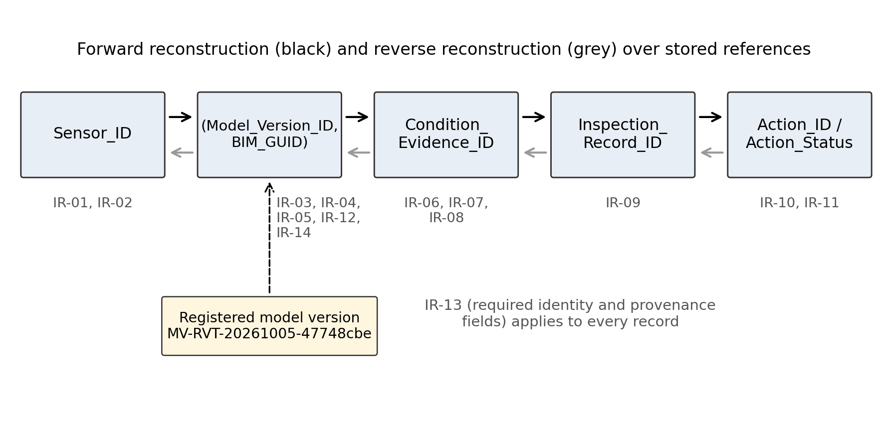
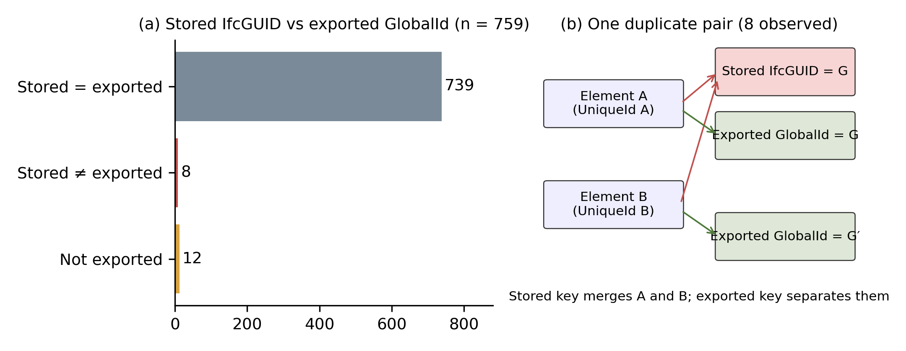

# Highlights

- A model version registered with a file hash scopes every BIM component reference held outside the model.
- In a 759-element steel building model, 8 stored IfcGUID values were shared by 16 elements; the 747 exported GlobalIds were all distinct.
- One chain links Sensor_ID, BIM_GUID, Condition_Evidence_ID, Inspection_Record_ID and Action_Status, with 14 explicit rejection rules.
- On synthetic records anchored to real components, the first frozen validator passed 68 of 78 challenge cases; corrective verification on the same set passed 78.
- Objective model observations, cross-source comparisons and internal verification are reported as separate evidence classes.

# Abstract

Inspection findings and maintenance actions are now held in BIM-linked records, and monitoring data reach the same records through IFC GlobalIds. A maintenance action is accountable only if its evidence can be traced to the component that was observed and to the model state that defined that component. Published studies link sensors to components, inspections to components and inspections to maintenance actions, and they govern identifier quality; among the ten closest studies read in full, none combines these mechanisms into one component-level chain with explicit rejection of broken links. This study asks whether an identity rule scoped to a registered model version can support deterministic traceability from Sensor_ID through BIM_GUID, Condition_Evidence_ID and Inspection_Record_ID to Action_Status, with explicit failures for missing, invalid and ambiguous links. Component identity is the ordered pair (Model_Version_ID, BIM_GUID); BIM_GUID is the exported IFC GlobalId, not the IfcGUID value stored as a Revit parameter; duplicated identifiers are reported and never repaired silently. The rule was applied to the hash-identified Revit model of a 25 m × 80 m steel portal-frame industrial building with 759 structural elements. Eight stored IfcGUID values were each shared by two elements, while all 747 exported GlobalIds were distinct; the rule kept the 16 affected elements apart and rejected the shared stored value as a key. A six-entity schema with 14 integrity rules and 12 competency questions was then verified internally on synthetic chain records anchored to nine real components: all nine chains were reconstructed forward and in reverse, and 145 of 145 mutated records were rejected with the intended failure class. On a 78-case challenge set the first frozen validator passed 68 cases; after 8 validator defects and 2 specification gaps were corrected, the same set passed 78 of 78. The evidence covers one model version, one export and synthetic downstream records. It shows that the identity rule and the rejection logic work on a real model containing a real identifier anomaly. It does not show field performance or persistence of identity across model versions.

**Keywords:** building information modelling; IFC GlobalId; component identity; model versioning; traceability; inspection and maintenance records; asset information management

# 1 Introduction

## 1.1 Inspection and maintenance information in BIM

Facility managers have used BIM for operation and maintenance information for more than a decade (Pärn et al., 2017; Patacas et al., 2020). Recent work places the inspection record itself inside BIM-linked structures. Bellon et al. (2025) represent inspections, damage, maintenance services and costs in IFC using real bridge inspection data. Hagedorn et al. (2023) route a bridge inspection finding to a repair order through linked information containers. Kim et al. (2018) link 590 maintenance work records to IFC objects, and Marmo et al. (2020) map an IFC subset for maintenance to a relational database. In each of these structures, the component identifier is the join that allows an asset manager to ask which evidence led to which action on which element.

## 1.2 Why a link to a component is not yet accountable evidence

Monitoring data enter the same structures through the same join. Delgado et al. (2018) generate IFC-compliant models of a bridge monitoring system with time-series data; Chatsuwan et al. (2025a) map indoor-environment sensors to IFC GlobalIds through a mapping table; Ramonell et al. (2023) join IFC entities and IoT devices through shared GUIDs. Chatsuwan et al. (2025a) also observe that a GlobalId can be regenerated when an element is deleted and recreated during a model update, which breaks the sensor link without warning. Rogage et al. (2020) tested more than 100 building models and found that very few were authored in a way that let relevant objects be identified for transfer to a maintenance database. A record that points to a GlobalId therefore carries an unstated assumption about which model state issued that GlobalId and whether that state is still current.

## 1.3 Identity, versions and provenance

Borkowski et al. (2026) show that the same physical element receives different GUIDs in independently created design, as-built and operation files, and propose a persistent identifier above the GUID. Fang et al. (2025) measure completeness, validity, uniqueness and stability of IfcGUIDs and register every check with hashes, timestamps and operators. Mariniello et al. (2025) log the validation of monitoring data and the reactions to alerts on a ledger, García et al. (2026) tie publish/hold decisions to a specific IFC revision and named roles, and Kochovski et al. (2026) issue decentralised identifiers and verifiable credentials for building logbook data. Each study addresses part of a single question: can a recorded action be traced back to valid evidence about the right component?

## 1.4 What the literature already provides

Sensor-to-component binding, inspection-to-component linkage, inspection-to-action linkage, identifier quality checking, auditable data validation and competency-question verification are all reported (Section 2). This study does not claim any of them as new.

## 1.5 Remaining gap

Among the ten closest studies read in full (Section 2.8), none reports one component-level chain from sensor to action status in which (a) identity is scoped to a registered model version and fails closed under any other version, (b) explicit rules reject missing, invalid and ambiguous links at every step of the chain, with deliberate invalid-data tests, and (c) the chain is exercised on a real model that contains an observed identifier anomaly. Lorvão Antunes et al. (2024) reach sensors and inspections without actions or rule validation; Bellon et al. (2025) reach inspections and maintenance without sensors or identity governance; Fang et al. (2025) govern identifiers without a downstream chain. Two 2026 studies that could be read only at abstract level, Rico Thirion et al. (2026) and Kochovski et al. (2026), are discussed separately in Section 7.3.

## 1.6 Research question

RQ2: Can a BIM-based, model-version-controlled identity architecture support deterministic traceability Sensor_ID → BIM_GUID → Condition_Evidence_ID → Inspection_Record_ID → Action_Status, with explicit integrity failures for missing, invalid and ambiguous information?

## 1.7 Contributions

1. A version-scoped component-identity rule, (Model_Version_ID, BIM_GUID) with BIM_GUID equal to the exported IFC GlobalId and with detect-not-repair handling of stored-identifier duplicates, applied to a real model in which stored and exported identifiers diverge for 16 elements.
2. A component-level traceability structure from sensor to action status with forward and reverse reconstruction and 14 integrity rules that separate missing, invalid and ambiguous links, verified internally on synthetic records anchored to real component identities.
3. A verification record that reports the first frozen run (68/78) separately from the corrective run on the same challenge set (78/78) and classifies every first-run failure.

The rest of the paper is organised as follows. Section 2 positions the study. Section 3 describes the method and Section 4 the traceability architecture. Section 5 describes the case, Section 6 the results and Section 7 the discussion. Sections 8 and 9 give limitations and conclusions.

# 2 Related work

## 2.1 Monitoring data linked to BIM

Systematic reviews of BIM for health monitoring and maintenance list IFC schema extension, interoperability and data volume as open problems (Shafie Panah and Kioumarsi, 2021; Sadhu et al., 2023). IFC Monitor extends the IFC schema to describe structural health monitoring systems (Theiler and Smarsly, 2018). Delgado et al. (2018) build parametric IFC models of a fibre-optic monitoring system on a bridge, and Hu et al. (2024) visualise processed IoT strain data on structural members of a laboratory frame. Gragnaniello et al. (2024) check SHM information requirements in a viaduct model with the Information Delivery Specification. Chatsuwan et al. (2025a) and Ramonell et al. (2023) bind live sensor streams to IFC entities through GlobalIds or shared GUIDs, and Lorvão Antunes et al. (2024) model sensors as hosted by structures using the SSN ontology and link physical objects to ifcElement GUIDs in three road-authority pilots. Binding a sensor to a component is established.

## 2.2 BIM and IFC component identity

Lee et al. (2018, 2021) derive rule logic for model view definitions, including GUID uniqueness, format and round-trip rules. Fang et al. (2025) treat the 22-character IfcGUID as a cross-system primary key and measure four quality indicators over 820 objects in a virtual smart-home project; stability is defined as identical GlobalIds in two exports made under identical settings. Shafiq and Lockley (2022) report GUID inconsistencies after modelling operations and match objects by attribute signatures. None of these studies distinguishes the GUID stored as a Revit parameter from the GlobalId written at export. Section 6.3 shows why the distinction matters.

## 2.3 Model versioning and identity persistence

Borkowski et al. (2026) give each element a GUID-independent URI and attach a phase-specific GUID as a backlink; cross-file matching is manual, and the authors state that the ontology is not designed for continuous monitoring. Rico Thirion et al. (2026) report persistent component identifiers in a bridge digital-twin platform (abstract only). Fang et al. (2025) test GlobalId stability between two exports. Persistence of identity across versions is therefore addressed in the literature, and the present study does not claim it. It claims a narrower property: a GlobalId held in a downstream record is valid only together with the model version that issued it.

## 2.4 Provenance and asset-information governance

Data quality has several dimensions beyond accuracy, including traceability of origin (Wang and Strong, 1996). In construction, Çelik et al. (2023) record object version and responsibility for BIM objects on a blockchain, Erri Pradeep et al. (2021) keep blockchain records of design information exchanges for liability control, and Tavakoli et al. (2024) propose a digital-twin data provenance model for predictive asset management. Mariniello et al. (2025) use smart contracts to validate monitoring data, authenticate damage-detection tools and log reactions on a real viaduct; component identity binding is not reported. García et al. (2026) attach publish/hold decision records to IFC revisions and roles across 22 real deliverables, and Patacas et al. (2020) validate asset information models against requirements in a common data environment. The PAV vocabulary separates authoring, provenance and versioning roles in a domain-neutral form (Ciccarese et al., 2013). Provenance of records is established. Provenance of the component reference inside those records is less developed.

## 2.5 Inspection and maintenance information linkage

Sacks et al. (2018) specify information delivery requirements for bridge inspection. Bellon et al. (2025) represent inspections as IfcTask, damage as IfcSurfaceFeature and the inspector as IfcActor, and link damage to maintenance services and cost items. Hagedorn et al. (2023) and Wan et al. (2019) connect inspection findings to repair activities in bridge management. Kim et al. (2018) link maintenance work records to IFC objects, Shalabi and Turkan (2017) link building-system alarms to maintenance management records through IFC, and Liu and El-Gohary (2022) model deterioration and maintenance actions in a bridge ontology. Matarneh et al. (2022) and Otranto et al. (2025) report that manual data entry and missing verification degrade information handed over to facility management. None of these studies starts from sensor-derived evidence.

## 2.6 Forward and reverse traceability

Kim et al. (2018) retrieve work records by component and across components that share objects. Lorvão Antunes et al. (2024) answer competency questions such as "what are the results of a certain inspection by element". These are forward or single-step queries. Reconstruction from an action back to the originating sensor across four record types is not reported in the studies reviewed.

## 2.7 Integrity verification and competency questions

Competency questions are a standard device for scoping and verifying ontologies (Monfardini et al., 2023) and are used by Lorvão Antunes et al. (2024), Liu and El-Gohary (2022) and Borkowski et al. (2026). Rule-based checking of BIM data is established (Lee et al., 2018, 2021; Fang et al., 2025; García et al., 2026). Mutation-based test generation, in which faults are injected deliberately to check whether a test procedure detects them, is established in software engineering (Jia and Harman, 2011). In BIM traceability it appears only in limited forms: a pre-test/post-test design (Fang et al., 2025) and one schema-level inconsistency test (Borkowski et al., 2026).

## 2.8 Positioning

Table 1 compares the ten Tier-A studies, read in full, against the capabilities of the present design. Seven capabilities are reported individually and four studies cover three or more; none covers the version-scoped chain with rejection rules and invalid-data tests on a real model. The search behind Table 1 was targeted (about 140 unique records from Consensus, Scopus, OpenAlex and a Zotero library, October 2026) and was not a systematic review.

Table 1. Tier-A positioning (YES / PARTIAL / NO / NR = not reported). Evidence level: full text for all ten rows.

| Study | Sensor–BIM | Version | Inspection | Action | Reverse trace | Rules | CQs | Invalid-data tests | Real data |
|---|---|---|---|---|---|---|---|---|---|
| Borkowski et al. (2026) | NO | YES | PARTIAL | NO | PARTIAL | PARTIAL | YES | PARTIAL | PARTIAL |
| Fang et al. (2025) | PARTIAL | YES | NO | NO | NR | YES | NO | PARTIAL | NO |
| Lorvão Antunes et al. (2024) | YES | NO | YES | NO | PARTIAL | NO | YES | NO | YES |
| Mariniello et al. (2025) | PARTIAL | NR | PARTIAL | PARTIAL | NR | YES | NO | PARTIAL | YES |
| García et al. (2026) | NO | YES | NO | NO | NR | YES | NO | PARTIAL | YES |
| Bellon et al. (2025) | NO | NR | YES | YES | NR | PARTIAL | NO | NO | YES |
| Kim et al. (2018) | NO | NO | PARTIAL | YES | YES | NO | NO | NO | YES |
| Hagedorn et al. (2023) | PARTIAL | NR | YES | YES | NR | PARTIAL | NO | NO | YES |
| Chatsuwan et al. (2025a) | YES | NO | NO | PARTIAL | NR | NO | NO | NO | YES |
| Ramonell et al. (2023) | YES | NR | PARTIAL | PARTIAL | NR | NO | NO | NO | PARTIAL |
| This study | YES (synthetic) | YES | YES (synthetic) | YES (synthetic) | YES | YES | YES | YES | identities and anomaly real; chain records synthetic |

# 3 Research method

## 3.1 Research design and scope

The study follows a design-science approach (Hevner et al., 2004): an information artefact (an identity rule and a traceability structure) is designed against a stated problem and evaluated on one controlled case. The evaluation tests information traceability only. It does not diagnose structural condition, calibrate a structural model or evaluate maintenance outcomes. Condition evidence is treated as a record type with an identifier, a status and a validity window. How the evidence is computed is outside the scope of this paper.

## 3.2 Case: P002 steel portal-frame industrial building

The case building is a single-storey steel portal-frame industrial building with plan dimensions of 25 m × 80 m, grids 1–9 along the length (eight 10 m bays) and A–B across the span, column top at +6.300 m and ridge at +9.300 m. The building has a Revit model, an IFC export and as-built drawings in PDF. It was chosen because all three sources exist for the same structure and because the research team controlled the model, so that its state could be frozen and hashed.

A 1:10 laboratory frame of the same building type, 2.5 m × 7.0 m in plan, is being built for later condition-monitoring work. Because of the available laboratory floor area it reproduces seven of the eight bays. The laboratory frame contributes no data to this paper; its relationship to the full-scale model is discussed in Section 7.8 as an identity-mapping problem for future work.

## 3.3 Source hierarchy

Roles were assigned to four sources before any identity analysis (Figure 1). The Revit file of version 4 of the model was designated the working BIM reference after live verification; it is not claimed to be an exact as-built model. The IFC file exported from it was designated a derived exchange model, and the as-built PDF the physical as-built reference. A second Revit file in the project folder, whose relationship to the working reference could not be established from file metadata, was left unresolved and not used.

Figure 1. Source hierarchy and evidence flow from Gate 2 (identity readiness) to Gate 3 (traceability verification). [To be drawn.]

## 3.4 Model-version registration

The working reference was opened in Autodesk Revit 2027 (build 27.3.0.28) and read through a read-only programming interface. The live document path, a SHA-256 hash of the saved file (47748cbeb460229e…), the file size (37 564 416 bytes) and the flag Document_Modified = FALSE were recorded. The version identifier MV-RVT-20261005-47748cbe was then registered by the researcher as a provenance event together with the hash, the software build, the IFC file name and hash, and the known limitations. Registration is a human decision. A newer file timestamp does not make a file authoritative.

## 3.5 Identity-governance method

Every element in the scoped categories (structural framing, structural columns, structural foundations, generic models and floors) was read live: ElementId, UniqueId, the stored IfcGUID parameter, category, family, type and level. The IFC export was parsed with IfcOpenShell 0.8.5 and joined to the live inventory on Revit ElementId = IFC Tag. For each element the stored IfcGUID and the exported GlobalId were compared.

Identity was then defined as follows. BIM_GUID is the exported IFC GlobalId. Component identity is the ordered pair (Model_Version_ID, BIM_GUID), not a concatenated string. UniqueId, ElementId and the stored IfcGUID are supporting evidence only. A duplicate stored IfcGUID is an integrity anomaly to be detected and reported; it is not repaired or regenerated in the source model, because a repair would erase the evidence that earlier references may be wrong. Location is derived by a separate locator rule (native level, then IFC spatial containment, then labelled geometry) and is not part of identity. Asset_ID is optional.

## 3.6 Traceability schema

Six entities were defined: Model_Version, BIM_Component, Sensor, Condition_Evidence, Inspection_Record and Action_Status_Record (Table 2). Action level (NORMAL, WATCH, INSPECT, PRIORITY_INSPECTION) and action workflow status (nine states from proposed to reopened) are separate controlled vocabularies. Neither encodes a maintenance decision rule.

Table 2. Identifier roles.

| Identifier | Role | Origin in this study |
|---|---|---|
| Model_Version_ID | Scopes every component reference | Registered (real) |
| BIM_GUID | Exported IFC GlobalId; key together with Model_Version_ID | Real |
| Revit_UniqueId | Supporting; detects ambiguous identity | Real |
| Stored_IfcGUID | Supporting; not authoritative | Real |
| Sensor_ID | Sensor placement | Synthetic |
| Condition_Evidence_ID | Evidence record; references one sensor and one component | Synthetic |
| Inspection_Record_ID | References the evidence used | Synthetic |
| Action_ID, Action_Status | References the inspection; level and workflow status | Synthetic |

## 3.7 Integrity rules

Fourteen rules (IR-01 to IR-14) were written before any test fixture was generated and were frozen with a hash (Table 3). They are evaluated in a fixed order; the reported failure class is that of the first failing rule. No score or index is computed, so a record is either accepted (with or without warning flags) or rejected with a named class.

Table 3. Integrity rules.

| Rule | Condition | Failure class |
|---|---|---|
| IR-01 | Sensor_ID present and registered | MISSING_IDENTIFIER / UNKNOWN_SENSOR |
| IR-02 | Sensor maps to exactly one active component in the declared version | SENSOR_BINDING_MISMATCH |
| IR-03 | BIM_GUID exists in the registered version | MISSING_IDENTIFIER / UNKNOWN_BIM_GUID |
| IR-04 | Identity evaluated as the pair (Model_Version_ID, BIM_GUID) | MODEL_VERSION_MISMATCH / UNKNOWN_BIM_GUID |
| IR-05 | Duplicate stored IfcGUID reported and never used as BIM_GUID | AMBIGUOUS_IDENTITY / anomaly flag |
| IR-06 | Condition_Evidence_ID unique | DUPLICATE_EVIDENCE_ID |
| IR-07 | Evidence references the chain's sensor and component | BROKEN_EVIDENCE_LINK |
| IR-08 | Evidence status and validity window usable at inspection date | INVALID_EVIDENCE |
| IR-09 | Inspection references the evidence | BROKEN_INSPECTION_LINK |
| IR-10 | Action level and status from controlled vocabularies | INVALID_ACTION_STATUS |
| IR-11 | Action references the inspection | BROKEN_ACTION_LINK |
| IR-12 | Unregistered or wrong version fails lookup | MODEL_VERSION_MISMATCH |
| IR-13 | Required identity and provenance fields present | MISSING_IDENTIFIER / PROVENANCE_MISSING |
| IR-14 | No silent resolution of multiple values or of BIM_GUID/UniqueId disagreement | AMBIGUOUS_IDENTITY |

## 3.8 Competency questions

Twelve competency questions (CQ01–CQ12) were frozen before validation (Table 4). Each has an input, an expected output, the entities and rules involved, and a pass criterion.

Table 4. Competency questions.

| CQ | Question | Rules |
|---|---|---|
| CQ01 | Given Sensor_ID, which BIM component is linked? | IR-01, IR-02 |
| CQ02 | Which Model_Version_ID was valid when the link was recorded? | IR-12 |
| CQ03 | Given Condition_Evidence_ID, which sensor produced it? | IR-06, IR-07 |
| CQ04 | Which component did that evidence refer to? | IR-07 |
| CQ05 | Was the evidence usable at the time of inspection? | IR-08 |
| CQ06 | Which inspection used that evidence? | IR-09 |
| CQ07 | What action level and status resulted from the inspection? | IR-10, IR-11 |
| CQ08 | Who or what record created or changed the status? | IR-13 |
| CQ09 | Can the chain be reconstructed from the action back to the sensor? | IR-07, IR-09, IR-11 |
| CQ10 | Does a wrong model version cause deterministic rejection? | IR-12, IR-04 |
| CQ11 | Do missing, duplicate and invalid identifiers fail explicitly? | IR-01, IR-03, IR-06, IR-13 |
| CQ12 | Are missing, invalid and ambiguous information distinguished? | IR-13, IR-01/03/08/10, IR-14 |

## 3.9 Positive and negative verification

Nine positive fixtures were built on real component identities from the registered model: two primary columns, a primary rafter and a ridge rafter, a gable column and a gable rafter, a placeholder brace, and both elements of one real duplicate pair. All sensor, evidence, inspection and action records attached to them were synthetic and were labelled as such in every record. Seventeen deterministic mutation classes (Table 5), in the sense of mutation-based testing (Jia and Harman, 2011), were applied to the nine positives to generate 145 negative fixtures with 13 intended failure classes. The fixtures were hashed before validation and re-checked unchanged afterwards. A rejection counted as a pass only if it was a controlled failure with the intended class; a crash did not count.

Table 5. Mutation classes.

| Class | Target | Operation | Intended class |
|---|---|---|---|
| NEG01 | Sensor_ID | empty | MISSING_IDENTIFIER |
| NEG02 | Sensor_ID | unregistered value | UNKNOWN_SENSOR |
| NEG03 | BIM_GUID | empty | MISSING_IDENTIFIER |
| NEG04 | BIM_GUID | well-formed unknown value | UNKNOWN_BIM_GUID |
| NEG05 | Model_Version_ID | unregistered version | MODEL_VERSION_MISMATCH |
| NEG06 | BIM_GUID | two values in one field | AMBIGUOUS_IDENTITY |
| NEG07 | Condition_Evidence_ID | empty | MISSING_IDENTIFIER |
| NEG08 | Condition_Evidence_ID | ID of another chain | DUPLICATE_EVIDENCE_ID |
| NEG09 | Evidence sensor reference | sensor of another chain | BROKEN_EVIDENCE_LINK |
| NEG10 | Evidence_Status | EXPIRED | INVALID_EVIDENCE |
| NEG11 | Inspection_Record_ID | empty | MISSING_IDENTIFIER |
| NEG12 | Inspection evidence reference | evidence of another chain | BROKEN_INSPECTION_LINK |
| NEG13 | Action_Status | out-of-vocabulary value | INVALID_ACTION_STATUS |
| NEG14 | Action inspection reference | inspection of another chain | BROKEN_ACTION_LINK |
| NEG15 | Provenance | empty | PROVENANCE_MISSING |
| NEG16 | BIM_GUID | shared stored IfcGUID | AMBIGUOUS_IDENTITY |
| NEG17 | BIM_GUID and UniqueId | another valid component | SENSOR_BINDING_MISMATCH |

## 3.10 Challenge procedure

A second set of 78 challenge cases was written after the first validation and frozen: 19 expected accepts, 59 expected rejects, 8 multi-fault cases with up to three simultaneous faults, and all 8 real duplicate pairs in three variants each. It was run once against the unchanged, hash-frozen validator. The author of the challenge set had not seen validator outputs for these cases but had written the validator, so the set is classified as internal with Level C independence (blind to outputs, not to code). Every first-run failure was classified as either a validator defect or a specification gap. Defects were then corrected in a new validator version, and the same 78 cases and the original 154 fixtures were re-run. One intermediate corrected attempt, whose output files were deleted before the final run, is excluded from the evidence.

## 3.11 Evidence-independence classification

Every result is labelled E1 (objective observation of source data), E2 (comparison across independent sources) or E3 (internal verification of the authors' own specification and code). E3 results are reported as internal verification and are not used to establish novelty, which is argued from the literature in Section 2.

# 4 Traceability architecture

## 4.1 Entities

The six entities form a chain in which each record holds the identifier of the record it depends on (Figure 2). The evidence record stores its own copy of the sensor and component reference, and the inspection and action records store the identifier of the upstream record, so a broken reference is visible in the record itself rather than inferred.

## 4.2 Identifier roles

Table 2 separates the key (Model_Version_ID with BIM_GUID) from supporting identifiers. The stored IfcGUID is retained because its disagreement with the exported GlobalId is evidence. It is never the key.

## 4.3 The pair (Model_Version_ID, BIM_GUID)

A BIM_GUID is resolved only within the version named in the same record. If that version is not registered, the lookup fails with MODEL_VERSION_MISMATCH even when the same GlobalId exists in the registered version. A reference to a superseded or unknown model state is therefore visible instead of silently resolving to whatever element now carries that GlobalId. The pair does not tell the user which element in a new version corresponds to an element in the old one; that requires a persistence mechanism such as the one proposed by Borkowski et al. (2026). The two mechanisms are complementary: persistence answers "which element is this across versions", and version scoping answers "is this reference still valid as written".

## 4.4 Sensor to component

A sensor is bound to exactly one active component within the declared version (IR-02). The schema does not constrain how many sensors a component may carry.

## 4.5 Evidence to inspection

An inspection record names the evidence record it used. The evidence must have a known status and a validity window that covers the inspection date (IR-08). Expired or invalid evidence fails.

## 4.6 Inspection to action

An action record names the inspection; its level and workflow status come from controlled vocabularies (IR-10, IR-11).

## 4.7 Forward traceability

From a Sensor_ID, the component, evidence, inspection and action are resolved in sequence.

## 4.8 Reverse traceability

From an Action_ID, the inspection, evidence, component and sensor are resolved backwards; the result must equal the forward chain (CQ09).

## 4.9 Invalid and ambiguous data

Missing values (empty identifiers, missing provenance), invalid values (unknown identifiers, wrong version, expired evidence, out-of-vocabulary status) and ambiguous values (several components in one field, a shared stored IfcGUID used as key, GlobalId and UniqueId pointing to different elements) map to disjoint groups of failure classes (CQ12).

# 5 Case implementation

## 5.1 BIM source

The working reference was verified live on 6 October 2026: the open document was the registered file, unmodified, with the registered hash [E1]. A targeted comparison of 16 items against the as-built drawings gave 3 matches, 4 functionally equivalent names, 4 mismatches and 5 items that could not be checked [E2]. Intermediate gable columns, for example, stand at Y = 0, 4.1, 8.2, 16.8, 20.9 and 25.0 m in the model, while the printed dimension chain on the drawings reads 8500 | 8000 | 8500 mm. The model is therefore treated as a working reference, not as an as-built model.

## 5.2 Revit and IFC inventory

The live model held 759 elements in the scoped categories: 625 structural framing, 62 structural columns, 26 structural foundations, 45 generic models and 1 floor, with 759 distinct ElementIds and UniqueIds [E1]. No element carried an Asset_ID or other asset shared parameter (0 of 759) [E1]. The eight brace objects were generic-model placeholders without material or section, and none of the 18 structural framing elements sampled had a native level [E1].

## 5.3 Model-version registration

One version, MV-RVT-20261005-47748cbe, was registered. The IFC header recorded the same save count (43) as the Revit file metadata [E2].

## 5.4 Objective identifier anomalies

The anomalies reported in Section 6 were found in the source data. None was injected by the authors.

## 5.5 Traceability records

Nine chains were instantiated, one per positive fixture, each with one synthetic sensor, evidence, inspection and action record.

## 5.6 Boundary between real and synthetic data

Every record downstream of BIM_Component is synthetic. The real parts of each chain are the model version, the component identities and the duplicate-pair anomaly. Results in Sections 6.4–6.9 therefore show that the logic works on real identities. They show nothing about real sensors, real inspections or maintenance outcomes.

# 6 Results

## 6.1 Objective BIM and IFC observations

Of the 759 scoped elements, 747 were present in the IFC export and 12 opening objects were not [E2]. For the 747 exported elements, the stored IfcGUID equalled the exported GlobalId for 739 and differed for 8 (Figure 3a). In terms of identity integrity, 731 elements passed, 16 were conditional (both members of each duplicate pair) and 12 were unresolved (not exported); none failed (Table 6).

Table 6. Objective identity observations, model MV-RVT-20261005-47748cbe.

| Observation | Count | Class |
|---|---|---|
| Scoped live elements | 759 | E1 |
| Distinct ElementIds / UniqueIds | 759 / 759 | E1 |
| Elements in IFC export | 747 | E2 |
| Stored IfcGUID = exported GlobalId | 739 | E2 |
| Stored IfcGUID ≠ exported GlobalId | 8 | E2 |
| Not exported (openings, no BIM_GUID) | 12 | E2 |
| Duplicate stored IfcGUID values | 8 (16 elements) | E1 |
| Distinct exported GlobalIds among exported elements | 747 / 747 | E2 |
| Elements with Asset_ID | 0 | E1 |

## 6.2 Model-version and identity findings

The live model, the IFC export and an inventory produced earlier from the same project agreed for 739 elements, partially agreed for 20 (8 re-identified at export, 12 not exported) and disagreed for none; all 232 elements in the earlier inventory had identical identifiers [E2]. Internally, a chain that referenced a valid BIM_GUID under an unregistered version was rejected with MODEL_VERSION_MISMATCH for all nine positives [E3].

## 6.3 Real duplicate-identifier case

Eight stored IfcGUID values were each shared by two elements with distinct UniqueIds; the duplication was reproduced in the live model [E1]. In the IFC export, the second element of each pair received a new GlobalId, so the 16 elements had 16 distinct GlobalIds [E2] (Figure 3b). A sensor mapping built from the stored parameter would have merged eight pairs of physically distinct members under one key each. Using the exported GlobalId kept them apart. The cause of the duplication was not established, and no parameter was edited.

Under the identity rule, both elements of every pair were accepted through their exported GlobalId with an anomaly flag, and a chain that used the shared stored value as BIM_GUID was rejected as AMBIGUOUS_IDENTITY. This held for all eight pairs [E3].

## 6.4 Forward traceability

For all nine positive chains, Sensor_ID → BIM_GUID → Condition_Evidence_ID → Inspection_Record_ID → Action_Status resolved to the registered records [E3].

## 6.5 Reverse traceability

For all nine positive chains, reverse reconstruction from the action record returned the same five identifiers as the forward chain. A mutated chain with a broken action-to-inspection reference was rejected as BROKEN_ACTION_LINK [E3].

## 6.6 Internal positive and negative verification

All 9 positives were accepted; 3 carried the expected flags (one component-metadata gap for the placeholder brace and two duplicate-identifier flags for the real pair). All 145 negatives were rejected with the intended failure class; 13 rules acted as the deciding rule at least once, and IR-04 acted as the lookup key in every test. No crash occurred [E3] (Table 7). The negative set was generated by the authors of the rules and the validator.

Table 7. Internal positive and negative verification [E3].

| Set | Cases | Expected | Observed |
|---|---|---|---|
| Positive fixtures | 9 | accept (3 with flags) | 9 accepted, 3 flagged as expected |
| Negative fixtures (17 mutation classes) | 145 | reject with intended class | 145 rejected with intended class |
| Forward reconstruction | 9 | full chain | 9 |
| Reverse reconstruction | 9 | equal to forward chain | 9 |
| Competency-question checks | 121 | pass criterion | 121 |

## 6.7 First-run challenge failures

On the 78-case challenge set, the frozen first validator passed 68 cases, failed 10 and crashed on none [E3]. Eight failures were validator defects: registry-level duplicates not detected (three cases), schema-required fields not enforced (three), and anomaly flags not shown on rejected records (two). Two were specification gaps: whether identifiers must match exactly (one case) and whether dates must follow ISO 8601 (one) (Table 8). In seven of the eight multi-fault cases the first validator reported the class of the earliest failing rule; the remaining case missed an anomaly flag, not a class. All eight real duplicate pairs behaved as specified in the first run.

Table 8. Challenge runs [E3].

| Run | Validator | Set | Pass | Fail | Status |
|---|---|---|---|---|---|
| First frozen run | v1 (hash-frozen) | 78 cases | 68 | 10 | Formal evidence |
| Intermediate attempt | v2 draft | 78 cases | (76 reported) | (2) | Not evidence; outputs deleted |
| Corrective run | v2 | same 78 cases | 78 | 0 | Corrective verification |
| Regression | v2 | 154 earlier fixtures | 154 | 0 | No per-fixture difference |
| Consistency patch | v2.1 | 78 + 154 | 0 differences | | No regression |

## 6.8 Corrective verification

After the eight defects were corrected and the two specification gaps resolved by researcher decision (exact matching after trimming leading and trailing whitespace in required text fields; ISO 8601 for dates), the new validator passed the same 78 cases and reproduced all 154 earlier outcomes without per-fixture difference [E3]. The corrections were made against this set, so the re-run is corrective verification and not fresh evidence of robustness.

## 6.9 Competency-question results

All 121 competency-question checks passed: 10 each for CQ01–CQ10, 8 for CQ11 and 13 for CQ12 [E3]. Missing, invalid and ambiguous cases fell into disjoint groups of failure classes (CQ12).

## 6.10 Evidence boundary

Table 9 separates the evidence classes. The observations in Sections 6.1, 6.2 (first sentence) and 6.3 (first paragraph) are E1 or E2 and would stand without any test. The remaining results are E3.

Table 9. Claim, evidence and independence.

| Claim | Evidence | Class | Independence |
|---|---|---|---|
| Stored and exported identifiers diverge for 16 elements | Live model vs IFC | E1/E2 | Tool outputs, not author content |
| Exported GlobalIds separate the 16 elements in this export | IFC parse | E2 | Tool output |
| Version-scoped lookup rejects unregistered versions | 9/9 | E3 | Same author |
| Chain reconstructs forward and in reverse | 9/9 and 9/9 | E3 | Synthetic records |
| Rules reject designed mutations | 145/145 | E3 | Same author |
| First validator had defects | 68/78 | E3 | Level C |
| Corrections hold on the same set | 78/78 | E3 | Same set reused |

# 7 Discussion

## 7.1 What the objective evidence demonstrates

In the P002 model, the identifier a user reads from the Revit element (the stored IfcGUID parameter) is not always the identifier the exchange file carries (the exported GlobalId), and the stored value is shared by two elements eight times. A sensor-to-component table built from the stored parameter would bind one sensor reference to two physical members without any warning. This is a source-data observation, independent of the authors' code. It shows that the choice of key has consequences in a working model and that the choice must be recorded together with the model state. Whether such duplicates are frequent in practice cannot be inferred from one model.

## 7.2 What is only internally verified

The rejection behaviour, the reconstruction in both directions and the competency-question answers were checked by the authors on records the authors wrote. The first-run result (68/78) shows that the authors' validator was incomplete when it first met cases it had not been tuned on. The corrective result (78/78) shows only that the exposed defects were fixed.

## 7.3 Comparison with the closest studies

Lorvão Antunes et al. (2024) go further than this study on real data, with three national pilots, real sensors and real inspection campaigns, but they do not carry the chain to actions and state that rule-based validation was not addressed. Bellon et al. (2025) represent inspection, damage, maintenance and cost in IFC with real inspection data; they start from visual inspection rather than sensor evidence and validate schema conformance rather than rejecting broken references. Borkowski et al. (2026) solve a harder identity problem, persistence across versions, with manual matching and no downstream records. Fang et al. (2025) measure GlobalId stability across two exports, which this study did not do, and repair the mapping layer, which this study forbids for the source model. Mariniello et al. (2025) and García et al. (2026) apply deterministic gates to real data at the level of data streams and deliverables rather than component references.

Two 2026 studies could be read only at abstract level and are therefore compared with caution. Rico Thirion et al. (2026) describe a bridge digital-twin platform that aligns BrIM, IoT data and inspection records through "a unified property and identifier system" with persistent component identifiers. Kochovski et al. (2026) use decentralised identifiers and verifiable credentials for provenance of building logbook data, including sensor logs and inspection records, in a real case. Both overlap with the present study on identity and provenance. Neither abstract reports version-scoped rejection or deliberate invalid-data testing; whether their full texts do is not known to the authors at the time of writing.

The difference claimed here is the combination: one component reference scoped to a model version and checked at every step from sensor to action, on a model with an observed anomaly.

## 7.4 Scientific contribution

The first contribution is the version-scoped identity rule together with the observation that motivates it. The second is the traceability structure with rejection rules; its novelty is argued from the literature in Section 2, and its function is shown by internal verification. The third is a reporting practice: publishing the first-run failure rate of one's own checker and keeping corrective runs separate from it.

## 7.5 Construction-management contribution

For an asset manager, the question is whether an action recorded against a component can be defended later: which evidence triggered it, which inspection used that evidence, and whether that evidence referred to the same element in the same model state. The design turns these questions into queries with yes/no answers and named failure classes. It moves part of asset-information governance (who recorded what, against which model version) from procedure into checkable records. García et al. (2026) do this for deliverables; this study does it for component references in inspection and maintenance records.

## 7.6 Practical implications

Three practices follow from the case and need no new software. First, record the model version with every component reference held outside the model. Second, take the identifier from the exchange file, not from an authoring-tool parameter, and keep the parameter as evidence. Third, report identifier duplicates as anomalies instead of repairing them silently, because a repair erases the evidence that earlier references may be wrong.

## 7.7 Interpretation boundary

The results do not show that the exported GlobalId is stable across re-exports, that the rule scales to many versions, that the rules are complete, or that the structure improves inspection or maintenance decisions.

## 7.8 Link to future field and laboratory feasibility

Two tests follow. The first is a second registered version of the same model, re-exported, so that GlobalId persistence and version-mismatch handling can be observed on real data. The second uses measured evidence in place of the synthetic records. The 1:10 laboratory frame (2.5 m × 7.0 m) reproduces seven of the eight bays of the 25 m × 80 m building. Its members therefore map to a subset of the full-scale components, and the members of the eighth bay have no physical counterpart. Under the identity rule of this study, a laboratory sensor must reference a (Model_Version_ID, BIM_GUID) pair that exists in a registered version; a reference to a member of the missing bay, or to a laboratory-only element, would be rejected rather than resolved silently. How laboratory evidence should be mapped to full-scale components is not addressed here.

# 8 Limitations

1. One building and one Revit model; no cross-project generalisation.
2. One registered model version and one IFC export; persistence of GlobalIds across re-exports or edits was not tested.
3. The model is a working reference; reconciliation with the as-built drawings was a 16-item sample with 4 mismatches and 5 items that could not be checked.
4. All sensor, condition-evidence, inspection and action records are synthetic, and only 9 of 759 components carry chains.
5. Rules, mutation generator, challenge set and validator were written by the same author; the challenge set is Level C (blind to outputs, not to code).
6. The corrective 78/78 run reused the challenge set it was corrected against.
7. No external or independent validation and no field validation were performed.
8. Component-to-sensor cardinality is not constrained, and identical repeated sensor rows were not tested.
9. The cause of the eight stored-identifier duplicates is not known.
10. Twelve opening objects have no BIM_GUID because they were not exported.
11. The output files of one intermediate validator attempt were deleted; that attempt is excluded from the evidence.
12. The literature search was targeted, not systematic; two directly relevant 2026 studies were read at abstract level only.

# 9 Conclusions

The research question asked whether a model-version-controlled identity architecture can support deterministic traceability from Sensor_ID to Action_Status, with explicit failures for missing, invalid and ambiguous information. For the P002 model and its single registered version, the answer is a bounded yes.

The identity rule (Model_Version_ID, BIM_GUID), with BIM_GUID taken from the IFC export, kept apart 16 elements whose stored identifiers were duplicated in the source model. On synthetic chain records anchored to nine real components, the traceability structure reconstructed every chain in both directions and rejected every designed mutation with its intended class. The first frozen validator passed 68 of 78 challenge cases, and the corrected validator passed all 78 on the same set.

The study does not establish field performance, persistence of identity across model versions, or any effect on maintenance decisions. The next test is a second registered version of the same model with measured evidence records.

# Declarations

**CRediT authorship contribution statement.** [To be completed.]

**Funding.** [To be completed.]

**Declaration of competing interest.** [To be completed.]

**Data availability.** The model-version registry, identity audit tables, schema, integrity rules, competency questions, fixtures and validator are held by the authors. [Public repository and DOI to be added once deposited.]

**Declaration of generative AI use.** [To be completed according to the target journal's policy.]

**Acknowledgements.** [To be completed.]

# References

Bellon, F.G., Martins, A.C.P., de Carvalho, J.M.F., de Souza, C.A.F., Ribeiro, J.C.L., César Júnior, K.M.L., de Oliveira, D.S., 2025. IFC framework for inspection and maintenance representation in facility management. Automation in Construction 174, 106157. https://doi.org/10.1016/j.autcon.2025.106157

Borkowski, A.S., Jarema, P., Kładź, M., Smoliar, A., 2026. Temporally qualified building elements: a DOLCE-based ontology for phase-dependent identity and change tracking in BIM models. Technologies 14 (7), 413. https://doi.org/10.3390/technologies14070413

Çelik, Y., Petri, I., Barati, M., 2023. Blockchain supported BIM data provenance for construction projects. Computers in Industry 144, 103768. https://doi.org/10.1016/j.compind.2022.103768

Chatsuwan, M., Ichinose, M., Alkhalaf, H., 2025a. Enhancing facility management with a BIM and IoT integration tool and framework in an open standard environment. Buildings 15 (11), 1928. https://doi.org/10.3390/buildings15111928

Chatsuwan, M., et al., 2025b. BIM–FM interoperability through open standards: a critical literature review. Architecture 5 (3), 74. https://doi.org/10.3390/architecture5030074

Ciccarese, P., Soiland-Reyes, S., Belhajjame, K., Gray, A.J.G., Goble, C., Clark, T., 2013. PAV ontology: provenance, authoring and versioning. Journal of Biomedical Semantics 4 (1), 37. https://doi.org/10.1186/2041-1480-4-37

Delgado, J.M.D., et al., 2018. Structural performance monitoring using a dynamic data-driven BIM environment. Journal of Computing in Civil Engineering 32 (3). https://doi.org/10.1061/(ASCE)CP.1943-5487.0000749

Erri Pradeep, A.S., Yiu, T.W., Zou, Y., Amor, R., 2021. Blockchain-aided information exchange records for design liability control and improved security. Automation in Construction 126, 103667. https://doi.org/10.1016/j.autcon.2021.103667

Fang, Z., Teng, X., Shen, Z., Yang, D., Lin, X., 2025. Standardizing design-stage digital-twin assets in a smart home for building data management: workflow design and validation based on IfcGUID compliance. Buildings 15 (22), 4096. https://doi.org/10.3390/buildings15224096

García, J.A., Toledo, I., Aragonés, L., Bañón, L., 2026. A CDE-centered quality gate framework to operationalize ISO 19650 governance in hybrid railway depots. Applied Sciences 16 (5), 2562. https://doi.org/10.3390/app16052562

Godager, B., et al., 2024. Exploring the Enterprise BIM concept in practice: the case of asset management in a Norwegian hospital. Journal of Information Technology in Construction 29, 549–572. https://doi.org/10.36680/j.itcon.2024.025

Gragnaniello, C., Mariniello, G., Pastore, T., Asprone, D., 2024. BIM-based design and setup of structural health monitoring systems. Automation in Construction 158, 105245. https://doi.org/10.1016/j.autcon.2023.105245

Hagedorn, P., Liu, L., König, M., Hajdin, R., Blumenfeld, T., Stöckner, M., Billmaier, M., Großauer, K., Gavin, K.G., 2023. BIM-enabled infrastructure asset management using information containers and semantic web. Journal of Computing in Civil Engineering 37 (1). https://doi.org/10.1061/(ASCE)CP.1943-5487.0001051

Hevner, A.R., March, S.T., Park, J., Ram, S., 2004. Design science in information systems research. MIS Quarterly 28 (1), 75–106. https://doi.org/10.2307/25148625

Hu, X., Olgun, G., Assaad, R.H., 2024. An intelligent BIM-enabled digital twin framework for real-time structural health monitoring using wireless IoT sensing, digital signal processing, and structural analysis. Expert Systems with Applications 252, 124204. https://doi.org/10.1016/j.eswa.2024.124204

Jia, Y., Harman, M., 2011. An analysis and survey of the development of mutation testing. IEEE Transactions on Software Engineering 37 (5), 649–678. https://doi.org/10.1109/TSE.2010.62

Kim, K., Kim, H., Kim, W., Kim, C., Kim, J., Yu, J., 2018. Integration of IFC objects and facility management work information using Semantic Web. Automation in Construction 87, 173–187. https://doi.org/10.1016/j.autcon.2017.12.019

Kochovski, P., Fujs, D., Vavpotič, D., Chiachío, J., Miri, P., Stankovski, V., 2026. Leveraging IFC semantics and W3C decentralized identifiers for Digital Building Logbooks in construction and deep renovation. Automation in Construction 189, 107065. https://doi.org/10.1016/j.autcon.2026.107065

Lee, Y.-C., Eastman, C.M., Solihin, W., 2018. Logic for ensuring the data exchange integrity of building information models. Automation in Construction 85, 249–262. https://doi.org/10.1016/j.autcon.2017.08.010

Lee, Y.-C., Eastman, C.M., Solihin, W., 2021. Rules and validation processes for interoperable BIM data exchange. Journal of Computational Design and Engineering 8 (1), 97–114. https://doi.org/10.1093/jcde/qwaa064

Liu, K., El-Gohary, N., 2022. Bridge deterioration knowledge ontology for supporting bridge document analytics. Journal of Construction Engineering and Management 148 (6). https://doi.org/10.1061/(ASCE)CO.1943-7862.0002210

Lorvão Antunes, A., Barateiro, J., Marecos, V., Petrović, J., Cardoso, E., 2024. Ontology-based BIM-AMS integration in European highways. Intelligent Systems with Applications 22, 200366. https://doi.org/10.1016/j.iswa.2024.200366

Mariniello, G., Gragnaniello, C., Asprone, D., 2025. Enhancing structural health monitoring data management and damage detection in digital twins with blockchain and smart contracts. Automation in Construction 180, 106558. https://doi.org/10.1016/j.autcon.2025.106558

Marmo, R., Polverino, F., Nicolella, M., Tibaut, A., 2020. Building performance and maintenance information model based on IFC schema. Automation in Construction 118, 103275. https://doi.org/10.1016/j.autcon.2020.103275

Matarneh, S., Elghaish, F., Pour Rahimian, F., Dawood, N., Edwards, D., 2022. Automated and interconnected facility management system: an open IFC cloud-based BIM solution. Automation in Construction 143, 104569. https://doi.org/10.1016/j.autcon.2022.104569

Monfardini, G.K.Q., Salamon, J.S., Barcellos, M.P., 2023. Use of competency questions in ontology engineering: a survey. In: Conceptual Modeling (ER 2023), Lecture Notes in Computer Science. Springer, Cham, pp. 45–64. https://doi.org/10.1007/978-3-031-47262-6_3

Otranto, R.B., Miceli Junior, G., Pellanda, P.C., 2025. BIM-FM integration through openBIM: solutions for interoperability towards efficient operations. Journal of Information Technology in Construction 30, 298–318. https://doi.org/10.36680/j.itcon.2025.012

Pärn, E.A., Edwards, D.J., Sing, M.C.P., 2017. The building information modelling trajectory in facilities management: a review. Automation in Construction 75, 45–55. https://doi.org/10.1016/j.autcon.2016.12.003

Patacas, J., Dawood, N., Kassem, M., 2020. BIM for facilities management: a framework and a common data environment using open standards. Automation in Construction 120, 103366. https://doi.org/10.1016/j.autcon.2020.103366

Ramonell, C., Chacón, R., Posada, H., 2023. Knowledge graph-based data integration system for digital twins of built assets. Automation in Construction 156, 105109. https://doi.org/10.1016/j.autcon.2023.105109

Rico Thirion, M.A., Moghtadernejad, S., Xu, Y., Lounis, Z., Chen, Q., 2026. Digital twin platform based on an identity-semantic-interaction framework to improve bridge management workflows. Digital Engineering 11, 100111. https://doi.org/10.1016/j.dte.2026.100111

Rogage, K., et al., 2020. Data transfer between digital models of built assets and their operation & maintenance systems. Journal of Information Technology in Construction 25, 469–481. https://doi.org/10.36680/j.itcon.2020.027

Sacks, R., Kedar, A., Borrmann, A., Ma, L., Brilakis, I., Hüthwohl, P., Daum, S., Kattel, U., Yosef, R., Liebich, T., Barutcu, B.E., Muhic, S., 2018. SeeBridge as next generation bridge inspection: overview, information delivery manual and model view definition. Automation in Construction 90, 134–145. https://doi.org/10.1016/j.autcon.2018.02.033

Sadhu, A., Peplinski, J.E., Mohammadkhorasani, A., Moreu, F., 2023. A review of data management and visualization techniques for structural health monitoring using BIM and virtual or augmented reality. Journal of Structural Engineering 149 (1). https://doi.org/10.1061/(ASCE)ST.1943-541X.0003498

Shafie Panah, R., Kioumarsi, M., 2021. Application of building information modelling (BIM) in the health monitoring and maintenance process: a systematic review. Sensors 21 (3), 837. https://doi.org/10.3390/s21030837

Shafiq, M.T., Lockley, S.R., 2022. Application of signature-based matching for IFC model comparison. International Journal of Construction Management 22 (9), 1765–1774. https://doi.org/10.1080/15623599.2020.1742630

Shalabi, F., Turkan, Y., 2017. IFC BIM-based facility management approach to optimize data collection for corrective maintenance. Journal of Performance of Constructed Facilities 31 (1). https://doi.org/10.1061/(ASCE)CF.1943-5509.0000941

Tavakoli, P., Yitmen, I., Sadri, H., Taheri, A., 2024. Blockchain-based digital twin data provenance for predictive asset management in building facilities. Smart and Sustainable Built Environment 13 (1), 4–21. https://doi.org/10.1108/SASBE-07-2023-0169

Theiler, M., Smarsly, K., 2018. IFC Monitor: an IFC schema extension for modeling structural health monitoring systems. Advanced Engineering Informatics 37, 54–65. https://doi.org/10.1016/j.aei.2018.04.011

Wan, C., Zhou, Z., Li, S., Ding, Y., Xu, Z., Yang, Z., Xia, Y., Yin, F., 2019. Development of a bridge management system based on the building information modeling technology. Sustainability 11 (17), 4583. https://doi.org/10.3390/su11174583

Wang, R.Y., Strong, D.M., 1996. Beyond accuracy: what data quality means to data consumers. Journal of Management Information Systems 12 (4), 5–33. https://doi.org/10.1080/07421222.1996.11518099
