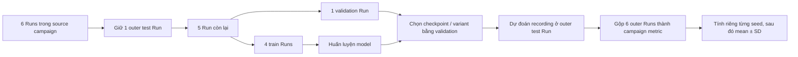
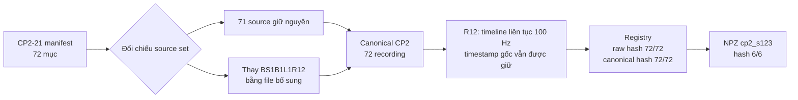

# Báo cáo xác minh tính hợp lệ và kết quả thí nghiệm ML

**Phạm vi:** CP1, CP2, CP3; 1D-CNN và ResNet-1D; seed 42, 43, 44.  
**Đơn vị đánh giá chính:** recording.  
**Metric chính:** campaign-level Macro-F1.  
**Nguyên tắc:** chứng minh dữ liệu hợp lệ, coverage đủ, cách gộp đúng và kiểm định đúng trước khi kết luận hiệu năng.

---

## 1. Executive Summary

| Câu hỏi | Trả lời trực tiếp | Bằng chứng chính |
| --- | --- | --- |
| CP2 có quan hệ gì với CP2-21? | **CP2 là canonical dataset có nguồn gốc từ CP2-21, gồm 71 recording giữ nguyên và 1 recording được thay thế bằng file bổ sung có truy vết.** CP2 không bằng CP2-21 ở byte level. Không dùng dữ liệu 22/07. | Tập nguồn chỉ khác đúng một file; raw hash 72/72, canonical hash 72/72 và NPZ hash 6/6 đều khớp registry/index. |
| Cross-campaign có ổn định không? | **Không đủ ổn định để khẳng định khả năng tổng quát hóa.** Campaign mean thay đổi theo chiều chuyển, model, seed và target Run. | Macro-F1 từ 0,105 đến 0,289 giữa bốn cấu hình; các target Run nằm ở cả hai phía của BA 0,25. |
| Kết quả có tốt hơn ngẫu nhiên không? | **Chưa có đủ bằng chứng thống kê để kết luận tốt hơn ngẫu nhiên.** Không có kiểm định một phía nào đạt p < 0,05. | Với BA, p một phía nằm trong khoảng 0,131–0,980; với Macro-F1, 0,088–0,709. |
| Kết luận của 1D-CNN và ResNet? | ResNet đạt kết quả in-campaign cao hơn 1D-CNN trên CP1 và CP2. Cả hai giảm mạnh khi chuyển campaign. 1D-CNN có điểm cross-campaign cao nhất ở CP3→CP2, nhưng chưa có đủ bằng chứng thống kê để kết luận tốt hơn empirical chance ở mức 0,05. | In-campaign Macro-F1: ResNet 0,935/0,959 trên CP1/CP2; cross-campaign tốt nhất: 1D-CNN CP3→CP2 = 0,289 ± 0,039, p = 0,088 cho Macro-F1. |

Hai giới hạn phải giữ trong mọi diễn giải:

1. Permutation hiện tại giữ prediction cố định; đây không phải permutation retrain toàn pipeline.
2. Quy tắc gộp validation được chuẩn hóa trong giai đoạn phân tích lại sau khi test artifact đã tồn tại; đây không phải quy tắc preregistered.

---

## 2. Mục tiêu và thiết kế thí nghiệm

### 2.1. Dataset

| Campaign | Run | Recording/Run | Tổng recording | Trạng thái | Cảm biến dùng trong thí nghiệm |
| --- | --- | ---: | ---: | --- | --- |
| CP1 | R1–R6 | 12 | 72 | Healthy, B1, B2, B3 | `s12` |
| CP2 | R7–R12 | 12 | 72 | Healthy, B1, B2, B3 | `s123` |
| CP3 | R13–R18 | 12 | 72 | Healthy, B1, B2, B3 | `s123` |

Mỗi Run có ba recording cho mỗi trạng thái: BEAT-L1, BEAT-L2 và white noise. Dataset cân bằng ở cấp recording: mỗi campaign có 18 recording/lớp.

Tín hiệu được chia thành các window để đưa vào model. Khi đánh giá, model không bỏ phiếu từng window như các mẫu độc lập. Xác suất dự đoán của mọi window thuộc cùng recording được lấy trung bình; lớp có xác suất trung bình lớn nhất là prediction duy nhất của recording đó.

### 2.2. Leave-One-Run-Out

In-campaign dùng cấu trúc outer LORO:

- một Run được giữ ngoài làm **outer test**;
- trong năm Run còn lại, một Run làm **validation**;
- bốn Run còn lại làm **train**;
- train, validation và test không giao nhau;
- mỗi outer test Run có năm lựa chọn validation, tạo 6 × 5 = 30 variants/seed.

Cross-campaign dùng năm source Runs để train, một source Run để validation và toàn bộ sáu target Runs để test. Không có target label nào được dùng để chọn model.



**Hình 1. LORO pipeline.** Test Run được giữ ngoài train và validation. Năm validation choices là các phương án chọn model trong cùng outer fold, không phải năm test sample độc lập.

Không có leakage theo Run vì loader kiểm tra ba tập Run rời nhau. Không có leakage theo recording giữa train/test vì mỗi recording chỉ thuộc một Run và outer test Run không xuất hiện trong train hoặc validation.

---

## 3. Xác minh nguồn dữ liệu

### 3.1. CP2 so với CP2-21

Định nghĩa chính xác:

> **CP2 là canonical dataset có nguồn gốc từ CP2-21, gồm 71 recording giữ nguyên và 1 recording được thay thế bằng file bổ sung có truy vết.**

Vì có thay thế recording và canonicalization, CP2 không bằng CP2-21 ở byte level.

Manifest CP2-21 và canonical CP2 đều có 72 mục. Hai tập chỉ khác đúng một đường dẫn:

- bỏ nguồn `cp2/thinghiem_210726_PASCO/BS1B1L1R12.csv`;
- dùng `raw/BS1B1L1R12_bo_sung_file_thieu_dot_2.csv` thay thế.

File bổ sung không tạo recording thứ 73. Không có file phiên 22/07 trong canonical CP2.

| Kiểm tra | Kết quả | Trạng thái |
| --- | ---: | --- |
| Số recording | 72/72 | Khớp |
| Run × recording | 6 × 12 | Khớp |
| Label | 72/72 | Khớp |
| Phân bố lớp | 18/lớp | Khớp |
| Tập nguồn CP2-21 | 71 giữ nguyên + 1 thay thế có tài liệu | Khớp sau thay thế đã khai báo |
| Raw SHA-256 so với registry | 72/72 | Khớp |
| Canonical SHA-256 so với registry | 72/72 | Khớp |
| NPZ `cp2_s123` so với index | 6/6 | Khớp |

CP2–R12 được đặt trên một timeline tổng hợp liên tục 100 Hz theo thứ tự REC0001→REC0012. Kiểm tra 106.339 mẫu cho thấy mọi bước thời gian bằng 0,01 giây, kể cả 11 biên recording. Timestamp PASCO gốc vẫn được giữ trong `timestamp_original`.



**Hình 2. Flow xác minh CP2.** CP2 là canonical dataset có nguồn gốc từ tập đo CP2-21, sau một thay thế bổ sung đã khai báo và bước chuẩn hóa timestamp; đây không phải byte-level equality và không phải kết luận dựa trên đổi tên thư mục.

### 3.2. Raw được xử lý vào đâu

| Tầng | Đường dẫn | Vai trò |
| --- | --- | --- |
| Raw CP2-21 | `datasets/raw/cp2/thinghiem_210726_PASCO/` | Nguồn 71 recording được sử dụng |
| Raw bổ sung | `datasets/raw/BS1B1L1R12_bo_sung_file_thieu_dot_2.csv` | Thay thế B1–BEAT-L1–R12 |
| Canonical | `datasets/canonical/campaigns/CP2/RUN007/`–`RUN012/` | CSV chuẩn hóa header, thứ tự cảm biến và timestamp R12 |
| Registry | `datasets/canonical/registry/recordings.csv` | Ánh xạ source→canonical, label và hai hash riêng biệt |
| Model input | `datasets/built/v1/cp2_s123/R7.npz`–`R12.npz` | Input ba cảm biến dùng để huấn luyện/đánh giá |

Raw hash và canonical hash không được yêu cầu bằng nhau vì canonicalization làm thay đổi nội dung CSV. Tính toàn vẹn được kiểm tra đúng tầng: raw với `source_sha256`, canonical với `canonical_sha256`, NPZ với `index.csv`.

---

## 4. Độ đầy đủ của thí nghiệm

### 4.1. Execution coverage và artifact coverage

| Model | Campaign | Expected | Executed | Artifact dùng được |
| --- | --- | ---: | ---: | ---: |
| 1D-CNN | CP1 | 90 | 90 | 90 |
| 1D-CNN | CP2 | 90 | 90 | 90 |
| 1D-CNN | CP3 | 90 | 90 | 90 |
| ResNet-1D | CP1 | 90 | 90 | 90 |
| ResNet-1D | CP2 | 90 | 90 | 90 |
| ResNet-1D | CP3 | 90 | 90 | 90 |


**Hình 3. Execution coverage và usable-artifact coverage.** Mỗi ô có 30 variants × 3 seed = 90. Tất cả sáu cấu hình in-campaign đều đạt 90/90 ở cả execution và artifact coverage.

Bốn cấu hình cross-campaign đều đủ 18/18 đánh giá: sáu source validation variants × ba seed.

### 4.2. Xác nhận ResNet–CP3 sau khi đồng bộ artifact

Sau lần đồng bộ mới, ResNet–CP3 có:

- 30/30 split directories;
- 90/90 `scores.json`, `predictions.json`, `run_info.json`, `history.json` và confusion matrix;
- 90/90 checkpoint hợp lệ, không có file 0 byte;
- không có JSON lỗi hoặc split train/validation/test giao nhau;
- đủ năm validation choices cho mỗi outer test Run và seed.

Log `results_after_run/signal_loro_v1/signal-loro-v1.log` cũng có 90 job index và 90 confusion matrix, không có traceback trong đoạn ResNet–CP3. Như vậy discrepancy 71/90 của snapshot trước đã được giải quyết; không cần retrain 19 job.

---

## 5. Phương pháp đánh giá

### 5.1. Đơn vị và hierarchy đánh giá

```text
Campaign
└── Outer test Run
    └── Recording  ← đơn vị dự đoán và chấm điểm
        └── Windows ← chỉ là các đoạn tín hiệu đầu vào
```

Quy trình gộp:

1. Trung bình xác suất các window trong cùng recording.
2. Lấy một prediction cho recording.
3. Với mỗi outer test Run và seed, chọn một validation variant chỉ bằng thông tin validation.
4. Ghép prediction của sáu outer test Runs để tạo đúng một prediction/recording/seed.
5. Tính metric toàn campaign riêng cho mỗi seed.
6. Báo mean ± SD giữa ba seed.

### 5.2. Quy tắc chọn validation

Quy tắc aggregation được chuẩn hóa cho phân tích chính:

1. validation Balanced Accuracy cao nhất;
2. nếu hòa, validation loss thấp nhất;
3. nếu vẫn hòa, tên split theo thứ tự xác định.

Quy tắc không đọc nhãn hoặc metric test khi thực thi. Với in-campaign, quy tắc áp dụng riêng trong từng outer test Run và seed. Với cross-campaign, quy tắc chọn một source validation variant cho mỗi seed trước khi chấm toàn target campaign.

**Thời điểm xác lập rule:** quy tắc này được đặt ra trong giai đoạn phân tích lại, sau khi các test artifact ban đầu đã tồn tại. Vì vậy báo cáo gọi đây là **standardized post-hoc aggregation rule**, không gọi là predefined hoặc preregistered. Sau khi được xác lập, cùng một rule được áp dụng cho mọi model, campaign và seed; rule không được thay đổi riêng để tối ưu bất kỳ cấu hình test nào. Đây vẫn là một limitation của phân tích hồi cứu và cần được cố định trước khi chạy trong các thí nghiệm tiếp theo.

Ba mươi train–validation variants là 6 outer folds × 5 validation choices. Chúng không phải 30 mẫu độc lập. **Ba seed được xem là ba lần lặp stochastic để mô tả độ nhạy của kết quả đối với ngẫu nhiên huấn luyện; chúng không được diễn giải như ba mẫu dữ liệu độc lập.** Run-level chỉ là diagnostic.

### 5.3. Macro-F1 chính thức

Macro-F1 chính thức được tính từ confusion counts của toàn campaign trong từng seed. Không dùng trung bình Macro-F1 theo Run vì Macro-F1 là hàm phi tuyến: trung bình sáu F1 nhỏ không nhất thiết bằng F1 của tập prediction campaign.

Với CP2→CP3–1D-CNN, các số cũ 0,173; 0,164 và 0,203 xuất phát từ ba cách gộp khác nhau. Sau khi áp dụng một prediction/recording/seed và campaign-level scoring, giá trị chính thức là **0,190 ± 0,023**.

---

## 6. Kết quả chính

### 6.1. Overall Accuracy in-campaign


**Hình 4. Recording-level Accuracy theo campaign.** Thanh là mean qua ba seed; error bar là SD giữa seed. Mọi cấu hình đều có coverage đầy đủ.

| Model | CP1 | CP2 | CP3 |
| --- | ---: | ---: | ---: |
| 1D-CNN | 0,694 ± 0,048 | 0,745 ± 0,099 | 0,440 ± 0,076 |
| ResNet-1D | 0,935 ± 0,008 | 0,958 ± 0,014 | 0,569 ± 0,037 |

Do mỗi campaign cân bằng 18 recording/lớp, Accuracy và Balanced Accuracy bằng nhau ở mức campaign trong các kết quả này. Balanced Accuracy vẫn được giữ làm metric kiểm định để định nghĩa chance 0,25 rõ ràng.

### 6.2. Campaign Macro-F1


**Hình 5. Campaign-level Macro-F1.** Mỗi recording chỉ xuất hiện một lần trong mỗi seed. Không lấy trung bình theo Run.

| Model | CP1 | CP2 | CP3 |
| --- | ---: | ---: | ---: |
| 1D-CNN | 0,688 ± 0,056 | 0,740 ± 0,107 | 0,404 ± 0,081 |
| ResNet-1D | 0,935 ± 0,008 | 0,959 ± 0,014 | 0,568 ± 0,030 |

ResNet đạt kết quả in-campaign cao hơn 1D-CNN trên cả ba campaign quan sát được. Báo cáo không diễn giải đây là so sánh có ý nghĩa thống kê vì chưa thực hiện kiểm định trực tiếp giữa hai kiến trúc.

### 6.3. Cross-campaign

| Chiều | Model | BA | Campaign Macro-F1 |
| --- | --- | ---: | ---: |
| CP2→CP3 | 1D-CNN | 0,259 ± 0,029 | 0,190 ± 0,023 |
| CP2→CP3 | ResNet-1D | 0,227 ± 0,029 | 0,105 ± 0,014 |
| CP3→CP2 | 1D-CNN | 0,296 ± 0,029 | 0,289 ± 0,039 |
| CP3→CP2 | ResNet-1D | 0,282 ± 0,021 | 0,248 ± 0,045 |

Tất cả cross-campaign Macro-F1 thấp hơn mạnh so với in-campaign trên target tương ứng. Chiều CP2→CP3 thấp hơn CP3→CP2 cho cả hai model. Đây là quan sát phù hợp với hiện tượng domain shift bất đối xứng; ý nghĩa thống kê được kiểm tra ở Mục 8.

---

## 7. Phân tích theo Run — diagnostic


**Hình 6. Macro-F1 theo target Run sau standardized post-hoc aggregation rule.** Mỗi ô là mean qua ba seed; mỗi seed có 12 recording/Run.


**Hình 7. Phân bố Macro-F1 của sáu target Runs trong từng seed.** Điểm là từng target Run; boxplot chỉ dùng diagnostic, không biến Run thành mẫu độc lập cho suy luận. Độ ổn định seed được tổng hợp ở Mục 9.

Cross-campaign thấp không do một target Run duy nhất:

- CP2→CP3–1D-CNN dao động từ 0,085 (R18) đến 0,258 (R16).
- CP2→CP3–ResNet dao động từ 0,048 (R14) đến 0,170 (R15); R16–R18 đều quanh 0,100.
- CP3→CP2–1D-CNN dao động từ 0,176 (R9) đến 0,373 (R8).
- CP3→CP2–ResNet dao động từ 0,194 (R8) đến 0,306 (R11).

Các Run nằm ở cả hai phía của BA 0,25, nhưng không có cấu hình nào chỉ bị kéo xuống bởi đúng một Run. Do đó kết luận phù hợp là **collapse không đồng nhất tuyệt đối, nhưng mang tính campaign-wide**.

### Kiểm tra riêng R12 và R16

| Campaign | Model | Run | BA | Macro-F1 |
| --- | --- | --- | ---: | ---: |
| CP2 in-campaign | 1D-CNN | R12 | 0,722 ± 0,048 | 0,720 ± 0,041 |
| CP2 in-campaign | ResNet-1D | R12 | 0,861 ± 0,048 | 0,863 ± 0,044 |
| CP3 in-campaign | 1D-CNN | R16 | 0,278 ± 0,096 | 0,230 ± 0,052 |
| CP3 in-campaign | ResNet-1D | R16 | 0,417 ± 0,083 | 0,370 ± 0,062 |

R12 không phải outlier xấu trong CP2. R16 khó trong CP3, nhưng không phải Run duy nhất có biến động; với 1D-CNN, R18 có seed range BA lớn hơn. Không có cơ sở loại R12 hoặc R16 khỏi báo cáo.

---

## 8. Kiểm định thống kê

### 8.1. Permutation test đang kiểm tra gì

Prediction được giữ cố định. Nhãn target được xáo ở cấp recording, riêng trong từng target Run; một recording nhận cùng nhãn xáo trong cả ba seed. Thống kê kiểm định là mean campaign metric qua ba seed.

Kiểm định trả lời:

> Prediction đã lưu có liên kết với nhãn target mạnh hơn mức thu được khi phá liên kết nhãn hay không?

Kiểm định không trả lời hiệu năng của toàn pipeline nếu retrain dưới nhãn hoán vị, vì feature extraction, training và model selection không được chạy lại.

### 8.2. Giả thuyết “tốt hơn chance”

P một phía được tính ở high tail: `(1 + số null ≥ observed) / (10.000 + 1)`.

| Chiều | Model | BA observed | Null mean | p một phía |
| --- | --- | ---: | ---: | ---: |
| CP2→CP3 | 1D-CNN | 0,259 | 0,250 | 0,395 |
| CP2→CP3 | ResNet-1D | 0,227 | 0,250 | 0,980 |
| CP3→CP2 | 1D-CNN | 0,296 | 0,250 | 0,131 |
| CP3→CP2 | ResNet-1D | 0,282 | 0,250 | 0,151 |


**Hình 8. Empirical null của Balanced Accuracy.** Đường cam là observed; đường đứt là null mean; vùng nhạt là khoảng 95% empirical null.

Kết luận BA: **0/4** cấu hình có p một phía < 0,05. Kết quả tương tự với Macro-F1: p lần lượt là 0,511; 0,709; 0,088 và 0,096. Chưa có bằng chứng thống kê rằng model tốt hơn empirical chance trong cross-campaign. Các p chưa hiệu chỉnh đa kiểm định; hiệu chỉnh không thể làm kết luận mạnh hơn.

---

## 9. Phân tích độ ổn định

### 9.1. Đổi seed

Hình 7 cho thấy phân bố theo target Run trong từng seed; bảng dưới đây dùng campaign metric, không dùng các Run như mẫu độc lập.

| Chiều | Model | Campaign Macro-F1 mean ± SD seed | Min–max giữa seed |
| --- | --- | ---: | ---: |
| CP2→CP3 | 1D-CNN | 0,190 ± 0,023 | 0,171–0,216 |
| CP2→CP3 | ResNet-1D | 0,105 ± 0,014 | 0,096–0,122 |
| CP3→CP2 | 1D-CNN | 0,289 ± 0,039 | 0,244–0,312 |
| CP3→CP2 | ResNet-1D | 0,248 ± 0,045 | 0,217–0,300 |

Không loại seed hoặc outlier. Chỉ có ba seed nên không thực hiện kiểm định outlier hình thức; báo cáo giữ nguyên cả ba và mô tả SD/range. CP3→CP2 có biến thiên seed lớn hơn CP2→CP3 về Macro-F1, đặc biệt ResNet.

### 9.2. Validation choice

Với experiment in-campaign đầy đủ, mỗi outer test Run/seed có năm validation choices. Sau khi áp dụng standardized post-hoc aggregation rule, mỗi recording còn đúng một prediction/seed.

Sau khi đồng bộ artifact, mọi experiment in-campaign, gồm ResNet–CP3, đều có đủ năm validation choices cho từng outer test Run và seed. Standardized post-hoc aggregation rule vì vậy được áp dụng trên candidate set đầy đủ và đồng nhất.

---

## 10. Thảo luận

### 10.1. Vì sao CP3 khó hơn?

CP3 có in-campaign score thấp hơn CP1/CP2 cho cả hai kiến trúc: Macro-F1 1D-CNN giảm còn 0,404; ResNet còn 0,568. Run-level cũng phân tán hơn và nhiều Run gần chance. Những kết quả này cho thấy CP3 khó hơn về mặt quan sát, nhưng chưa xác định nguyên nhân nhân quả.

Các giả thuyết phù hợp để kiểm tra tiếp gồm thay đổi phân bố biên độ/tần số, điều kiện kích thích, coupling cảm biến và độ tách lớp theo campaign. Không quy kết lỗi label hoặc sai nguồn CP2 vì provenance, label counts và hash đã được xác minh.

### 10.2. Vì sao ResNet khác 1D-CNN?

ResNet đạt kết quả in-campaign cao hơn 1D-CNN trên CP1/CP2. Tuy nhiên, chênh lệch quan sát được này không chuyển thành kết quả cross-campaign cao hơn: ở CP2→CP3, ResNet có Macro-F1 0,105, thấp hơn 1D-CNN 0,190. Một diễn giải phù hợp là ResNet có thể học đặc trưng đặc hiệu campaign mạnh hơn; đây là giả thuyết, không phải kết luận nhân quả từ thiết kế hiện tại.

### 10.3. Domain shift đến từ đâu?

Ba quan sát phù hợp với hiện tượng domain shift:

1. in-campaign cao nhưng cross-campaign giảm mạnh;
2. chiều CP2→CP3 khó hơn chiều CP3→CP2;
3. prediction cross-campaign thay đổi theo target Run và thường tập trung vào ít lớp.

Thiết kế hiện tại không tách riêng đóng góp của cảm biến, excitation, session và preprocessing. Muốn định lượng nguồn shift cần ablation có kiểm soát, ví dụ cùng sensor subset, cùng excitation và chuẩn hóa được fit chỉ trên source train.

---

## 11. Kết luận

1. **CP2 được xác minh hợp lệ về provenance:** đây là canonical dataset có nguồn gốc từ CP2-21, gồm 71 recording giữ nguyên và 1 recording được thay thế bằng file bổ sung có truy vết; CP2 không bằng CP2-21 ở byte level.
2. **Coverage đầy đủ:** cả sáu cấu hình in-campaign có 90/90 evaluation và 90/90 artifact; bốn cấu hình cross-campaign có 18/18.
3. **Metric chính thức là campaign-level Macro-F1** từ một prediction/recording/seed; 30 variants không được coi là 30 mẫu độc lập.
4. **Cross-campaign chưa có đủ bằng chứng thống kê để kết luận tốt hơn empirical chance:** 0/4 kiểm định BA và 0/4 kiểm định Macro-F1 có p một phía < 0,05.
5. **Kết luận model:** ResNet đạt kết quả in-campaign cao hơn 1D-CNN trên CP1 và CP2; 1D-CNN có cross-campaign score cao nhất ở CP3→CP2, nhưng chưa có bằng chứng thống kê về khả năng tổng quát hóa của cả hai kiến trúc.

---

## Phụ lục A. File kiểm chứng

| File | Nội dung |
| --- | --- |
| `data/coverage_matrix.csv` | Expected, executed và artifact available cho mọi experiment |
| `data/cp3_resnet_log_audit.json` | 90 job index, 90 confusion matrix và trạng thái traceback của log ResNet–CP3 |
| `data/selected_validation_models.csv` | Variant được chọn và validation criterion |
| `data/campaign_metrics.csv` | Mean ± SD campaign metrics |
| `data/campaign_seed_metrics.csv` | Metric riêng từng seed |
| `data/in_campaign_run_metrics.csv` | Diagnostic theo outer test Run in-campaign |
| `data/cross_run_metrics.csv` | Diagnostic theo target Run cross-campaign |
| `data/permutation_one_sided.csv` | Observed, empirical null và p một phía |
| `../part_2/part2_cp2_provenance.json` | Source paths, hash chain và CP2 provenance |
| `../part_2/part2_resnet_cp3_missing.csv` | Audit missing artifact sau đồng bộ; kỳ vọng 0 dòng |

Script tái lập bảng và Hình 3–8: `../../script_analytics/build_final_validity_report.py`.
