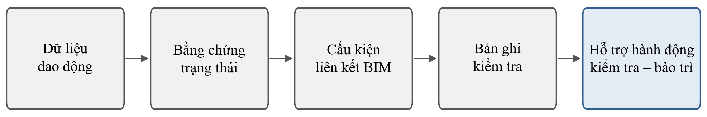

# CHƯƠNG 1. GIỚI THIỆU VÀ PHƯƠNG PHÁP TỔNG QUAN

## 1.1. Bối cảnh nghiên cứu

### 1.1.1. Bối cảnh vận hành nhà công nghiệp khung thép

Nhà công nghiệp khung thép được thiết kế và xây dựng trong một giai đoạn hữu hạn nhưng được khai thác, kiểm tra, sửa chữa và điều chỉnh trong nhiều năm. Khi công trình chuyển sang vận hành, người quản lý phải trả lời lặp lại các câu hỏi: cấu kiện nào cần chú ý, căn cứ nào cho thấy trạng thái đã thay đổi, lần kiểm tra gần nhất do ai thực hiện, kết quả lưu ở đâu và việc xử lý đang ở trạng thái nào. Đó trước hết là câu hỏi về tổ chức thông tin phục vụ quyết định, sau đó mới là câu hỏi về phép đo. Cơ sở lý luận về quản lý tài sản và quản lý thông tin vận hành, gồm vai trò của ISO 19650-3:2020 \[1\], được trình bày ở Chương 2.

Trong môi trường công nghiệp, yêu cầu quản lý thông tin trở nên rõ hơn vì trạng thái khai thác chịu đồng thời tác động của chế độ tải, thiết bị, điều kiện môi trường, thay đổi công năng, lịch sử can thiệp và quá trình lão hóa. Nghiên cứu xem các yếu tố này là **bối cảnh quản lý tài sản** cần được lưu giữ cùng dữ liệu và hồ sơ; chúng không được dùng để suy luận cơ chế hư hỏng từ một chỉ báo dao động riêng lẻ. Cách đặt vấn đề này giúp giữ trọng tâm ở tính liên tục, nguồn gốc và khả năng truy vết của thông tin thay vì giới hạn nghiên cứu theo một điều kiện địa lý cụ thể.

Trong nhà công nghiệp khung thép, nhiều chức năng chịu lực được truyền qua liên kết bu lông, nên trạng thái liên kết là đối tượng trực tiếp của theo dõi và kiểm tra. Từ góc nhìn Quản lý xây dựng, câu hỏi không dừng ở việc tín hiệu có nhận biết được thay đổi của liên kết hay không. Khi một dấu hiệu thay đổi xuất hiện, cần biết dấu hiệu đó được biến thành bằng chứng ra sao, được giới hạn phạm vi sử dụng thế nào, gắn với cấu kiện nào và đi vào quy trình kiểm tra – bảo trì theo cách nào.

### 1.1.2. Chuyển đổi số trong quản lý vận hành

Cảm biến, mô hình thông tin công trình (BIM), chuẩn trao đổi dữ liệu IFC, cơ sở dữ liệu vận hành và Song sinh số cho phép gắn dữ liệu kỹ thuật với ngữ cảnh của tài sản. Ở từng mắt xích, nền kỹ thuật đã tương đối rõ: lược đồ IFC có thể được mở rộng để biểu diễn hệ theo dõi trạng thái và quan hệ giữa cảm biến với cấu kiện \[2\]; dữ liệu vận hành có thể được tích hợp với mô hình số ở cấp công trình và khuôn viên \[3\]; định danh toàn cục của đối tượng IFC có thể dùng để nối mô hình với cơ sở dữ liệu chuỗi thời gian \[4\], \[5\]. Đưa dữ liệu cảm biến vào ngữ cảnh mô hình công trình đã là bài toán có lời giải.

Tuy vậy, **tích hợp dữ liệu không đồng nghĩa với truy vết thông tin**. Trong vận hành, dữ liệu cảm biến nằm trong hệ thu nhận; hình học và thuộc tính cấu kiện nằm trong BIM; hồ sơ kiểm tra nằm trong biểu mẫu, cơ sở dữ liệu hoặc hệ quản lý bảo trì; lịch sử hành động có thể nằm ở một hệ thống khác. Sự phân tán này là lý do Kim và cộng sự (2018) phải xây một lớp ngữ nghĩa riêng để nối dữ liệu quản lý vận hành với đối tượng IFC \[6\], và Boje và cộng sự (2020) cho rằng mô hình thông tin tĩnh không đáp ứng được một hệ thống số vận hành cần dữ liệu động, ngữ nghĩa và khả năng liên thông \[7\].

Khoảng cách giữa **có dữ liệu** và **có bằng chứng dùng được cho quản lý** vẫn còn. Một cảnh báo có thể hiện đúng vị trí trên mô hình trong khi người quản lý không biết nó được tạo từ dữ liệu nào, bằng phiên bản xử lý nào, có giá trị trong phạm vi nào, cấu kiện liên quan đã được kiểm tra chưa và hành động tiếp theo đang ở trạng thái nào. Mức độ chuyển đổi số trong vận hành vì vậy nên được đo bằng khả năng duy trì quan hệ kiểm tra được giữa **nguồn dữ liệu – bằng chứng – cấu kiện – hồ sơ – hành động**, hơn là bằng khối lượng dữ liệu hay độ trực quan của giao diện.

### 1.1.3. Song sinh số như mục tiêu kiến trúc của nghiên cứu

Khái niệm Song sinh số được dùng với nhiều mức năng lực khác nhau trong các nghiên cứu. Kritzinger và cộng sự (2018) phân biệt mô hình số, bóng số và song sinh số theo chiều và mức tự động của luồng dữ liệu giữa đối tượng vật lý với biểu diễn số \[8\]; Sepasgozar (2021) đưa sự phân biệt này vào môi trường xây dựng \[9\]; Chen và cộng sự (2021) tiếp cận Song sinh số trong quản lý tài sản bằng mô hình trưởng thành nhiều chiều \[10\]. Cả ba cách phân loại cùng cho thấy mức năng lực của một hệ thống phải được đánh giá trên các chức năng thực có, không suy ra từ tên gọi.

Tiểu luận không coi “Song sinh số” là nhãn tự xác nhận chỉ vì BIM đã được nối với cảm biến, và cũng không gán trước cho hệ thống một mức thấp hay cao khi các chức năng chưa được triển khai và đánh giá. Trong luận án, **khung Song sinh số dựa trên dữ liệu** là mục tiêu kiến trúc: dữ liệu từ tài sản vật lý được tổ chức thành bằng chứng trạng thái có nguồn gốc và phạm vi hiệu lực; bằng chứng được liên kết với cấu kiện trong BIM và hồ sơ kiểm tra; trạng thái hành động kiểm tra – bảo trì được ghi trở lại hệ thống thông tin và trở thành bối cảnh cho các lần đánh giá sau. Mô hình phần tử hữu hạn không phải điều kiện để định nghĩa khung; nếu được sử dụng, đó chỉ là **mô hình danh nghĩa, chưa hiệu chuẩn, dùng để tham chiếu và không dùng cho chẩn đoán hư hỏng**. Dự báo tuổi thọ còn lại, bảo trì dự báo, suy luận suy giảm độ cứng và tự động tác động lên tài sản không thuộc mục tiêu hiện tại.

### 1.1.4. Bối cảnh quản lý bảo trì và mô hình thông tin công trình tại Việt Nam

Tại Việt Nam, bảo trì công trình xây dựng hiện được quy định chi tiết tại Nghị định số 207/2026/NĐ-CP ngày 15/6/2026 của Chính phủ, có hiệu lực từ ngày 01/7/2026 và thay thế Nghị định số 06/2021/NĐ-CP \[11\]. Nghị định xác định quy trình bảo trì là tài liệu quy định trình tự, nội dung và chỉ dẫn thực hiện các công việc bảo trì. Nội dung chính của quy trình bảo trì gồm, cùng các nội dung khác, quy định đối tượng, phương pháp và tần suất kiểm tra công trình, và quy định về hồ sơ bảo trì cùng việc cập nhật thông tin vào hồ sơ này (Điều 34). Quan trắc phục vụ bảo trì được yêu cầu trong các trường hợp cụ thể: công trình có dấu hiệu lún, nghiêng, nứt hoặc bất thường khác có khả năng gây sập đổ; theo yêu cầu của chủ đầu tư, chủ sở hữu hoặc chủ quản lý sử dụng; và công trình thuộc danh mục phải quan trắc theo quy định chuyên ngành (Điều 37). Đây không phải yêu cầu chung cho mọi công trình.

Về mô hình thông tin công trình, Quyết định số 258/QĐ-TTg ngày 17/3/2023 phê duyệt lộ trình áp dụng BIM, trong đó BIM là bắt buộc từ năm 2023 với công trình cấp I và cấp đặc biệt, và từ năm 2025 với công trình cấp II trở lên, thuộc các dự án đầu tư xây dựng mới sử dụng vốn đầu tư công, vốn nhà nước ngoài đầu tư công và đầu tư theo phương thức đối tác công tư \[12\]. Quyết định cũng yêu cầu chủ đầu tư các dự án áp dụng BIM theo lộ trình tổ chức cập nhật mô hình để phục vụ quản lý, vận hành và bảo trì công trình (Điều 1, khoản 3, điểm g).

Hai văn bản trên cho thấy hồ sơ bảo trì, thông tin kiểm tra và mô hình thông tin công trình đều là đối tượng quản lý đã có cơ sở pháp lý tại Việt Nam. Tiểu luận dùng chúng để đặt bài toán quản lý thông tin của luận án vào bối cảnh trong nước, không dùng để suy ra ngưỡng kỹ thuật và không coi Song sinh số là yêu cầu pháp lý; cả hai văn bản đều không quy định về Song sinh số.

## 1.2. Vấn đề nghiên cứu

### 1.2.1. Vấn đề quản lý trung tâm

Vấn đề nghiên cứu xuất phát từ sự không liên tục giữa dữ liệu kỹ thuật và thông tin quản lý. Dữ liệu cảm biến, mô hình BIM, hồ sơ kiểm tra và lịch sử bảo trì có thể cùng tồn tại nhưng phân tán; khi đó, một kết quả sinh từ dữ liệu cảm biến chưa chắc nối được, theo cách kiểm chứng được, với cấu kiện cụ thể, hồ sơ kiểm tra tương ứng và trạng thái của hành động tiếp theo. Vấn đề quản lý trung tâm của luận án được phát biểu như sau:

Thông tin giám sát, kiểm tra và bảo trì có thể tồn tại đồng thời nhưng thiếu một chuỗi truy vết bảo toàn được nguồn gốc và phạm vi hiệu lực của bằng chứng từ dữ liệu cảm biến tới cấu kiện, hồ sơ kiểm tra và trạng thái hành động.

Với người quản lý, một cảnh báo chỉ có giá trị khi trả lời được chuỗi câu hỏi: cảnh báo xuất phát từ cảm biến nào, cảm biến đó phục vụ cấu kiện nào, dữ liệu được thu trong điều kiện nào, kết quả được tạo bằng phiên bản xử lý và giao thức đánh giá nào, bằng chứng có hiệu lực tới đâu, cấu kiện đã được kiểm tra chưa, hồ sơ nào liên quan, ai đã rà soát và hành động hiện đang ở trạng thái nào. Nếu phải tra thủ công qua nhiều hệ thống mới trả lời được, khả năng giải trình và kiểm lại quyết định sẽ bị hạn chế.

Bài toán của luận án vì thế không phải tìm mô hình học máy có điểm số cao nhất. Mô hình học máy và học sâu là công cụ tạo bằng chứng kỹ thuật. Câu hỏi khoa học là làm thế nào để bằng chứng đó được **xác lập chất lượng**, được **giới hạn phạm vi sử dụng**, được **liên kết đúng đối tượng** và được **duy trì trong chuỗi thông tin quản lý**.

### 1.2.2. Từ kết quả phân loại đến bằng chứng trạng thái

Theo dõi trạng thái kết cấu bằng dữ liệu dao động đã có nền nghiên cứu rộng; riêng Jia và Li (2023) tổng hợp 337 công bố về học sâu trong lĩnh vực này \[13\]. Áp dụng thêm một mô hình phân loại cho dữ liệu khung thép vì vậy không tự tạo thành khoảng trống khoa học. Vấn đề nằm ở độ tin cậy của kết quả, bắt nguồn từ cấu trúc của dữ liệu dao động: rất nhiều cửa sổ tín hiệu có thể được cắt ra từ một số ít lần thu vật lý. Nếu coi các cửa sổ này là quan sát độc lập, hiệu năng sẽ bị đánh giá lạc quan. Beleites và cộng sự (2013) chỉ ra nguyên tắc phân biệt số quan sát tính toán với số đơn vị độc lập thực \[14\]; Wheat và cộng sự (2024) cho thấy chỉ cần đổi cấp nguồn vật lý dùng để chia dữ liệu là hiệu năng đo được trên dữ liệu rung động đã thay đổi mạnh \[15\]. Các tiền lệ đầy đủ được tổng hợp ở mục 3.3.

Những nguyên tắc này không mới; giá trị của chúng là làm rõ **một kết quả có thể được tin cậy trong phạm vi nào**. Luận án dùng khái niệm **bằng chứng trạng thái** để chỉ kết quả tạo từ dữ liệu dao động cùng các thông tin cần để diễn giải nó: nguồn dữ liệu, cấu hình cảm biến, phiên bản chuỗi xử lý, giao thức đánh giá, độ bất định và phạm vi hiệu lực đã được kiểm chứng. Bằng chứng trạng thái khác với chẩn đoán hư hỏng. Một thay đổi của tín hiệu có thể do điều kiện môi trường, cách lắp đặt, lịch sử bảo trì hoặc một thay đổi vật lý thật. Bất thường từ dữ liệu vì vậy được dùng để **kích hoạt kiểm tra**, không dùng để tự động kết luận nguyên nhân hay mức độ hư hỏng.

### 1.2.3. Từ định danh cấu kiện đến truy vết thông tin

Ở lớp thông tin công trình, BIM và IFC là nền để liên kết dữ liệu với cấu kiện: hệ theo dõi trạng thái và quan hệ cảm biến – cấu kiện có thể được biểu diễn ngay trong lược đồ IFC \[2\], và định danh toàn cục có thể nối dữ liệu mô hình với chuỗi thời gian \[5\]. Các tiền lệ về liên kết BIM – hệ quản lý bảo trì, hồ sơ khiếm khuyết gắn cấu kiện và kiểm chứng quan hệ bằng ràng buộc ngữ nghĩa được trình bày ở mục 4.2–4.4. Nối cảm biến với BIM, nối BIM với hệ quản lý bảo trì hay gắn hồ sơ khiếm khuyết với cấu kiện đều không còn là đóng góp mới nếu đứng riêng.

Điều cần xem xét là **bảo toàn chất lượng của bằng chứng qua chuỗi**. Sau khi được tạo, một bằng chứng mang theo nhãn trạng thái cùng nguồn gốc, phiên bản, điều kiện đánh giá và phạm vi hiệu lực; các thuộc tính này phải còn nguyên khi bằng chứng được liên kết với cấu kiện hoặc hồ sơ. Việc người dùng bấm được từ cảm biến tới cấu kiện chưa chứng minh rằng một hồ sơ kiểm tra truy ngược được tới đúng bằng chứng đã làm phát sinh nó. Một liên kết hai chiều trên giao diện cũng chưa chứng minh quan hệ giữa các bản ghi ở hai hệ thống vẫn toàn vẹn khi dữ liệu thay đổi. Trọng tâm vì vậy chuyển từ **kết nối dữ liệu** sang **truy vết có thể kiểm chứng**.

### 1.2.4. Từ bằng chứng đến hỗ trợ hành động có thể giải trình

Hệ thống quản lý tài sản không dừng ở việc hiển thị trạng thái cấu kiện. Sau một dấu hiệu bất thường, người quản lý phải quyết định có kiểm tra hay không, ai chịu trách nhiệm, kết quả kiểm tra thay đổi nhận định ban đầu thế nào và hành động tiếp theo được ghi nhận ra sao. Từng phần của quá trình này đã có tiền lệ. Çelik và cộng sự (2023) ghi nguồn gốc dữ liệu, tác nhân, thời điểm và phiên bản trong trao đổi thông tin xây dựng \[16\]; Wu và cộng sự (2026) phát triển khung kiểm định công trình có chuyên gia tương tác và rà soát \[17\]; các tiền lệ về bản ghi sửa chữa, trạng thái hoàn thành và điều hướng giữa BIM với hệ quản lý bảo trì được trình bày ở mục 4.3 và mục 4.5. Con người trong quy trình, bản ghi sửa chữa hay trạng thái hoàn thành vì vậy đều không phải khoảng trống riêng.

Phần còn lại nằm ở khả năng giải trình của **điểm nối từ bằng chứng tới hành động**. Khi một hành động được đề xuất hoặc chuyển trạng thái, người quản lý cần truy ngược được tới căn cứ kỹ thuật đã dùng và biết căn cứ đó có hiệu lực trong phạm vi nào; lịch sử rà soát, vai trò, thời điểm và kết quả xử lý cũng phải tái dựng được. Ở giai đoạn tổng quan, **bằng chứng chưa đủ để khẳng định sự vắng mặt phổ quát** của một chuỗi như vậy trong các nghiên cứu quốc tế. Luận án chỉ giữ phát biểu trong phạm vi tập tài liệu đã rà soát và coi đây là một điểm nối cần kiểm chứng, không phải một tuyên bố “lần đầu tiên”.

### 1.2.5. Chuỗi nghiên cứu

Từ các vấn đề trên, trục nghiên cứu được khóa thành một chuỗi duy nhất, trình bày ở Hình 1.1.

<!-- GĐ0: hình gốc vẽ bằng shape trong .docx; ảnh cắt từ PDF do Word xuất ngày 28/09/2026 -->

Hình 1.1. Chuỗi nghiên cứu tổng thể

Tương ứng với chuỗi này là một chuỗi định danh kỹ thuật:

**Sensor_ID → BIM_GUID → Condition_Evidence_ID → Inspection_Record_ID → Action_Status**

Trong đó *Sensor_ID* xác định nguồn đo; *BIM_GUID* xác định cấu kiện trong mô hình thông tin; *Condition_Evidence_ID* xác định bản ghi bằng chứng trạng thái; *Inspection_Record_ID* xác định hồ sơ kiểm tra; *Action_Status* biểu diễn trạng thái xử lý của hành động kiểm tra hoặc bảo trì. Các mã này thống nhất với kiến trúc dữ liệu của luận án (mục 5.6.2).

## 1.3. Sự cần thiết của nghiên cứu

### 1.3.1. Cần nâng chất lượng của kết quả phân loại thành chất lượng của bằng chứng

Số mô hình học máy và học sâu trong theo dõi trạng thái kết cấu đã đủ lớn để một kiến trúc mới không tự động mang lại giá trị khoa học. Điều cần kiểm chứng là cách kết quả được tạo ra, và các nghiên cứu về kết cấu có liên kết cho thấy lý do: đáp ứng của kết cấu chịu ảnh hưởng mạnh của quá trình lắp ráp và trạng thái tiếp xúc \[18\]; dữ liệu từ một đợt thí nghiệm mới sau tháo – lắp lại có thể tạo thành một miền dữ liệu khác \[19\]; cách phân bổ đơn vị vật lý giữa tập huấn luyện và tập kiểm tra có thể làm thay đổi mạnh kết quả đánh giá \[20\].

Bằng chứng kỹ thuật vì vậy phải mang theo điều kiện và giới hạn của chính nó. Nếu khả năng chuyển giao sang một đợt đo mới chưa được chứng minh, kết quả vẫn giữ giá trị trong phạm vi đã kiểm chứng. Cách hiểu này khớp với nhu cầu quản lý: người ra quyết định cần một nhãn kèm **mức độ chắc chắn và bối cảnh sử dụng của nhãn đó**.

### 1.3.2. Cần chuyển từ tích hợp phần mềm sang truy vết có thể kiểm tra

Các nghiên cứu đã cho thấy cảm biến có thể nối với BIM, hồ sơ kiểm tra có thể gắn với cấu kiện và tài sản có thể được đồng bộ sang hệ quản lý bảo trì. “Kết nối được” vì vậy không còn đủ để định vị đóng góp. Cần kiểm tra xem các quan hệ có đúng, đủ và bền vững hay không, và điều này cũng đã khả thi: ràng buộc ngữ nghĩa có thể phát hiện vi phạm trong các liên kết xuyên miền \[21\]; lược đồ IFC mở rộng có thể được kiểm tra bằng các trường hợp cố ý vi phạm quy tắc \[2\].

Câu hỏi đặt ra vì thế chuyển từ “Hệ thống có liên kết được không?” sang “Hệ thống có chứng minh được rằng bằng chứng liên kết đúng với cấu kiện, hồ sơ và trạng thái hành động, đồng thời phát hiện được khi chuỗi bị thiếu hoặc sai hay không?”. Đây là bước chuyển từ trình diễn tích hợp sang kiểm chứng thông tin.

### 1.3.3. Cần phân biệt bằng chứng phòng thí nghiệm với khả năng áp dụng trong bối cảnh thực tế

Trên công trình đang vận hành, dữ liệu hư hỏng có nhãn thường khó thu đủ để kiểm chứng trực tiếp một bộ phân loại huấn luyện trong phòng thí nghiệm; điều kiện môi trường, cách lắp đặt, lịch sử bảo trì và cấu trúc thực tế cũng khác mô hình thu nhỏ. Vì vậy, định hướng nghiên cứu không giả định khả năng chuyển trực tiếp bộ phân loại từ khung thép 1:10 sang công trình thực.

Phần có thể chuyển từ phòng thí nghiệm sang bối cảnh thực tế là **nguyên tắc tổ chức bằng chứng**: bằng chứng phải có định danh, nguồn gốc, bối cảnh, phạm vi hiệu lực và quan hệ với cấu kiện. Ở cấp tổng quan, yêu cầu này được dùng để xác lập ranh giới phương pháp: dữ liệu vận hành có thể hỗ trợ nhận biết biến đổi và kích hoạt kiểm tra, nhưng không tự động trở thành nhãn hư hỏng. Việc kiểm chứng cụ thể khả năng áp dụng của khung thuộc các chuyên đề nghiên cứu tiếp theo.

### 1.3.4. Cần một kiến trúc Song sinh số bám theo quá trình quản lý

Song sinh số chỉ có ý nghĩa với luận án khi nó giúp duy trì liên hệ giữa tài sản vật lý, thông tin số và lịch sử quản lý. Các khung phân loại và mô hình trưởng thành yêu cầu năng lực của một hệ thống số được xác định rõ, không suy ra từ tên gọi \[8\]–\[10\]. Yêu cầu về dữ liệu động và ngữ nghĩa \[7\], khả năng nối dữ liệu thời gian với IFC \[5\] và vai trò của con người khi rà soát kết quả số mà Wu và cộng sự cũng đã được đặt ra \[17\].

Luận án kế thừa các tiền lệ này và tập trung vào một câu hỏi quản lý: **một bằng chứng trạng thái có thể được duy trì xuyên suốt tới hồ sơ kiểm tra và trạng thái hành động theo cách có thể truy lại và giải trình hay không**. Mức năng lực Song sinh số đạt được sẽ được đánh giá sau khi kiến trúc được triển khai trong nghiên cứu trường hợp (mục 5.6.6).

## 1.4. Mục tiêu của Tiểu luận tổng quan

### 1.4.1. Mục tiêu tổng quát

Mục tiêu của Tiểu luận tổng quan là hệ thống hóa và tổng hợp có chọn lọc cơ sở lý luận cùng bằng chứng nghiên cứu liên quan để xác lập nền khoa học cho việc phát triển **khung Song sinh số dựa trên dữ liệu phục vụ giám sát trạng thái và hỗ trợ kiểm tra – bảo trì nhà công nghiệp khung thép**. Trọng tâm của Tiểu luận là tính liên tục của chuỗi thông tin từ dữ liệu dao động tới bằng chứng trạng thái, cấu kiện trong mô hình thông tin, hồ sơ kiểm tra và trạng thái hành động.

### 1.4.2. Mục tiêu cụ thể

Tiểu luận thực hiện năm mục tiêu cụ thể:

1\. Hệ thống hóa cơ sở về quản lý tài sản, quản lý thông tin vận hành, BIM, IFC và Song sinh số có liên quan trực tiếp tới kiểm tra – bảo trì công trình.

2\. Tổng hợp bằng chứng nghiên cứu về dữ liệu dao động và điều kiện cần để một kết quả phân loại có thể được xem là bằng chứng trạng thái có phạm vi hiệu lực rõ.

3\. Tổng hợp các nghiên cứu về liên kết cảm biến – BIM, hồ sơ kiểm tra, định danh, nguồn gốc dữ liệu, kiểm chứng quan hệ và hỗ trợ hành động có người rà soát.

4\. Phân biệt những nội dung các nghiên cứu đã giải quyết với những điểm nối còn thiếu, tránh xây dựng khoảng trống bằng các tuyên bố thiếu vắng rộng.

5\. Tạo cơ sở để Chương 5 tổng hợp khoảng trống, xác lập các câu hỏi nghiên cứu, kiến trúc nghiên cứu và thiết kế kiểm chứng của luận án.

Tiểu luận không nhằm trình bày kết quả cuối cùng của thí nghiệm, không sử dụng kết quả sơ bộ để chứng minh trước câu trả lời cho câu hỏi nghiên cứu và không thay thế các bài báo chuyên đề của luận án.

## 1.5. Đối tượng và phạm vi tổng quan

### 1.5.1. Đối tượng tổng quan

Đối tượng tổng quan gồm các nghiên cứu và tài liệu chuẩn thuộc bốn nhóm gắn với chuỗi nghiên cứu: (1) quản lý tài sản, quản lý thông tin giai đoạn vận hành và Song sinh số trong môi trường xây dựng; (2) theo dõi trạng thái bằng dữ liệu dao động, cách tổ chức và đánh giá bằng chứng trạng thái; (3) BIM, IFC, định danh cấu kiện và liên kết dữ liệu cảm biến với mô hình thông tin; (4) hồ sơ kiểm tra – bảo trì, nguồn gốc dữ liệu, kiểm chứng quan hệ, khả năng truy vết và hỗ trợ hành động có con người rà soát.

Đối tượng ứng dụng trọng tâm của luận án là nhà công nghiệp khung thép. Mô hình khung thép 1:10 và bối cảnh công trình thực được xác định như **hai môi trường kiểm chứng dự kiến**, không phải kết quả được trình bày trong Tiểu luận tổng quan. Các nguyên tắc về quản trị bằng chứng, định danh và truy vết được xây dựng ở mức khái niệm có thể xem xét chuyển dụng cho các loại kết cấu và tài sản công trình khác; tuy nhiên, mọi tuyên bố tổng quát hóa ngoài đối tượng nhà công nghiệp khung thép cần được kiểm chứng riêng và không thuộc phạm vi kết luận của Tiểu luận này.

### 1.5.2. Phạm vi của Tiểu luận tổng quan

Tiểu luận rà soát tài liệu thuộc bốn mắt xích của chuỗi nghiên cứu: quản lý tài sản và Song sinh số trong vận hành; dữ liệu dao động và bằng chứng trạng thái; BIM/IFC, định danh và truy vết cấp cấu kiện; hồ sơ kiểm tra, khả năng áp dụng trong bối cảnh thực tế và hỗ trợ hành động. Học máy, học sâu, nguồn gốc dữ liệu, khả năng liên thông và con người trong vòng lặp được rà soát ở vai trò hỗ trợ.

Ngoài phạm vi hiện tại là các hướng như chẩn đoán hư hỏng hiện trường khi chưa có kiểm tra xác nhận, dự báo tuổi thọ còn lại, bảo trì dự báo, suy luận suy giảm độ cứng, tối ưu hóa vị trí cảm biến và bảo trì tự động. Bảng phân lớp phạm vi đầy đủ của luận án, gồm cả nhóm hướng nghiên cứu sau luận án, được trình bày ở **Chương 5, mục 5.8.1**.

Mô hình phần tử hữu hạn được giới hạn là mô hình danh nghĩa, chưa hiệu chuẩn, chỉ dùng để tham chiếu và không dùng cho chẩn đoán hư hỏng.

### 1.5.3. Bốn loại bằng chứng

Một nguyên tắc xuyên suốt của luận án là không sử dụng một loại bằng chứng để thay thế cho loại khác. Bằng chứng phòng thí nghiệm chỉ chứng minh khả năng phân biệt các trạng thái liên kết có kiểm soát trong phạm vi đã thí nghiệm; bằng chứng truy vết thông tin chỉ chứng minh tính toàn vẹn của định danh, bản ghi và quan hệ; bằng chứng về khả năng áp dụng trong bối cảnh thực tế chỉ chứng minh khung có thể được kiểm chứng trong điều kiện sử dụng thực; bằng chứng hỗ trợ quyết định quản lý chỉ chứng minh quy trình có thể trình bày căn cứ và ghi nhận người rà soát. Ranh giới chi tiết của từng loại, cùng những điều không được suy ra từ mỗi loại, được trình bày ở Chương 5 mục 5.8.2.

Quy tắc chung được giữ nhất quán là:

Bất thường trong dữ liệu vận hành dẫn tới xem xét và kiểm tra, không dẫn trực tiếp tới kết luận hư hỏng.

## 1.6. Phương pháp thực hiện tổng quan

### 1.6.1. Cách tiếp cận

Tiểu luận sử dụng **tổng quan tài liệu theo chủ đề có cấu trúc**, không tự nhận là tổng quan hệ thống toàn diện hay phân tích thư mục định lượng. Vấn đề nghiên cứu đi qua nhiều miền kiến thức: quản lý tài sản, BIM/IFC, Song sinh số, theo dõi trạng thái bằng dao động, học máy, nguồn gốc dữ liệu, quản lý hồ sơ kiểm tra và hỗ trợ hành động. Mục tiêu vì thế là xác định các tiền lệ và giới hạn ảnh hưởng trực tiếp tới chuỗi nghiên cứu, không phải đếm toàn bộ công bố của từng miền.

Quá trình tổng hợp tuân theo ba nguyên tắc. Thứ nhất, tài liệu được tổ chức theo mắt xích của chuỗi nghiên cứu thay vì theo tên công nghệ. Thứ hai, các nghiên cứu trọng yếu được đọc và tổng hợp theo cấu trúc luận điểm, bằng chứng, giới hạn và hàm ý nghiên cứu. Thứ ba, mọi phát biểu về khoảng trống phải được kiểm tra bằng nguồn phản biện hoặc tiền lệ gần nhất trước khi được giữ lại. Nguồn tài liệu, chiến lược khảo sát, quy trình sàng lọc, tiêu chí lựa chọn và cách đánh giá chất lượng bằng chứng được trình bày ở mục 1.6.5.

### 1.6.2. Các nhóm chủ đề

Tập tài liệu được tổ chức thành chín nhóm bám theo chuỗi nghiên cứu: quản lý tài sản và thông tin trong giai đoạn vận hành; BIM, IFC, mô hình thông tin tài sản và định danh cấu kiện; Song sinh số cùng các khung đánh giá mức năng lực; dữ liệu dao động và theo dõi trạng thái liên kết; đơn vị vật lý độc lập, rò rỉ dữ liệu và khả năng chuyển giao; liên kết cảm biến – BIM và dữ liệu chuỗi thời gian; hồ sơ kiểm tra, khiếm khuyết, sửa chữa và hệ quản lý bảo trì; nguồn gốc dữ liệu, kiểm chứng quan hệ và lịch sử thông tin; con người trong vòng lặp và hỗ trợ hành động kiểm tra – bảo trì. Cách phân nhóm này tránh gom những tài liệu rất khác nhau vào các nhãn quá rộng như “trí tuệ nhân tạo”, “BIM” hay “Song sinh số”.

### 1.6.3. Kiểm soát mức bằng chứng của nguồn tài liệu

Quan hệ giữa các loại nghiên cứu cũng không được suy rộng tùy ý. Một nghiên cứu liên kết cảm biến với BIM không tự chứng minh rằng hồ sơ kiểm tra đã tồn tại; một nghiên cứu có hồ sơ sửa chữa không tự chứng minh rằng lịch sử trạng thái được lưu; sự tham gia của con người vào quy trình không tự chứng minh rằng vai trò, thẩm quyền và trách nhiệm đã được biểu diễn thành dữ liệu; một giao diện điều hướng hai chiều không tự chứng minh tính toàn vẹn hai chiều của quan hệ dữ liệu; và một nghiên cứu phòng thí nghiệm không tự chứng minh khả năng chẩn đoán trong bối cảnh sử dụng thực. Khi bằng chứng không đủ cho một phát biểu, nguyên tắc sử dụng là: Bằng chứng hiện tại chưa đủ.

### 1.6.4. Cách xử lý khoảng trống nghiên cứu

Khoảng trống nghiên cứu không được xác lập bằng cách tìm một công nghệ chưa xuất hiện trong vài bài báo. Quá trình tổng hợp đi qua ba bước: xác định nội dung các nghiên cứu đã giải quyết; tìm các nghiên cứu gần nhất có khả năng phản biện nhận định còn thiếu; chỉ giữ phần còn lại sau khi đã trừ các tiền lệ đó. Cách đối chiếu với nghiên cứu gần nhất được mô tả chi tiết ở mục 1.6.5.

Kết quả rà soát cho thấy các thành phần kỹ thuật chính đều đã có tiền lệ, từ phân loại trạng thái bằng dữ liệu dao động, kiểm soát rò rỉ và đánh giá theo nhóm, tới liên kết cảm biến – BIM, BIM – hệ quản lý bảo trì, hồ sơ khiếm khuyết, định danh, nguồn gốc dữ liệu, kiểm chứng quan hệ và con người trong quy trình. Phần còn thiếu nằm chủ yếu ở **các điểm nối** giữa những thành phần đó: chất lượng và phạm vi hiệu lực của bằng chứng; sự bảo toàn các thuộc tính này trong chuỗi truy vết; khả năng giải trình khi bằng chứng được dùng để hỗ trợ hành động. Ba khoảng trống được phản biện và phát biểu chính thức tại **Chương 5**.

### 1.6.5. Nguồn tài liệu, chiến lược khảo sát và quy trình lựa chọn nghiên cứu

Việc khảo sát tài liệu được thực hiện theo phương pháp tổng quan tài liệu theo chủ đề có cấu trúc (structured thematic literature review), nhằm xác lập cơ sở khoa học, nhận diện các hướng nghiên cứu đã được giải quyết và xác định những khoảng trống liên quan trực tiếp đến mục tiêu của luận án.

Quá trình tổng quan tập trung vào ba nội dung chính: (i) xác định phạm vi và nguồn tài liệu khoa học phù hợp; (ii) khảo sát, sàng lọc và đánh giá các nghiên cứu theo những tiêu chí xác định; và (iii) tổng hợp, đối chiếu các kết quả nghiên cứu để xác lập khoảng trống và định hướng nghiên cứu tiếp theo.

**a) Nguồn tài liệu và phạm vi khảo sát**

Nguồn tài liệu được xem xét gồm các bài báo khoa học đăng trên tạp chí quốc tế có phản biện, bài báo hội nghị khoa học, các công trình tổng quan, tiêu chuẩn kỹ thuật và tài liệu chính thức của các tổ chức chuyên ngành có liên quan.

Việc khảo sát tập trung vào các nghiên cứu thuộc lĩnh vực Quản lý xây dựng, quản lý tài sản công trình, quản lý thông tin trong giai đoạn vận hành, BIM/IFC, Song sinh số (Digital Twin), theo dõi trạng thái kết cấu (SHM), phân tích dữ liệu dao động, truy vết thông tin và hỗ trợ kiểm tra – bảo trì.

Các tài liệu được tổ chức theo chín nhóm chủ đề đã xác định tại mục 1.6.2, bám sát các mắt xích của chuỗi nghiên cứu, thay vì phân loại riêng biệt theo từng công nghệ.

Đối với các nghiên cứu về BIM, Digital Twin và quản lý thông tin công trình, tài liệu được ưu tiên khảo sát trong giai đoạn 2018–2026 nhằm phản ánh sự phát triển gần đây của lĩnh vực. Các nghiên cứu có tính nền tảng về phương pháp đánh giá mô hình, kiểm soát rò rỉ dữ liệu, lý thuyết quản lý tài sản và các tiêu chuẩn liên quan được xem xét không phụ thuộc vào thời điểm công bố.

Phạm vi khảo sát không chỉ giới hạn ở các nghiên cứu về nhà công nghiệp khung thép mà còn xem xét các nghiên cứu trên cầu, công trình dân dụng và những loại tài sản xây dựng khác khi phương pháp hoặc kết quả của chúng có liên quan trực tiếp đến bài toán quản lý thông tin, truy vết bằng chứng và hỗ trợ kiểm tra – bảo trì.

**b) Chiến lược khảo sát và tìm kiếm tài liệu**

Chiến lược tìm kiếm được xây dựng theo từng nhóm chủ đề, sử dụng các tổ hợp từ khóa tiếng Anh phản ánh đối tượng nghiên cứu, phương pháp và nội dung cần kiểm chứng.

Các nhóm từ khóa chính bao gồm:

- Quản lý tài sản và thông tin vận hành: asset management, facility management, operation and maintenance, asset information management.

- BIM và Song sinh số: Building Information Modeling, Industry Foundation Classes, Digital Twin, BIM-enabled asset management.

- Theo dõi trạng thái kết cấu: structural health monitoring, vibration-based condition monitoring, bolted steel connections.

- Chất lượng bằng chứng và đánh giá mô hình: data leakage, grouped evaluation, independent experimental units, cross-campaign generalization, transferability.

- Truy vết và quản lý hồ sơ: information traceability, data provenance, IFC GlobalId, inspection records, maintenance records, semantic validation.

Các tổ hợp từ khóa được điều chỉnh theo từng nhóm nội dung nhằm tìm kiếm cả những nghiên cứu trực tiếp giải quyết bài toán và các nghiên cứu có phương pháp hoặc kết quả có thể sử dụng để đối chiếu, phản biện.

Bên cạnh tìm kiếm theo từ khóa, quá trình khảo sát còn xem xét danh mục tài liệu tham khảo của các công trình trọng yếu và những nghiên cứu có liên quan được trích dẫn trong các công trình đó. Cách tiếp cận này nhằm nhận diện các nghiên cứu nền tảng, các phương pháp đã được xác lập và những tiền lệ gần với vấn đề nghiên cứu của luận án.

Đối với các phát biểu về khoảng trống nghiên cứu, việc khảo sát được thực hiện theo hướng tìm kiếm những công trình có khả năng phản biện hoặc thu hẹp phát biểu đó, thay vì chỉ lựa chọn các tài liệu ủng hộ định hướng nghiên cứu ban đầu.

**c) Quy trình sàng lọc và lựa chọn tài liệu**

Quá trình lựa chọn tài liệu được tổ chức theo năm bước.

Bước 1 – Thu thập và phân loại sơ bộ. Các tài liệu được thu thập theo nhóm chủ đề, xác định thông tin thư mục và phân loại sơ bộ theo mức độ liên quan đến vấn đề nghiên cứu.

Bước 2 – Kiểm tra và loại bỏ tài liệu trùng lặp. Các bản ghi được đối chiếu theo DOI, tên công trình, tác giả và năm công bố. Trường hợp một nghiên cứu có nhiều phiên bản công bố, ưu tiên sử dụng phiên bản đầy đủ và phù hợp nhất với nội dung cần phân tích.

Bước 3 – Sàng lọc theo tiêu đề và tóm tắt. Tài liệu được xem xét dựa trên mức độ liên quan đến các câu hỏi nghiên cứu, đối tượng nghiên cứu và các mắt xích trong chuỗi bằng chứng – truy vết – hỗ trợ hành động. Những công trình chỉ có sự tương đồng về từ khóa nhưng không đóng góp trực tiếp vào nội dung tổng quan được loại khỏi tập tài liệu phân tích trọng tâm.

Bước 4 – Đọc và đánh giá nội dung nghiên cứu. Các công trình được giữ lại được xem xét sâu hơn về mục tiêu, phương pháp, dữ liệu sử dụng, thiết kế kiểm chứng, kết quả và giới hạn nghiên cứu. Đối với các tài liệu trọng yếu, việc đánh giá tập trung vào phương pháp và kết quả được trình bày trong toàn văn, không chỉ dựa trên nội dung tóm tắt hoặc kết luận của tác giả.

Bước 5 – Tổng hợp và tổ chức bằng chứng. Các tài liệu phù hợp được đưa vào ma trận tổng hợp bằng chứng (Evidence Matrix) theo từng nhóm chủ đề và mắt xích của chuỗi nghiên cứu. Ma trận phân biệt nội dung đã được kiểm chứng, giới hạn của nghiên cứu và những vấn đề được tác giả đề xuất nhưng chưa có kết quả kiểm chứng tương ứng.

Tiêu chí lựa chọn ưu tiên các công trình có nội dung liên quan trực tiếp đến ít nhất một mắt xích của chuỗi nghiên cứu, trình bày rõ phương pháp và cung cấp bằng chứng có thể đánh giá được. Các tiêu chuẩn và tài liệu chính thức của tổ chức chuyên ngành được sử dụng để xác lập cơ sở khái niệm, yêu cầu thông tin và nguyên tắc kỹ thuật liên quan.

Những tài liệu không đủ thông tin để đánh giá phương pháp hoặc kết quả không được sử dụng làm căn cứ chính để xác lập tính mới hay chứng minh khoảng trống nghiên cứu.

**d) Đánh giá chất lượng và tổng hợp bằng chứng nghiên cứu**

Chất lượng bằng chứng được xem xét dựa trên sự phù hợp giữa mục tiêu nghiên cứu, phương pháp, loại dữ liệu sử dụng và kết luận được công bố.

Việc đánh giá tập trung vào ba nội dung:

Thứ nhất, xác định loại bằng chứng được sử dụng, bao gồm dữ liệu phòng thí nghiệm, dữ liệu hiện trường, dữ liệu mô phỏng hoặc các trường hợp kiểm chứng mô hình thông tin và quan hệ dữ liệu.

Thứ hai, xem xét quy mô, điều kiện và phạm vi kiểm chứng của từng nghiên cứu, đặc biệt là mức độ phù hợp giữa đối tượng được khảo sát và đối tượng nghiên cứu của luận án.

Thứ ba, phân biệt kết quả đã được kiểm chứng bằng dữ liệu với các đề xuất phương pháp, giả thuyết hoặc định hướng phát triển chưa được kiểm chứng.

Các nghiên cứu sử dụng dữ liệu mô phỏng hoặc trường hợp thử nghiệm giới hạn vẫn được xem xét khi cung cấp cơ sở lý thuyết hoặc phương pháp phù hợp. Tuy nhiên, bằng chứng từ các nghiên cứu này không được sử dụng để suy rộng trực tiếp về hiệu quả triển khai hoặc khả năng áp dụng trong điều kiện công trình thực.

Đối với từng khoảng trống nghiên cứu, các công trình có nội dung gần nhất được đối chiếu về mục tiêu, đối tượng, phương pháp, dữ liệu, kết quả và giới hạn. Những thành phần đã được nghiên cứu trước giải quyết được ghi nhận rõ; phần nghiên cứu còn lại chỉ được xác lập sau khi xem xét những tiền lệ có khả năng phản biện.

Quá trình tổng hợp tuân theo cấu trúc: luận điểm → bằng chứng → giới hạn → hàm ý nghiên cứu, qua đó hình thành cơ sở cho việc xác lập các câu hỏi nghiên cứu và thiết kế kiểm chứng của luận án.

Các tài liệu được giữ lại được tổ chức trong ma trận tổng hợp bằng chứng (Evidence Matrix), ghi cho mỗi nguồn nhóm chủ đề, mắt xích của chuỗi nghiên cứu, loại dữ liệu, phương pháp, nội dung đã được chính nghiên cứu kiểm chứng, giới hạn và khoảng trống mà nguồn đó góp phần xác lập hoặc thu hẹp. Ma trận được lưu thành tài liệu làm việc kèm theo, không đưa vào thân tiểu luận để giữ mạch lập luận.

**e) Giới hạn của phương pháp tổng quan**

Tiểu luận sử dụng phương pháp tổng quan tài liệu theo chủ đề có cấu trúc nhằm xây dựng cơ sở lý luận và xác lập khoảng trống nghiên cứu. Tiểu luận không được định vị là một tổng quan hệ thống toàn diện (systematic literature review) hoặc phân tích thư mục định lượng.

Do phạm vi nghiên cứu liên quan đến nhiều lĩnh vực và sử dụng các nhóm tài liệu có đặc điểm phương pháp khác nhau, kết quả tổng quan không nhằm khẳng định đã bao phủ toàn bộ các công bố quốc tế liên quan.

Các phát biểu về khoảng trống nghiên cứu được giới hạn trong phạm vi tập tài liệu đã khảo sát và đối chiếu. Khi xuất hiện nghiên cứu có kết quả tương đương hoặc trực tiếp giải quyết vấn đề đã xác định, phát biểu về khoảng trống cần được xem xét và điều chỉnh phù hợp.

Nhật ký tìm kiếm có ngày thực hiện, chuỗi truy vấn nguyên văn và số bản ghi ở từng bước sàng lọc chưa được lưu đầy đủ; vì vậy tiểu luận không báo cáo sơ đồ dòng chảy tài liệu theo mẫu PRISMA. Danh mục tài liệu tham khảo phản ánh các nguồn được trích dẫn trong tiểu luận, không phải số nghiên cứu đã đi qua từng bước sàng lọc.

## 1.7. Câu hỏi nghiên cứu và logic nghiên cứu

### 1.7.1. Câu hỏi nghiên cứu

Trên cơ sở vấn đề quản lý trung tâm và kết quả tổng hợp tài liệu, luận án sử dụng ba câu hỏi nghiên cứu.

**Câu hỏi nghiên cứu 1.**

Dữ liệu dao động từ mô hình khung thép 1:10 với các cấu hình cảm biến khác nhau tạo ra bằng chứng phân biệt các trạng thái liên kết có kiểm soát ở mức độ tin cậy nào? Phát biểu đầy đủ, gồm điều kiện về giao thức đánh giá và kiểm soát rò rỉ dữ liệu, được trình bày ở mục 5.4.1.

Trọng tâm là đơn vị độc lập, kiểm soát rò rỉ và phạm vi hiệu lực của kết quả.

**Câu hỏi nghiên cứu 2.**

Bằng chứng trạng thái từ dữ liệu cảm biến được tổ chức và liên kết với cấu kiện BIM cùng hồ sơ kiểm tra như thế nào để bảo đảm truy vết cấp cấu kiện? Phát biểu đầy đủ ở mục 5.4.2.

Trọng tâm là mô hình dữ liệu, chuỗi định danh, nguồn gốc bằng chứng và cách kiểm tra chuỗi bằng câu hỏi nghiệp vụ xác định trước.

**Câu hỏi nghiên cứu 3.**

Khung Song sinh số dựa trên dữ liệu hỗ trợ việc lựa chọn và ghi nhận hành động kiểm tra tại công trình thực như thế nào khi dữ liệu hư hỏng có nhãn còn hạn chế? Phát biểu đầy đủ ở mục 5.4.3.

Trọng tâm là khả năng áp dụng của khung và việc duy trì liên hệ giữa dữ liệu vận hành, định danh cấu kiện, bằng chứng, hồ sơ kiểm tra và trạng thái hành động. Câu hỏi không đặt vấn đề chuyển bộ phân loại phòng thí nghiệm sang công trình thực.

### 1.7.2. Logic kế tiếp giữa ba câu hỏi

Ba câu hỏi tạo thành một chuỗi kế tiếp: từ độ tin cậy của bằng chứng kỹ thuật, sang cách bằng chứng được tổ chức và truy vết, rồi tới cách khung thông tin vận hành và hỗ trợ kiểm tra tại công trình thực. Sơ đồ logic đầy đủ được trình bày ở **Chương 5, mục 5.4.4**.

Mỗi câu hỏi cần một loại bằng chứng riêng, và kết quả câu trước không thay thế câu sau: kết quả tốt của Câu hỏi 1 không chứng minh Câu hỏi 2; một mô hình dữ liệu đúng ở Câu hỏi 2 không chứng minh khả thi hiện trường; khả thi hiện trường không chứng minh một hành động là tối ưu. Cảm biến, xử lý tín hiệu, học máy và BIM được dùng để tạo và tổ chức thông tin phục vụ quản lý, không trở thành mục tiêu nghiên cứu tách rời.

### 1.7.3. Quan hệ với các gói công việc và thiết kế kiểm chứng

Chương 1 chỉ giới thiệu quan hệ giữa câu hỏi nghiên cứu, gói công việc và thiết kế kiểm chứng ở mức tổng quát. Câu hỏi 1 thuộc gói công việc về bằng chứng phòng thí nghiệm, Câu hỏi 2 thuộc gói công việc về truy vết thông tin, Câu hỏi 3 thuộc gói công việc về khả năng áp dụng trong bối cảnh thực tế; lớp hỗ trợ hành động tổng hợp các yêu cầu của truy vết và quản lý. Ma trận đầy đủ được trình bày ở **Chương 5**, mục 5.5.

## 1.8. Kiến trúc nghiên cứu tổng thể

### 1.8.1. Bốn lớp và chuỗi định danh

Kiến trúc nghiên cứu gồm bốn lớp, tương ứng với bốn loại bằng chứng ở mục 1.5.3: bằng chứng phòng thí nghiệm, truy vết thông tin, khả năng áp dụng trong bối cảnh thực tế và hỗ trợ quyết định quản lý. Các lớp kế tiếp nhau và không dùng thay cho nhau.

Chuỗi định danh lõi là *Sensor_ID → BIM_GUID → Condition_Evidence_ID → Inspection_Record_ID → Action_Status*. *FEM_Node_ID*, nếu được dùng, chỉ là siêu dữ liệu tùy chọn của mô hình tham chiếu danh nghĩa và không nằm trong chuỗi bắt buộc.

*Action_Status trong chuỗi là trạng thái của bản ghi hành động. Định danh bản ghi hành động và định danh sự kiện chuyển trạng thái được trình bày như siêu dữ liệu phụ trợ ở mục 5.6.2.*

Nội dung đầy đủ của bốn lớp, nghĩa vụ kiểm chứng của từng mắt xích, thang kiểm chứng và quan hệ giữa luồng dữ liệu với luồng trách nhiệm được trình bày ở Chương 5, mục 5.6.

### 1.8.2. Định vị Song sinh số trong kiến trúc

Khung nghiên cứu hướng tới duy trì mối liên hệ có cập nhật giữa tài sản vật lý, biểu diễn số, bằng chứng trạng thái, hồ sơ kiểm tra và trạng thái hành động. Các cách phân loại của Kritzinger và cộng sự (2018), Sepasgozar (2021) và Chen và cộng sự (2021) được dùng làm **khung tham chiếu để đánh giá năng lực**, không để gán trước mức trưởng thành \[8\]–\[10\].

Chương 1 vì vậy không kết luận hệ thống là bóng số hay song sinh số “đầy đủ”, cũng không bổ sung chức năng ngoài phạm vi chỉ để đạt nhãn trưởng thành cao hơn. Nếu nghiên cứu trường hợp chỉ đáp ứng một phần các tiêu chí tham chiếu, kết quả đó được báo cáo như giới hạn của hệ thống thực tế. Hai nguyên tắc định vị được trình bày ở mục 5.6.6.

## 1.9. Cấu trúc của Tiểu luận tổng quan

Tiểu luận gồm năm chương, đi từ nền quản lý tới bằng chứng kỹ thuật, truy vết thông tin và định hướng nghiên cứu.

**Chương 1 – Giới thiệu và phương pháp tổng quan** trình bày bối cảnh, vấn đề quản lý trung tâm, sự cần thiết, mục tiêu, phạm vi, phương pháp tổng quan, câu hỏi nghiên cứu và kiến trúc tổng thể ở mức giới thiệu.

**Chương 2 – Tổng quan về quản lý tài sản và Song sinh số trong giai đoạn vận hành** xây dựng nền lý luận về quản lý tài sản, thông tin vận hành, BIM/IFC, định danh cấu kiện, Song sinh số, khả năng liên thông, nguồn gốc dữ liệu và con người trong vòng lặp; chương giải thích vì sao BIM/IFC mới là điều kiện nền, chưa tự tạo ra khả năng truy vết.

**Chương 3 – Tổng quan về dữ liệu dao động và bằng chứng trạng thái** tập trung vào điều kiện để một kết quả từ dữ liệu dao động trở thành bằng chứng có thể kiểm lại, qua các nội dung về đơn vị vật lý độc lập, rò rỉ dữ liệu, đánh giá theo nhóm, khả năng chuyển giao, độ bất định, nguồn gốc và phạm vi hiệu lực.

**Chương 4 – Tổng quan về truy vết bằng chứng và hỗ trợ kiểm tra – bảo trì** tổng quan các nghiên cứu về tích hợp cảm biến – BIM, hồ sơ kiểm tra và sửa chữa, định danh, nguồn gốc dữ liệu, kiểm chứng quan hệ, khả năng áp dụng trong bối cảnh thực tế, con người trong vòng lặp và trạng thái hành động**.**

**Chương 5 – Tổng hợp khoảng trống và định hướng nghiên cứu** tổng hợp những nội dung đã được giải quyết, phản biện và phát biểu chính thức ba khoảng trống còn lại, rồi trình bày luận đề trung tâm, mục tiêu, câu hỏi nghiên cứu, ma trận gói công việc – bài báo – thiết kế kiểm chứng, kiến trúc Song sinh số dựa trên dữ liệu, đóng góp dự kiến, phạm vi và định hướng nghiên cứu tiếp theo.

Chương 2 bắt đầu từ lớp ngoài cùng của chuỗi: bối cảnh quản lý tài sản đặt ra yêu cầu gì đối với thông tin vận hành, và BIM/IFC cùng Song sinh số đáp ứng được tới đâu.
