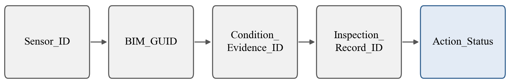
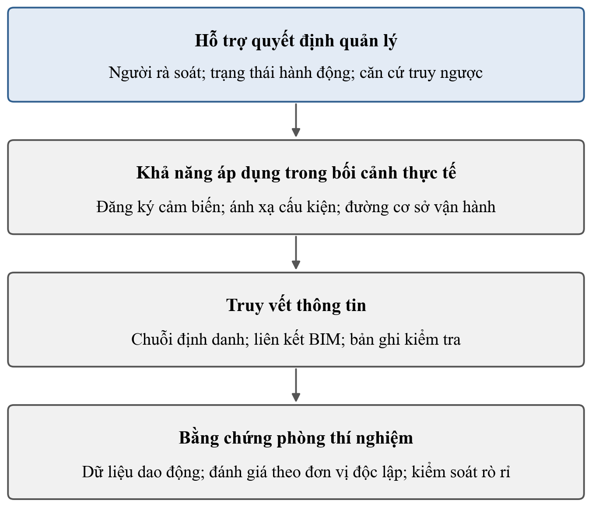
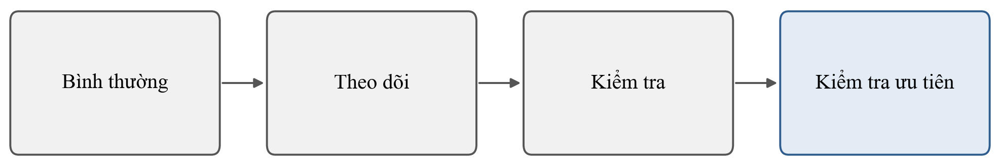

# CHƯƠNG 5. TỔNG HỢP KHOẢNG TRỐNG VÀ ĐỊNH HƯỚNG NGHIÊN CỨU

## 5.1. Tổng hợp những nội dung đã được giải quyết

### 5.1.1. Từ quản lý tài sản đến yêu cầu duy trì tính liên tục của thông tin

Các chương trước cho thấy quản lý nhà công nghiệp khung thép trong giai đoạn vận hành không thiếu dữ liệu theo nghĩa tuyệt đối. Dữ liệu tồn tại ở nhiều lớp: tín hiệu cảm biến trong hệ thu nhận; hình học và thuộc tính cấu kiện trong mô hình thông tin công trình; hồ sơ kiểm tra trong biểu mẫu hoặc hệ quản lý bảo trì; lịch sử xử lý trong các hệ thống quản lý công việc.

Chương 2 cho thấy quản lý tài sản trong giai đoạn vận hành đòi hỏi thông tin phải được tổ chức theo tài sản, có ngữ cảnh và duy trì được theo thời gian. ISO 19650-3:2020 cung cấp nền cho quản lý thông tin ở giai đoạn này, nhưng chuẩn hóa thông tin không tự động tạo ra chuỗi truy vết giữa dữ liệu kỹ thuật, cấu kiện, hồ sơ và hành động \[1\].

Ở phía mô hình thông tin, IFC cung cấp nền trao đổi và định danh đối tượng, và các nghiên cứu đã nối dữ liệu vận hành với đối tượng IFC theo nhiều cách (mục 2.2.2 và mục 5.1.3). Luận án vì vậy không đặt khoảng trống ở việc “có BIM”, “có cảm biến” hay “đưa dữ liệu lên mô hình”.

Điểm cần giải quyết nằm sâu hơn: **khi một kết quả kỹ thuật đã được xác lập chất lượng và phạm vi hiệu lực, các thuộc tính đó có được bảo toàn khi kết quả đi vào chuỗi thông tin quản lý hay không**.

### 5.1.2. Dữ liệu dao động và các phương pháp đánh giá 

Chương 3 cho thấy dữ liệu dao động, học máy và học sâu đã được dùng rộng trong theo dõi trạng thái kết cấu; riêng Jia và Li (2023) tổng hợp 337 công bố về học sâu trong lĩnh vực này \[13\].

Các nguyên tắc phương pháp về đánh giá cũng không mới và bao phủ gần hết các rủi ro của một thí nghiệm dao động: phân biệt số quan sát tính toán với số đơn vị độc lập thực \[14\]; ảnh hưởng của cấp nguồn vật lý dùng để phân tách dữ liệu \[15\]; chia theo sự kiện vật lý trước rồi mới học các phép biến đổi từ phần huấn luyện \[52\]; rò rỉ còn tồn tại khi cùng một chi tiết vật lý xuất hiện ở cả hai phía phép chia \[20\]; suy giảm khả năng chuyển giao khi giữ lại một đợt thí nghiệm chưa thấy sau tháo – lắp lại \[19\].

Kiểm soát rò rỉ dữ liệu, đánh giá theo nhóm, giữ lại đơn vị vật lý, giữ lại đợt thí nghiệm và kiểm định mức ngẫu nhiên vì vậy đều không phải kỹ thuật mới \[53\], \[54\]. Giá trị nghiên cứu nằm ở việc dùng chúng để xác định **một kết quả có thể được tin cậy trong phạm vi nào**, và đầu ra cần được quản lý như **bằng chứng trạng thái** gắn với nguồn gốc và điều kiện đánh giá.

### 5.1.3. Liên kết cảm biến, BIM, hồ sơ kiểm tra và quản lý bảo trì 

Chương 4 cho thấy lớp giữa của chuỗi nghiên cứu cũng đã có tiền lệ trực tiếp ở cả bốn mắt xích. Cảm biến hoặc dữ liệu cảm biến có thể được liên kết với ngữ cảnh cấu kiện \[2\], \[4\], \[5\]. Mã khiếm khuyết, vị trí cấu kiện, dữ liệu kiểm tra, bản ghi sửa chữa và trạng thái hoàn thành có thể được tổ chức trong cùng một hệ thống \[34\]. Định danh IFC có thể được duy trì khi tài sản từ BIM được đăng ký sang hệ quản lý bảo trì \[36\]. Các liên kết xuyên miền có thể được kiểm tra bằng ràng buộc ngữ nghĩa có thể thực thi \[21\]. Nguồn gốc dữ liệu và trách nhiệm giải trình cũng đã có nền phương pháp, từ việc ghi tác nhân, thời điểm và phiên bản trong trao đổi thông tin xây dựng \[16\] tới việc đưa chuyên gia vào quá trình tương tác và rà soát kết quả \[17\]. Lorvão Antunes và cộng sự (2024) nối dữ liệu quan trắc với cấu kiện kết cấu và định danh IFC trên ba dự án thí điểm đường cao tốc \[81\]. Seiß và cộng sự (2025) dùng trực tiếp định danh IFC để gắn hồ sơ kiểm tra với cấu kiện \[82\]. Kim và cộng sự (2018) và Wan và cộng sự (2019) gắn hồ sơ bảo trì, kiểm tra với cấu kiện trên dữ liệu thực \[6\], \[78\]. Oraskari, Senthilvel và Beetz (2021) dùng ràng buộc SHACL để phát hiện đối tượng mất đối ứng định danh \[83\]. Borkowski và cộng sự (2026) đề xuất một định danh bền vững cho cấu kiện qua các giai đoạn vòng đời \[33\].

Các tiền lệ này bác bỏ mọi tuyên bố về tính mới dựa trên từng thành phần riêng lẻ. Luận án không xem các nội dung sau là đóng góp mới tự thân:

- liên kết cảm biến với BIM;

- sử dụng định danh IFC;

- đưa hồ sơ kiểm tra hoặc sửa chữa vào hệ thống số;

- điều hướng giữa BIM và hệ quản lý bảo trì;

- ghi nguồn gốc dữ liệu;

- sử dụng các quy tắc kiểm tra dữ liệu;

- đưa con người vào quy trình rà soát;

- dùng câu hỏi nghiệp vụ và phép kiểm tra đạt/không đạt khi đứng riêng;

- duy trì định danh cấu kiện qua các giai đoạn vòng đời khi đứng riêng.

Phần còn lại nằm ở **cách các thành phần đã tồn tại được nối thành một chuỗi trong đó chất lượng và phạm vi hiệu lực của bằng chứng được bảo toàn tới hồ sơ và trạng thái hành động**.

### 5.1.4. Ranh giới giữa nội dung đã có và phần nghiên cứu còn lại

Bảng 5.1. Tổng hợp nội dung đã được xác lập và phần còn lại của nghiên cứu

| **Nội dung** | **Đã được xác lập** | **Phần còn lại trong phạm vi luận án** |
|:---|:---|:---|
| Dữ liệu dao động cho theo dõi trạng thái | Có nền nghiên cứu rộng | Không phải khoảng trống |
| Học máy và học sâu cho phân loại | Đã được áp dụng rộng | Không phải khoảng trống thuật toán |
| Đơn vị độc lập, đánh giá theo nhóm, kiểm soát rò rỉ | Các nguyên tắc đã được xác lập | Kết hợp và báo cáo đồng thời phạm vi hiệu lực trên đúng bài toán dao động của khung thép liên kết bu lông |
| Liên kết cảm biến với BIM/IFC | Có nhiều tiền lệ | Không phải khoảng trống |
| BIM – hệ quản lý bảo trì – hồ sơ khiếm khuyết/sửa chữa | Đã có các trường hợp triển khai | Không phải khoảng trống |
| Định danh và kiểm tra quan hệ | Đã có tiền lệ về lược đồ, đồ thị và ràng buộc | Duy trì tính liên tục của chuỗi cùng nguồn gốc và phạm vi hiệu lực của bằng chứng |
| Nguồn gốc dữ liệu | Có mô hình và từ vựng nền | Gắn với bản ghi bằng chứng trạng thái và bảo toàn tới hồ sơ/hành động |
| Con người trong quy trình | Có nhiều tiền lệ | Ghi được căn cứ, vai trò, lịch sử xử lý và trạng thái hành động trong cùng chuỗi |
| Song sinh số trong vận hành tài sản | Có nhiều mô hình khái niệm và trường hợp tích hợp | Đánh giá mức năng lực thực tế của khung sau nghiên cứu trường hợp |
| Biểu diễn quan trắc theo chuẩn mở | Đã có chuẩn SOSA và SSN | Gắn giao thức đánh giá và phạm vi hiệu lực vào bản ghi quan trắc |
| Yêu cầu thông tin và kiểm tra tuân thủ | Đã có cơ chế Information Delivery Specification cùng công cụ | Kết hợp kiểm tra thuộc tính cấu kiện với kiểm tra quan hệ của chuỗi bằng chứng |
| Chuyển giao tri thức giữa các kết cấu | Đã có khung theo quần thể cho nhóm đồng nhất và nhóm dị thể | Phát biểu mức tương đồng khi dùng kết quả mô hình thu nhỏ để nói về công trình thực |
| Giá trị thông tin và kiểm tra theo rủi ro | Đã có khung quyết định Bayes cho kế hoạch kiểm tra | Neo mức ưu tiên kiểm tra vào căn cứ rà soát được; hiệu chỉnh ngưỡng bằng dữ liệu chi phí thuộc bước sau luận án |

Cột thứ ba cho thấy ở mọi dòng, phần còn lại là một yêu cầu về *quan hệ* hoặc *sự bảo toàn thuộc tính*, không phải một thành phần công nghệ còn thiếu. Các khoảng trống của luận án nằm tại **các điểm nối giữa những thành phần đã có tiền lệ**.

## 5.2. Hai khoảng trống nghiên cứu

### 5.2.1. Khoảng trống A – Bằng chứng trạng thái có phạm vi hiệu lực

Một kết quả rút từ dữ liệu dao động của kết cấu có liên kết bu lông chỉ có nghĩa trong điều kiện đã tạo ra nó. Sau mỗi lần lắp lại khi bảo trì, phần lớn dữ liệu đáp ứng đã thu mất tác dụng cho theo dõi trạng thái \[18\]. Trên cầu thép KW51, sau khi liên kết bu lông được gia cường, mô hình huấn luyện trên dữ liệu trước can thiệp không còn đại diện cho trạng thái bình thường \[@2ZJSENQU\]. Ở phía đánh giá, chia dữ liệu theo đơn vị thấp hơn đơn vị độc lập làm con số hiệu năng lạc quan \[14\], \[15\], \[53\]. Với phát xạ âm trên dầm nhôm nối bu lông, độ chính xác giảm mạnh khi kiểm tra trên một lần lắp chưa thấy \[19\].

Điều còn chưa chắc gồm hai vế. Vế thứ nhất là mức lạc quan đó lớn đến đâu đối với phân loại dựa trên dao động của liên kết bu lông trong khung thép: các nghiên cứu đã rà soát cho bài toán này chia tập trong cùng lần lắp ráp hoặc cùng bản ghi \[48\], \[@VVBGM9EN\], nên không báo được chênh lệch. Vế thứ hai là cách ghi để biết khi nào một kết quả còn dùng được. Từ vựng nguồn gốc cho từng kết quả đã có trong PROV-O \[69\]; SSN có khái niệm điều kiện mà năng lực đo của cảm biến có hiệu lực \[CẦN NGUỒN: Khuyến nghị W3C SSN, mục 5.1\]; thẻ mô hình \[@82WQNDHU\] và phiếu thông tin mô hình \[53\] khai phạm vi ở mức mô hình, do người lập soạn. Trong các tài liệu đã rà soát, phạm vi hiệu lực và độ bất định chưa là trường bắt buộc của từng bằng chứng, có lần lắp ráp – can thiệp và điều kiện vận hành làm thành phần, và chưa được kiểm tại lần sử dụng.

Các điều kiện đó cần thiết vì hiệu lực sau can thiệp không đoán trước được: có trường hợp mất \[18\], \[@2ZJSENQU\], có trường hợp một lần siết lại vẫn được phân loại đúng \[48\], nên chỉ kiểm được khi bằng chứng được dùng. Mô hình học từ trạng thái bình thường cũng không bảo đảm với điều kiện vận hành chưa có trong huấn luyện \[@23TBQTIP\], \[45\]. Với nhà xưởng có cầu trục, điều kiện vận hành thuộc phạm vi này (Mục 3.2).

Nghiên cứu này kiểm hai điều: mức chênh lệch giữa đánh giá giữ lại cả lần chạy và đánh giá cùng lần chạy trên khung thép thu nhỏ (Mục tiêu 1), và khả năng kiểm bằng máy việc dùng bằng chứng ngoài phạm vi (Mục tiêu 2). Sau nghiên cứu, người quản lý có một con số về mức lạc quan của cách đánh giá thường gặp, và một bản ghi bằng chứng mang phạm vi để trả lời câu hỏi "tin được đến mức nào?".

### 5.2.2. Khoảng trống B – Từ bằng chứng đến hành động có trách nhiệm

Chuỗi lần kiểm tra – hư hỏng – cấu kiện – nhiệm vụ bảo trì đã được biểu diễn bằng thực thể chuẩn IFC 4.3 cho phát hiện bằng mắt \[35\]. IFC4 có lệnh bảo trì có trạng thái và phê duyệt ghi người, thời điểm \[CẦN NGUỒN: IFC4 ADD2 TC1\]; BCF 3.0 ghi trạng thái vấn đề gắn cấu kiện và sự kiện đổi trạng thái \[@K5SGFIGW\]; bước chuyển có gói bằng chứng và vai trò tách biệt đã được áp cho gói thông tin bàn giao \[44\].

Điều còn chưa chắc nằm ở chỗ nối dữ liệu đo với hành động. Chuỗi của các khung song sinh số đã đọc dừng ở cảnh báo và hỗ trợ quyết định \[3\], hoặc yêu cầu người dùng xác nhận mà không nêu cách ghi lần xác nhận \[7\]. Xác nhận của chuyên gia thường được dùng làm nhãn hay dữ liệu huấn luyện, và nhãn có thể sai \[@73MBWFVJ\], \[@Z9RD5DMZ\]. Trạng thái trong \[35\] gắn với hư hỏng và được gán "đã sửa" khi có lần bảo trì. Trong các tài liệu đã rà soát, bằng chứng có phạm vi hiệu lực chưa đi vào chuỗi kiểm tra – cấu kiện – hành động, và mỗi lần đổi trạng thái của hành động, kể cả lần kỹ sư xác nhận một đầu ra AI, chưa được ghi thành sự kiện có căn cứ, vai trò người thực hiện và bước xác minh sau sửa chữa.

Các điều kiện đó cần thiết vì việc thiết kế một hệ theo dõi phải xác định hành động nào được đưa ra và ai có thẩm quyền \[@EBB69J4F\], và bảo trì nhà công nghiệp thép cần hồ sơ hư hỏng cập nhật để theo dõi khắc phục \[22\]. Theo đánh giá của nghiên cứu này, khi xảy ra sự cố sau một lần sửa chữa, đơn vị quản lý cần truy ngược quyết định về bằng chứng và người phê duyệt.

Nghiên cứu này kiểm xem một mô hình thông tin mở rộng IFC 4.3 và BCF 3.0 bằng tầng bằng chứng và tầng trách nhiệm có phát hiện được các lỗi dùng bằng chứng ngoài phạm vi và đổi trạng thái không căn cứ hay không, so với hồ sơ kiểm định hiện hành và với mô hình chỉ dùng các chuẩn sẵn có (Mục tiêu 2), và có vận hành được trên một nhà xưởng thật hay không (Mục tiêu 3). Sau nghiên cứu, câu hỏi "ai đã xử lý, dựa vào đâu?" có một chuỗi bản ghi để truy ngược.

### 5.2.3. Quan hệ giữa hai khoảng trống

Hai khoảng trống nối với nhau qua bản ghi sử dụng bằng chứng: khoảng trống A xác định bằng chứng nào còn dùng được, khoảng trống B xác định việc dùng đó được ghi và giải trình ra sao. Yêu cầu về khoảng hiệu lực của quan hệ cảm biến – cấu kiện, trước đây nêu như một khoảng trống riêng, được xử lý như một ràng buộc của mô hình dữ liệu (Mục 5.5).

## 5.3. Luận đề trung tâm và mục tiêu nghiên cứu

### 5.3.1. Luận đề trung tâm

Từ hai khoảng trống trên, luận đề trung tâm của luận án được phát biểu như sau:

Với nhà công nghiệp khung thép liên kết bu lông, kết quả rút từ dữ liệu dao động là căn cứ đề nghị kiểm tra, còn kết luận hư hỏng do kỹ sư đưa ra sau kiểm tra. Kết quả đó trở thành căn cứ đáng tin và giải trình được khi mỗi bằng chứng trạng thái mang theo nguồn gốc, độ bất định và phạm vi hiệu lực, được kiểm tại lần sử dụng, và được nối qua hồ sơ kiểm tra tới lịch sử trạng thái của hành động kiểm tra – bảo trì.

Luận đề gồm ba mệnh đề, mỗi mệnh đề cần một loại bằng chứng riêng:

> 1\. đánh giá theo đơn vị độc lập cho biết bằng chứng từ dữ liệu dao động đáng tin trong phạm vi nào (Khoảng trống A);
>
> 2\. một mô hình thông tin bắt buộc phạm vi hiệu lực và ghi từng lần đổi trạng thái của hành động thành sự kiện có căn cứ phát hiện được các lỗi mà hồ sơ hiện hành và các chuẩn sẵn có không phát hiện (Khoảng trống A, B);
>
> 3\. chuỗi bằng chứng – hành động đó vận hành được trên một nhà xưởng đang khai thác với chi phí ghi nhận đo được (Khoảng trống A, B, áp dụng).

Kết quả của một mệnh đề không dùng để thay bằng chứng của mệnh đề khác: số liệu phòng thí nghiệm của mệnh đề 1 không được dùng làm kết luận về hiện trường ở mệnh đề 3.

### 5.3.2. Mục tiêu tổng quát

Mục tiêu tổng quát của luận án là phát triển và kiểm chứng một mô hình thông tin truy vết bằng chứng – trách nhiệm cho kiểm tra – bảo trì nhà công nghiệp khung thép, trong đó bằng chứng trạng thái từ dữ liệu dao động mang nguồn gốc, độ bất định và phạm vi hiệu lực, được gắn với cấu kiện BIM, hồ sơ kiểm tra và lịch sử trạng thái hành động.

Theo phân loại mức tích hợp của \[8\], hệ thống của luận án ở mức bóng số (digital shadow): dữ liệu đi tự động từ công trình vào mô hình số, còn mọi tác động trở lại công trình đi qua quyết định của con người. Trọng tâm của mục tiêu là quản lý thông tin và giải trình quyết định kiểm tra – bảo trì; các mô hình học máy là công cụ tạo bằng chứng (Mục 5.6A).

### 5.3.3. Mục tiêu cụ thể

**Mục tiêu 1 – Bằng chứng trạng thái có phạm vi hiệu lực (phòng thí nghiệm).** Định lượng hiệu năng của bốn mô hình, gồm rừng ngẫu nhiên (Random Forest, RF), máy vectơ hỗ trợ với nhân RBF (SVM-RBF), mạng tích chập một chiều (1D-CNN) và mạng phần dư một chiều (ResNet1D), trong việc phân biệt các trạng thái liên kết bu lông có kiểm soát trên mô hình khung thép tỉ lệ 1:10 khi đánh giá theo đơn vị độc lập; đo mức chênh lệch so với đánh giá cùng lần chạy; và khai báo phạm vi hiệu lực cho từng kết quả dưới dạng bản ghi bằng chứng.

**Mục tiêu 2 – Mô hình thông tin truy vết bằng chứng – hành động.** Xây dựng mô hình thông tin mở rộng mô hình IFC 4.3 của \[35\] và BCF 3.0 \[@K5SGFIGW\] bằng hai tầng: tầng bằng chứng (nguồn gốc, độ bất định, phạm vi hiệu lực) và tầng trách nhiệm (sự kiện chuyển trạng thái có căn cứ và vai trò người thực hiện, xác minh sau sửa chữa). Mô hình gồm sáu thực thể, năm ràng buộc kiểm bằng máy và logic hỗ trợ hành động bốn mức bằng luật minh bạch. Mô hình được đánh giá trên BIM của một nhà xưởng thật, so với hồ sơ kiểm định theo thực hành hiện hành (B0) và với mô hình chỉ dùng IFC 4.3 theo \[35\] và BCF 3.0 (B1), lấy tỉ lệ phát hiện lỗi chèn mù làm chỉ số chính.

**Mục tiêu 3 – Kiểm chứng khả thi trên nhà xưởng thật.** Triển khai chuỗi bằng chứng – hành động của Mục tiêu 2 trên một nhà xưởng khung thép đang khai thác có BIM: lắp 6–10 cảm biến ở các liên kết đại diện, lập đường cơ sở vận hành, sinh bằng chứng cảm biến bằng Autoencoder có bù nhiệt độ và trạng thái cầu trục, và chạy một kịch bản kiểm tra – xử lý – truy ngược đầu cuối. Mục tiêu này kiểm khả năng vận hành và truy vết của chuỗi; hiệu năng phát hiện hư hỏng ở hiện trường thuộc hướng mở rộng (Mục 5.8).

| Mục tiêu | Khoảng trống | Câu hỏi | Đối chứng | Kết quả đo | Sản phẩm |
|---|---|---|---|---|---|
| 1 | A (đánh giá, khai báo) | 1 | Đánh giá cùng lần chạy | Hiệu năng theo đơn vị độc lập kèm biến thiên theo seed, fold và kiểm định hoán vị; mức chênh lệch; phạm vi hiệu lực của từng kết quả | Bài báo 1 |
| 2 | B (và A) | 2 | B0, B1 | Tỉ lệ phát hiện lỗi chèn mù theo nhóm lỗi (chỉ số chính); đủ thuộc tính bắt buộc; thời gian truy ngược; chi phí ghi nhận | Bài báo 2 |
| 3 | A, B (áp dụng) | 3 | Không | Tỉ lệ dữ liệu về đủ; ánh xạ cảm biến – cấu kiện đúng; truy ngược kịch bản đầu cuối; chi phí ghi nhận | Chương luận án; phần hiện trường của Bài báo 2 |

Mục tiêu 1 cấp cho Mục tiêu 2 một tập bằng chứng có phạm vi hiệu lực đã biết, dùng để chèn các ca dùng bằng chứng ngoài phạm vi. Mục tiêu 2 cấp mô hình thông tin và công cụ kiểm ràng buộc cho Mục tiêu 3. Đánh giá của Mục tiêu 2 không phụ thuộc thời gian quan trắc của Mục tiêu 3. Tiểu luận tổng quan xác lập căn cứ và thiết kế của ba mục tiêu; dữ liệu và kết quả thuộc các chuyên đề và bài báo tiếp theo.

## 5.4. Câu hỏi nghiên cứu

### 5.4.1. Câu hỏi nghiên cứu 1 – Bằng chứng phòng thí nghiệm

**Khi giữ lại cả lần chạy trong đánh giá, bốn mô hình RF, SVM-RBF, 1D-CNN và ResNet1D phân biệt các trạng thái liên kết bu lông có kiểm soát trên khung thép 1:10 ở mức nào, chênh lệch bao nhiêu so với đánh giá cùng lần chạy, và mỗi kết quả được dùng trong phạm vi nào?**

Câu hỏi đo độ tin cậy của bằng chứng theo đơn vị suy luận và phạm vi đã kiểm chứng. Kết quả so sánh các mô hình được báo cáo trong phạm vi đó; thứ hạng giữa các mô hình là kết quả phụ.

### 5.4.2. Câu hỏi nghiên cứu 2 – Mô hình thông tin bằng chứng – hành động

**Trên cùng BIM nhà xưởng, so với hồ sơ kiểm định theo thực hành hiện hành (B0) và với mô hình IFC 4.3 theo \[35\] cùng BCF 3.0 chưa có tầng bằng chứng và tầng trách nhiệm (B1), mô hình đề xuất phát hiện được tỉ lệ nào của các lỗi chèn mù theo từng nhóm lỗi, và mức đủ thuộc tính bắt buộc, khả năng truy ngược, chi phí ghi nhận thay đổi ra sao?**

Hai nhóm lỗi trọng tâm là dùng bằng chứng ngoài phạm vi hiệu lực và đổi trạng thái hành động không có căn cứ. Phần chênh lệch quy cho đóng góp của luận án là chênh lệch so với B1. Chênh lệch so với B0 mô tả khoảng cách với thực hành kiểm định hiện hành ở Việt Nam và được diễn giải trong bối cảnh đó. Danh sách lỗi, người chèn lỗi, bộ câu hỏi truy ngược và cách tính chỉ số được khóa trước khi đo.

### 5.4.3. Câu hỏi nghiên cứu 3 – Khả năng áp dụng trên nhà xưởng thật

**Trên một nhà xưởng khung thép thật có BIM, chuỗi bằng chứng – hành động có thu đủ dữ liệu, giữ đúng ánh xạ cảm biến – cấu kiện và truy ngược được một kịch bản kiểm tra – xử lý đầu cuối không, với chi phí ghi nhận bao nhiêu?**

Câu hỏi kiểm khả năng vận hành của chuỗi trong điều kiện có cầu trục, nhiệt độ thay đổi và nhãn hư hỏng hạn chế. Mỗi bất thường trong dữ liệu vận hành tạo một bằng chứng đề nghị kiểm tra; kết quả kiểm tra của kỹ sư được ghi làm nhãn hiện trường và bản ghi kiểm tra.

### 5.4.4. Logic kế tiếp giữa ba câu hỏi

**Câu hỏi 1: Bằng chứng đáng tin trong phạm vi nào?\
↓\
Câu hỏi 2: Bằng chứng đó được ghi, kiểm và nối tới hành động như thế nào, và mô hình thông tin phát hiện được lỗi nào?\
↓\
Câu hỏi 3: Chuỗi đó vận hành được trên nhà xưởng thật với chi phí bao nhiêu?**

Câu hỏi 1 cấp bằng chứng có phạm vi đã biết cho câu hỏi 2; câu hỏi 2 cấp mô hình thông tin cho câu hỏi 3.

## 5.5. Ánh xạ câu hỏi nghiên cứu – gói công việc – bài báo – thiết kế kiểm chứng

### 5.5.1. Ma trận kiến trúc nghiên cứu

Trong chương này, RQ là câu hỏi nghiên cứu và WP là gói công việc. Phần kiểm chứng được trình bày như thiết kế phương pháp dự kiến nhằm cho thấy mỗi câu hỏi cần loại bằng chứng nào; Tiểu luận tổng quan không báo cáo trạng thái thực hiện hoặc kết quả của các bước kiểm chứng đó.

Bảng 5.2. Ánh xạ câu hỏi nghiên cứu, gói công việc, bài báo và thiết kế kiểm chứng

| Câu hỏi | Gói công việc | Nội dung cốt lõi | Chương luận án dự kiến | Công bố dự kiến | Thiết kế kiểm chứng |
|----|----|----|:--:|:--:|----|
| RQ1 | WP1 – Bằng chứng dao động phòng thí nghiệm | Sổ đăng ký lần chạy; trạng thái có kiểm soát; cấu hình cảm biến; đánh giá theo lần chạy; kiểm soát rò rỉ; phạm vi hiệu lực | Chương 4 | Công bố 1 | Chất lượng bằng chứng phòng thí nghiệm |
| RQ2 | WP2 – Truy vết BIM – cảm biến – kiểm tra | Mô hình dữ liệu; chuỗi định danh; câu hỏi nghiệp vụ; tiêu chí kiểm chứng; trình diễn đầu cuối | Chương 5 | Công bố 2 | Mô hình dữ liệu và tính toàn vẹn truy vết |
| RQ3 | WP3 – Khả năng áp dụng trong bối cảnh thực tế và hỗ trợ kiểm tra | Yêu cầu duy trì bối cảnh dữ liệu; ánh xạ định danh; quan hệ bằng chứng – cấu kiện – hồ sơ; tiêu chí đánh giá khả năng áp dụng | Chương 6 | Công bố 3 | Khả năng áp dụng trong bối cảnh công trình thực |
| Tổng hợp RQ2 – RQ3 | WP4 – Tổng hợp hỗ trợ quyết định | Logic Bình thường → Theo dõi → Kiểm tra → Kiểm tra ưu tiên; rà soát chuyên gia/người quản lý | Chương 7 | Phần tổng hợp của luận án | Rà soát logic hỗ trợ hành động, Evidence Gate 5 |

*Ghi chú Bảng 5.2:* các số chương ở cột “Chương luận án dự kiến” là chương dự kiến **của luận án**, không phải chương của Tiểu luận tổng quan. Các bước kiểm chứng dưới đây chỉ xác lập nghĩa vụ khoa học của từng phần nghiên cứu. Chúng không phải mốc tiến độ, trạng thái hoàn thành phần mềm hay kết quả thực nghiệm được báo cáo trong Tiểu luận tổng quan.

### 5.5.2. Nội dung các bước kiểm chứng dự kiến

**Bước kiểm chứng 1 – Chất lượng và phạm vi hiệu lực của bằng chứng trạng thái.**

Xác lập yêu cầu về đơn vị vật lý độc lập, kiểm soát rò rỉ dữ liệu, tính tái lập của chuỗi xử lý và cách báo cáo phạm vi hiệu lực; chi tiết thực nghiệm và kết quả được trình bày ở chuyên đề tương ứng.

**Bước kiểm chứng 2 – Mô hình dữ liệu truy vết và câu hỏi nghiệp vụ.**

Xác định trước các thực thể, thuộc tính, quan hệ, ràng buộc, nguồn gốc và các câu hỏi nghiệp vụ mà mô hình dữ liệu phải hỗ trợ.

**Bước kiểm chứng 3 – Tính toàn vẹn của chuỗi truy vết.**

Đặt yêu cầu kiểm tra khả năng truy theo hai chiều, bảo toàn nguồn gốc và phạm vi hiệu lực, đồng thời phát hiện các trường hợp quan hệ thiếu, sai hoặc không nhất quán bằng dữ liệu thử được xác định trước.

**Bước kiểm chứng 4 – Khả năng áp dụng trong bối cảnh công trình thực.**

Đặt yêu cầu đánh giá liệu chuỗi định danh, bối cảnh dữ liệu, bằng chứng và hồ sơ có thể được duy trì trong điều kiện vận hành thực tế hay không; Tiểu luận không mô tả cấu hình triển khai hoặc kết quả của bước này.

**Bước kiểm chứng 5 – Khả năng hỗ trợ hành động có thể giải trình.**

Đặt yêu cầu đánh giá logic hỗ trợ hành động qua các tình huống có người quản lý hoặc chuyên gia rà soát, trong đó căn cứ, vai trò và trạng thái xử lý phải có thể truy lại.

## 5.6. Khung nghiên cứu bốn lớp và kiến trúc Song sinh số dựa trên dữ liệu

### 5.6.1. Chuỗi nghiên cứu

Chuỗi nghiên cứu được giữ cố định theo Hình 1.1, và mỗi mũi tên trong chuỗi mang một nghĩa vụ kiểm chứng riêng. Mũi tên thứ nhất yêu cầu bằng chứng không được sinh ra từ một quá trình rò rỉ dữ liệu hoặc từ cách đếm sai đơn vị độc lập. Mũi tên thứ hai yêu cầu bằng chứng được gắn đúng cấu kiện và giữ được nguồn gốc. Mũi tên thứ ba yêu cầu hồ sơ kiểm tra là một bản ghi truy vết được, chứ không chỉ là ghi chú gắn vào mô hình. Mũi tên cuối yêu cầu trạng thái hành động có căn cứ và lịch sử xử lý có thể truy lại.

### 5.6.2. Chuỗi định danh

Ghi chú: FEM_Node_ID chỉ là metadata tùy chọn, không nằm trong chuỗi định danh bắt buộc.

<!-- GĐ0: hình gốc vẽ bằng shape trong .docx; ảnh cắt từ PDF do Word xuất ngày 28/09/2026 -->

Hình 5.1. Chuỗi định danh cốt lõi

Trong đó *Sensor_ID* là định danh nguồn đo; *BIM_GUID* là định danh cấu kiện trong mô hình thông tin; *Condition_Evidence_ID* là định danh bản ghi bằng chứng trạng thái; *Inspection_Record_ID* là định danh hồ sơ kiểm tra; và *Action_Status* là trạng thái xử lý của hành động kiểm tra hoặc bảo trì.

Chuỗi không yêu cầu mọi dữ liệu nằm trong cùng một cơ sở dữ liệu; yêu cầu chính là các định danh và quan hệ đủ ổn định để truy theo chiều thuận và chiều ngược. *FEM_Node_ID*, nếu có, chỉ là siêu dữ liệu tùy chọn.

*Trong chuỗi này, Action_Status là trạng thái hiện thời của một bản ghi hành động, không phải một định danh duy nhất. Để quản lý lịch sử xử lý và trách nhiệm, mô hình dữ liệu dùng thêm hai siêu dữ liệu phụ trợ: Action_ID định danh bản ghi hành động, và Status_Event_ID định danh từng sự kiện chuyển trạng thái, kèm thời điểm, người thực hiện hoặc vai trò, lý do chuyển và căn cứ đã dùng. Hai định danh này không làm thay đổi chuỗi lõi ở Hình 5.1; chúng nằm ở lớp dữ liệu bên dưới để trạng thái hiện thời luôn truy ngược được về lịch sử đã tạo ra nó.*

Chuỗi định danh lõi được giữ nguyên. Phần được hình thức hóa nằm bên dưới chuỗi, gồm các thực thể và thuộc tính cần thiết để chuỗi đúng theo thời gian và ngữ cảnh: bản ghi ánh xạ cảm biến với cấu kiện có thời gian hiệu lực và phiên bản mô hình; bản ghi bối cảnh quan trắc gồm đợt đo, cấu hình cảm biến và điều kiện môi trường ghi nhận được; liên hệ giữa bằng chứng với cấu kiện kèm căn cứ và phạm vi hiệu lực; và lịch sử thay đổi của từng ánh xạ. Bộ dữ liệu thử phải bao gồm các trường hợp cảm biến được di chuyển, ánh xạ đã hết hiệu lực, cấu kiện bị gắn nhầm và bằng chứng được dùng ngoài phạm vi đã kiểm chứng. Một chuỗi truy vết chỉ được coi là đúng khi phát hiện được các trường hợp này, không phải khi truy vấn chạy thành công.

Cần phân biệt hai loại đúng đắn ở đây. Loại thứ nhất là tính toàn vẹn của quan hệ dữ liệu: các quy tắc có thể kiểm tra được bản ghi có mồ côi hay không, định danh có trùng hay không, liên kết có hết hiệu lực hay không, phiên bản mô hình có khớp hay không và bằng chứng có được dùng ngoài phạm vi hiệu lực đã ghi hay không. Loại thứ hai là tính đúng đắn của ánh xạ cảm biến với cấu kiện ngoài thực tế, tức là cảm biến có thực sự được lắp ở cấu kiện đã khai báo hay không. Loại thứ hai không suy ra được từ dữ liệu của mô hình mà phải dựa trên hồ sơ lắp đặt, biên bản nghiệm thu và bảng đối chiếu định danh được xác nhận độc lập tại hiện trường. Vì vậy bộ quy tắc dữ liệu không được coi là phương tiện phát hiện mọi trường hợp gắn cảm biến sai ngoài thực tế. Quan hệ Sensor_ID → BIM_GUID chỉ là ánh xạ giữa nguồn đo và cấu kiện, không chứng minh nguồn vật lý của một bất thường. Action_ID và Status_Event_ID vẫn là siêu dữ liệu phụ trợ và chuỗi lõi không thay đổi.

### 5.6.3. Bốn lớp bằng chứng

<!-- GĐ0: hình gốc vẽ bằng shape trong .docx; ảnh cắt từ PDF do Word xuất ngày 28/09/2026 -->

Hình 5.2. Kiến trúc kiểm chứng bốn lớp

**Lớp 1 – Bằng chứng phòng thí nghiệm.** Chứng minh khả năng phân biệt các trạng thái liên kết có kiểm soát trong phạm vi đã thí nghiệm dưới giao thức đánh giá phù hợp. Đầu ra là bản ghi bằng chứng trạng thái có nguồn gốc, cấu hình cảm biến, phiên bản chuỗi xử lý, độ bất định và phạm vi hiệu lực.

**Lớp 2 – Truy vết thông tin.** Chứng minh chuỗi định danh, bản ghi và quan hệ có tính toàn vẹn và có thể kiểm tra. Lớp này phải cho phép trả lời các câu hỏi như: bằng chứng đến từ nguồn đo nào; liên quan tới cấu kiện nào; hồ sơ kiểm tra nào liên quan; trạng thái hành động hiện tại là gì; và từ hồ sơ có truy ngược được về căn cứ ban đầu hay không.

**Lớp 3 – Khả năng áp dụng trong bối cảnh thực tế.** Lớp này đặt yêu cầu kiểm chứng rằng kiến trúc có thể duy trì mối liên hệ giữa dữ liệu vận hành, định danh cấu kiện, bằng chứng, hồ sơ kiểm tra và trạng thái hành động trong điều kiện sử dụng thực. Lớp này không chứng minh phát hiện hư hỏng thực và không tiếp nhận trực tiếp bộ phân loại hoặc ngưỡng định lượng từ mô hình 1:10.

**Lớp 4 – Hỗ trợ quyết định quản lý.** Chứng minh quy trình có thể đưa một bằng chứng vào quá trình xem xét hành động theo cách minh bạch, có người rà soát và có trạng thái được ghi nhận. Lớp này không phải hệ thống ra quyết định tự động và không thay thế đánh giá kỹ thuật.

### 5.6.4. Thang kiểm chứng

Bảng 5.3. Thang kiểm chứng của khung nghiên cứu

| **Mức** | **Nội dung kiểm chứng** | **Điều không được suy ra** |
|:--:|:---|:---|
| V1 – Giá trị phòng thí nghiệm | Phân biệt trạng thái có kiểm soát dưới đánh giá theo đơn vị vật lý | Chẩn đoán hiện trường |
| V2 – Giá trị truy vết | Chuỗi định danh và quan hệ trả lời đúng các câu hỏi nghiệp vụ | Độ chính xác kỹ thuật của mô hình phân loại |
| V3 – Khả năng áp dụng trong bối cảnh thực tế | Duy trì được bối cảnh dữ liệu, định danh, quan hệ truy vết và hồ sơ trong điều kiện sử dụng thực | Phát hiện hư hỏng thực |
| V4 – Giá trị hỗ trợ quyết định | Căn cứ và đề xuất được trình bày minh bạch, có người quản lý rà soát | Quyết định tự động hoặc tối ưu toàn cục |

### 5.6.5. Luồng dữ liệu và luồng trách nhiệm

Kiến trúc nghiên cứu gồm hai luồng song song. **Luồng dữ liệu** đi từ cảm biến tới bằng chứng, cấu kiện, hồ sơ và trạng thái hành động. **Luồng trách nhiệm** đi từ người hoặc hệ thống tạo dữ liệu, qua người kiểm tra chất lượng, người rà soát, người phê duyệt và người thực hiện hành động.

Hai luồng gặp nhau tại bản ghi. Bản ghi bằng chứng cần lưu giá trị hoặc trạng thái cùng nguồn tạo ra, thời điểm, phiên bản xử lý và phạm vi hiệu lực; bản ghi hành động cần lưu việc đã hoàn thành hay chưa cùng căn cứ, người rà soát và lịch sử thay đổi trạng thái. Khả năng giải trình trong quản lý tài sản dựa trên chính các trường này.

### 5.6.6. Định vị Song sinh số

Luận án giữ mục tiêu **phát triển khung Song sinh số dựa trên dữ liệu**. Các nghiên cứu phân mức Song sinh số theo nhiều cách: theo chiều và mức tự động của luồng dữ liệu \[8\], theo các mức biểu diễn số trong môi trường xây dựng \[9\], hoặc theo mô hình trưởng thành đa chiều cho quản lý tài sản \[10\]. Các khung này là **tham chiếu đánh giá năng lực**, không phải căn cứ để gán trước một nhãn trưởng thành cho hệ thống.

Hai nguyên tắc được giữ:

> 1\. **Song sinh số là mục tiêu kiến trúc của nghiên cứu.**
>
> 2\. **Mức năng lực đạt được là một kết quả phải được đánh giá sau triển khai.**

Việc đánh giá mức năng lực Song sinh số thuộc giai đoạn kiểm chứng sau Tiểu luận tổng quan. Khi đó, nghiên cứu cần xem xét những chức năng nào thực sự được hiện thực hóa, luồng dữ liệu nào được cập nhật, quan hệ nào truy vấn được, phản hồi từ hồ sơ và hành động được ghi nhận tới đâu, và con người tham gia ở mức nào. **Bằng chứng hiện tại chưa đủ** để kết luận trước rằng khung đã đạt một mức trưởng thành Song sinh số cụ thể. Nghiên cứu không đặt mục tiêu tự động tác động vật lý lên công trình, điều khiển thời gian thực, bảo trì tự động, dự báo tuổi thọ còn lại hoặc bảo trì dự báo chỉ để đạt mức phân loại cao hơn.

## 5.6A. Công cụ trí tuệ nhân tạo và vai trò trong chuỗi bằng chứng

### 5.6A.1. Nguyên tắc: AI tạo bằng chứng, con người quyết định

Trong kiểm tra – bảo trì kết cấu thép, mỗi quyết định kiểm tra, siết lại hay thay thế cấu kiện phải truy ngược được tới người có thẩm quyền và căn cứ người đó đã dùng. Vì vậy, trong luận án, công cụ trí tuệ nhân tạo (AI) tạo bằng chứng, còn quyết định thuộc về kỹ sư và người quản lý có thẩm quyền. Mỗi đầu ra của mô hình được ghi thành một bản ghi bằng chứng (xem Mục 5.5) mang phiên bản phương pháp, trường độ bất định và trường phạm vi hiệu lực; chẩn đoán hư hỏng là kết luận của kỹ sư sau kiểm tra. Trên nền Mục 3.2.3, mục này xác định công cụ cho từng gói công việc và trường dữ liệu nhận đầu ra.

### 5.6A.2. Phòng thí nghiệm (WP1): phân biệt trạng thái liên kết có kiểm soát

Ở WP1, trạng thái liên kết được tạo có kiểm soát trên mô hình khung thép, nên bài toán là phân loại có giám sát. Họ mô hình thứ nhất học trên đặc trưng thủ công miền thời gian – tần số: rừng ngẫu nhiên (Random Forest, RF) \[@5TQ4AZVX\] và máy véc-tơ hỗ trợ với nhân hàm cơ sở bán kính (SVM-RBF) \[@JVI2GUPC\]. Họ thứ hai học trực tiếp trên tín hiệu đã chuẩn hóa. Mạng nơ-ron tích chập một chiều (1D-CNN) gộp trích đặc trưng và phân loại vào một khối học trên tín hiệu gia tốc thô \[@HPREAQAJ\], và đã được tổng quan cho tín hiệu một chiều, trong đó có theo dõi trạng thái kết cấu \[@IU5KZQEA\], \[@QUGY4928\]. Mạng dư một chiều (ResNet1D) kế thừa khối dư (residual block) của He và cộng sự (2016) \[@69U5H3TZ\]; Wang, Yan và Oates (2017) cho thấy cấu trúc ResNet học trực tiếp từ chuỗi thời gian thô đạt kết quả cạnh tranh trong phân loại \[@WXHN9TA2\]. Hai họ được dùng song song để đối chiếu xem kết luận có phụ thuộc cách biểu diễn tín hiệu hay không.

Giao thức đánh giá kế thừa Mục 3.3. Dữ liệu được chia theo nhóm, giữ lại cả lần chạy, để các cửa sổ của một bản ghi nằm trọn ở một phía của phép chia \[14\], \[53\]; điểm được chấm theo bản ghi, là đơn vị vật lý của phép đo; kiểm định hoán vị cho biết hiệu năng có vượt mức ngẫu nhiên hay không \[59\]. Siêu tham số được cố định trước hoặc chọn bên trong vòng huấn luyện của từng lần chia, vì sai số kiểm định chéo của một bộ phân loại đã tinh chỉnh bằng chính phép kiểm định đó bị lệch lạc quan \[@D28DT7CE\]; độ lệch lớn hơn khi cỡ mẫu nhỏ và khi chọn đặc trưng trên dữ liệu gộp \[@6JAQQCGE\]. Kết quả được báo cáo kèm biến thiên theo seed và theo fold.

Cấp nhóm, đơn vị chấm điểm và đợt lắp đặt ghi vào trường phạm vi hiệu lực (cách chia dữ liệu, đơn vị suy luận, đợt lắp đặt); biến thiên theo seed, fold và kết quả kiểm định hoán vị ghi vào trường độ bất định; nhãn hoặc xác suất lớp ghi vào trường giá trị. Kết quả thực nghiệm của WP1 thuộc chuyên đề tiếp theo.

### 5.6A.3. Hiện trường (WP3): từ phân loại sang phát hiện bất thường

Bốn nhóm bằng chứng cho thấy bộ phân loại học ở phòng thí nghiệm khó chuyển nguyên sang nhà xưởng. Thứ nhất, nhãn hiện trường đến từ kiểm tra của chuyên gia nên hiếm và đắt; thiếu nhãn, học không giám sát dừng ở bậc phát hiện bất thường trong phân cấp của Rytter \[@87NKU5IS\]. Mỗi công trình còn có điều kiện biên và vật liệu riêng \[@TDRPDWJE\], và dữ liệu đo phủ đủ các điều kiện vận hành và hư hỏng của một công trình hiếm khi có sẵn \[57\]. Thứ hai, ở kết cấu có mối nối, quy trình lắp ráp quyết định độ lặp lại; thiếu kiểm soát lắp ráp, độ bất định đo được có thể lớn hơn độ dịch tần số do phi tuyến của mối nối \[18\]. Thứ ba, biến đổi môi trường – vận hành có thể che lấp thay đổi do hư hỏng, nên dữ liệu huấn luyện phải phủ dải điều kiện rộng \[45\]. Thứ tư, bộ phân loại lực siết học trên một dầm liên kết bu lông đã thất bại khi áp trực tiếp sang dầm tương tự \[56\]; dòng nghiên cứu theo quần thể đặt riêng câu hỏi khi nào tri thức được chuyển giữa các kết cấu \[57\].

Từ đó, luận án đề xuất đổi vai AI ở WP3: mô hình học đường cơ sở vận hành của chính công trình (Mục 4.5.2) và báo độ lệch so với đường cơ sở. Công cụ chính là bộ tự mã hóa (autoencoder). Wang và Cha (2021) huấn luyện autoencoder sâu chỉ bằng gia tốc đo ở trạng thái nguyên vẹn, lấy sai lệch tái tạo làm đặc trưng, và kiểm chứng trên cầu thép thu nhỏ có bu lông bị nới lỏng tại nút \[@TDRPDWJE\]. Ghazimoghadam và Hosseinzadeh (2024) cũng học từ trạng thái chưa hư hỏng và phát hiện bu lông liên kết bị nới lỏng trên kết cấu phòng thí nghiệm \[@G98ZWHKW\]. Luận án đề xuất áp dụng nguyên tắc này cho nhà công nghiệp khung thép; hiệu quả khi có cầu trục và máy móc vận hành là nội dung kiểm chứng của WP3. Sai số tái tạo được ghi thành bản ghi bằng chứng loại cảm biến với nghĩa là tín hiệu đề nghị kiểm tra. Vì định vị và định lượng hư hỏng vẫn khó khi dữ liệu huấn luyện thiếu thông tin hư hỏng \[@TDRPDWJE\], tình trạng cấu kiện được xác định qua kiểm tra của kỹ sư.

Để giảm báo động giả, luận án đề xuất bù ảnh hưởng môi trường – vận hành (EOV) theo hai hướng Figueiredo và cộng sự (2011) phân biệt: tham số hóa đặc trưng theo các biến vận hành – môi trường đo được, hoặc học trạng thái bình thường trực tiếp từ dữ liệu đáp ứng \[@23TBQTIP\]. Khi nhà xưởng ghi được nhiệt độ và trạng thái thiết bị trong bối cảnh quan trắc, hướng thứ nhất được ưu tiên. Với nguồn biến động chưa đo được, phân tích đồng liên kết (cointegration) tạo phần dư dừng đã loại xu hướng chung của các biến quan trắc mà không cần đo điều kiện môi trường – vận hành, với điều kiện tập huấn luyện lấy từ trạng thái bình thường và chứa cả những sự kiện vận hành bình thường gây thay đổi lớn trong đáp ứng \[@KPWFC4PI\]. Các thuật toán này có thể thất bại với điều kiện chưa có trong dữ liệu huấn luyện \[@23TBQTIP\], nên dải điều kiện của đường cơ sở được ghi vào trường điều kiện áp dụng, và bằng chứng sinh ngoài dải đó phải kèm lý do khi sử dụng (ràng buộc về sử dụng bằng chứng ngoài phạm vi hiệu lực, Phụ lục B).

Học chủ động (active learning) là cơ chế luận án đề xuất cho vòng lặp kiểm tra tạo nhãn. Hughes và cộng sự (2022) coi mỗi lần hỏi nhãn là một lần kiểm tra kết cấu, chỉ thực hiện khi giá trị kỳ vọng của thông tin với quyết định bảo trì vượt chi phí kiểm tra, với giả định kiểm tra cho thông tin hoàn hảo \[@Z9RD5DMZ\]. Bull và cộng sự (2022) bổ sung kiểm tra định kỳ bằng kiểm tra được truy vấn khi phép đo giàu thông tin, và lưu ý trạng thái ở thời điểm đã qua không kiểm tra lại được \[@87NKU5IS\]. Hướng này chủ yếu phát triển trên dữ liệu cầu, máy bay thí nghiệm, ổ trục và bơm \[@87NKU5IS\]. Trong luận án, kết quả kiểm tra được ghi thành bản ghi kiểm tra có người thực hiện và thời điểm, làm nhãn hiện trường của cấu kiện.

### 5.6A.4. Hồ sơ và hỗ trợ hành động (WP2, WP4)

Ở WP2, mô hình ngôn ngữ lớn (LLM) hỗ trợ trích xuất loại lỗi và thông tin kiểm tra từ hồ sơ cũ để lập đường cơ sở B0 (xem Mục 5.7); kỹ sư xác nhận mọi kết quả trích xuất, và độ chính xác trích xuất được báo cáo. Ở WP4, logic bốn mức ưu tiên được viết bằng luật minh bạch, nên mỗi sự kiện chuyển trạng thái truy ngược được tới luật đã áp dụng, bản ghi sử dụng bằng chứng và bằng chứng đã dùng.

### 5.6A.5. Tổng hợp công cụ theo gói công việc

Bảng 5.6A. Công cụ trí tuệ nhân tạo theo gói công việc và trường dữ liệu tương ứng

| **Gói** | **Công cụ** | **Vai trò** | **Đầu ra** | **Trường dữ liệu tương ứng** |
|:--:|:---|:---|:---|:---|
| WP1 | RF, SVM-RBF; 1D-CNN, ResNet1D | Phân biệt trạng thái liên kết có kiểm soát | Nhãn hoặc xác suất lớp theo bản ghi | `EVIDENCE.value` |
| WP1 | Đánh giá theo nhóm, chấm điểm theo bản ghi, kiểm định hoán vị, biến thiên theo seed và fold | Căn cứ khai báo | Cấp chia, đơn vị suy luận, đợt lắp đặt; biến thiên | `VALIDITY_SCOPE`, `uncertainty` |
| WP3 | Autoencoder học đường cơ sở vận hành | Phát hiện độ lệch so với đường cơ sở | Sai số tái tạo; đề nghị kiểm tra | `EVIDENCE` loại cảm biến |
| WP3 | Bù EOV (hồi quy; đồng liên kết) | Giảm báo động giả do cầu trục, máy móc, nhiệt | Đặc trưng đã bù; dải điều kiện đường cơ sở | `OBS_CONTEXT`, `applicable_conditions` |
| WP3 | Học chủ động | Chọn bất thường cần kiểm tra | Nhãn hiện trường sau kiểm tra | `INSPECTION_RECORD`, `EVIDENCE_USE` |
| WP2 | LLM trích xuất hồ sơ cũ, kỹ sư xác nhận | Phân loại lỗi; đường cơ sở B0 | Bản ghi lỗi đã xác nhận; độ chính xác trích xuất | `INSPECTION_RECORD` (B0) |
| WP4 | Logic bốn mức bằng luật minh bạch | Đề xuất mức ưu tiên | Mức ưu tiên kèm luật đã áp dụng | `ACTION.priority_level`, `STATUS_EVENT` |

Công cụ hỗ trợ ngoài AI gồm Python, scikit-learn, PyTorch; MLflow, DVC để cấp phiên bản phương pháp; IfcOpenShell, ifctester để đọc IFC và kiểm tra thuộc tính bắt buộc; rdflib, pySHACL để lưu đồ thị bằng chứng và kiểm tra các ràng buộc ở Phụ lục B. Việc sử dụng AI tạo sinh khi thực hiện Tiểu luận được khai báo ở phần đầu; phạm vi diễn giải của các công cụ trên được trình bày ở Mục 5.8.

## 5.7. Đóng góp dự kiến của luận án

### 5.7.1. Đóng góp 1 – Bằng chứng trạng thái có chất lượng và phạm vi hiệu lực rõ

Đóng góp dự kiến thứ nhất là quy trình tạo và đánh giá bằng chứng trạng thái ở cấp đơn vị vật lý cho bài toán trạng thái liên kết khung thép. Thuật toán phân loại, kiểm định hoán vị, đánh giá giữ lại từng lần chạy hay kiểm soát rò rỉ đều đã có tiền lệ khi đứng riêng; đóng góp dự kiến nằm ở việc kết hợp chúng thành một quy trình tái lập được, trong đó đầu ra trở thành bản ghi bằng chứng có nguồn gốc, độ bất định và phạm vi hiệu lực rõ.

Nếu kết quả suy giảm giữa các đợt thí nghiệm, đó chưa phải thất bại; nó cho thấy phạm vi hiệu lực hẹp hơn và phải được ghi nhận đúng.

Ánh xạ và điều kiện kiểm chứng. Đóng góp 1 thuộc RQ1, gói công việc WP1, Bài báo 1 và Evidence Gate 1. Kiến thức dự kiến tạo ra là một quy trình tạo và đánh giá bằng chứng trạng thái ở cấp đơn vị vật lý, tái lập được, cùng cách báo cáo phạm vi hiệu lực. Khác biệt so với nghiên cứu hiện có nằm ở chỗ các nghiên cứu tiền lệ trên khung thép liên kết bu lông thường không mô tả rõ đơn vị suy luận và cấp chia dữ liệu. Bằng chứng cần thiết gồm dữ liệu từ ít nhất ba đợt tháo lắp lại, kết quả đánh giá theo ba cách chia, và báo cáo chênh lệch giữa các cách chia đó. Giới hạn kết luận: kết quả chỉ chứng minh khả năng phân biệt trạng thái có kiểm soát trong phạm vi thí nghiệm, không chứng minh khả năng chẩn đoán hư hỏng tại công trình.

### 5.7.2. Đóng góp 2 – Khung truy vết cấp cấu kiện bảo toàn chất lượng của bằng chứng

Đóng góp dự kiến thứ hai là mô hình dữ liệu truy vết hình thức hóa chuỗi định danh ở Hình 5.1, xây trên các chuẩn đã có thay vì thay thế chúng: lớp quan trắc dùng SOSA và SSN, lớp nguồn gốc dùng PROV và PAV, lớp yêu cầu thông tin dùng Information Delivery Specification, lớp kiểm chứng quan hệ dùng ràng buộc ngữ nghĩa. Các chuẩn này được dùng ở mức cần thiết cho bài toán, ưu tiên tái sử dụng công cụ sẵn có. Phần được đề xuất gồm bốn điểm. Thứ nhất, phạm vi hiệu lực là thuộc tính bắt buộc của bản ghi bằng chứng, gồm đơn vị suy luận, cách chia dữ liệu, đợt lắp đặt và cấu hình cảm biến. Thứ hai, điều kiện bảo toàn các thuộc tính đó qua chuỗi tới hồ sơ kiểm tra và trạng thái hành động được viết thành ràng buộc thực thi được. Thứ ba, chuỗi được kiểm chứng bằng tập ca kiểm thử âm tính xác định trước cùng ba chỉ số: tỷ lệ phát hiện quan hệ sai, tỷ lệ bản ghi đủ nguồn gốc và thời gian truy ngược. Thứ tư, đối tượng được giải trình là bản ghi kiểm tra tình trạng neo trên bằng chứng cảm biến, khác với chứng chỉ hiệu chuẩn trong đo lường, với quyết định công bố mô hình trong môi trường dữ liệu chung, và với định danh cấu kiện qua các giai đoạn vòng đời.

Cấu hình triển khai được chọn là một phương án duy nhất, giữ ở mức tối thiểu nhưng không giảm nghĩa vụ kiểm chứng khoa học. Phương án này gồm bốn thành phần. Thứ nhất, một mô hình dữ liệu cốt lõi với các thực thể nguồn đo, ánh xạ nguồn đo với cấu kiện, bối cảnh quan trắc, bằng chứng trạng thái, cấu kiện trong mô hình thông tin, hồ sơ kiểm tra và lịch sử hành động. Thứ hai, một cơ chế kiểm chứng chính cho các quan hệ của mô hình dữ liệu. Thứ ba, một bộ dữ liệu thử gồm các trường hợp hợp lệ và các trường hợp cố ý sai, thiếu, trùng, xung đột hoặc liên kết đã hết hiệu lực. Thứ tư, một bộ câu hỏi năng lực cùng tiêu chí chấp nhận được khóa trước khi kiểm chứng. IFC và IDS, SOSA và SSN, PROV và PAV, cùng ràng buộc ngữ nghĩa được tham chiếu hoặc tái sử dụng ở mức cần thiết cho phương án đã chọn; không phải mọi chuẩn trong số này đều được triển khai đầy đủ. Các nghĩa vụ khoa học giữ nguyên: nguồn gốc, phạm vi hiệu lực, phiên bản và thời gian hiệu lực, truy vết hai chiều, ca kiểm thử âm tính và quy tắc toàn vẹn. Công bố 2 không nhận nhiệm vụ xây dựng một mô hình dữ liệu (ontology) tổng quát, một nền tảng phần mềm mới hay một hệ thống Song sinh số hoàn chỉnh.

Người quản lý phải kiểm lại được nguồn cảnh báo, điều kiện đánh giá, phạm vi hiệu lực, hồ sơ liên quan và trạng thái xử lý, chứ không chỉ nhìn thấy một cảnh báo trên mô hình.

Ánh xạ và điều kiện kiểm chứng. Đóng góp 2 thuộc RQ2, gói công việc WP2, Bài báo 2 và Evidence Gate 2 đến 3. Kiến thức dự kiến tạo ra là mô hình dữ liệu hình thức cùng bộ quy tắc toàn vẹn cho chuỗi bằng chứng ở cấp cấu kiện, kèm bộ ca kiểm thử âm tính. Khác biệt so với nghiên cứu hiện có nằm ở phạm vi hiệu lực của bằng chứng như thuộc tính bắt buộc và ở yêu cầu bảo toàn thuộc tính đó qua chuỗi, thay vì ở việc tạo thêm liên kết hoặc bảo đảm tính bất biến của bản ghi. Bằng chứng cần thiết gồm mô hình dữ liệu triển khai được, tập câu hỏi nghiệp vụ, dữ liệu thử đúng và sai, cùng ba chỉ số: tỷ lệ phát hiện quan hệ sai, tỷ lệ bản ghi đủ nguồn gốc và thời gian truy ngược. Giới hạn kết luận: kết quả chỉ chứng minh tính toàn vẹn của chuỗi thông tin trong phạm vi dữ liệu thử, không chứng minh giá trị quản lý của hệ thống. Việc xây dựng phần mềm, kết nối Revit với IFC hay dựng giao diện Song sinh số không được tính là đóng góp khoa học.

### 5.7.3. Đóng góp 3 – Cơ sở kiểm chứng khả năng áp dụng của chuỗi truy vết

Đóng góp dự kiến thứ ba là xây dựng cơ sở kiểm chứng cho khả năng áp dụng của kiến trúc truy vết trong bối cảnh nhà công nghiệp khung thép thực. Trọng tâm không nằm ở một cấu hình thiết bị hay nền tảng phần mềm cụ thể, mà ở việc duy trì được quan hệ giữa nguồn dữ liệu, cấu kiện, bằng chứng, hồ sơ kiểm tra và trạng thái hành động trong bối cảnh vận hành.

Ranh giới ở đây: phần có thể chuyển từ mô hình 1:10 sang bối cảnh thực tế là **nguyên tắc tổ chức và truy vết bằng chứng**, không phải bộ phân loại hay ngưỡng định lượng. Điều kiện môi trường, vận hành và lịch sử can thiệp phải được xem là bối cảnh của dữ liệu khi diễn giải tín hiệu; việc chúng ảnh hưởng như thế nào tới từng loại kết cấu cần được kiểm chứng trong nghiên cứu chuyên đề, không được suy ra từ Tiểu luận tổng quan.

Ánh xạ và điều kiện kiểm chứng. Đóng góp 3 thuộc RQ3, gói công việc WP3, Bài báo 3 và Evidence Gate 4. Kiến thức dự kiến tạo ra là phương pháp đánh giá khả năng áp dụng của chuỗi truy vết trong bối cảnh vận hành thực, tập trung vào tính liên tục của định danh, bối cảnh dữ liệu, bằng chứng và hồ sơ. Bằng chứng cần thiết gồm dữ liệu từ công trình thực, nhật ký thay đổi cảm biến và mô hình, cùng kết quả kiểm tra chuỗi trong điều kiện đó. Giới hạn kết luận: kết quả chỉ nói về khả năng duy trì quan hệ thông tin, không nói về khả năng phát hiện hư hỏng thực và không suy ra từ kết quả phòng thí nghiệm.

### 5.7.4. Đóng góp 4 – Logic hỗ trợ hành động minh bạch và có thể giải trình

Đóng góp dự kiến thứ tư là logic hỗ trợ hành động bốn mức.

Bất thường hiện trường dẫn tới kiểm tra, không dẫn trực tiếp tới kết luận hư hỏng.

<!-- GĐ0: hình gốc vẽ bằng shape trong .docx; ảnh cắt từ PDF do Word xuất ngày 28/09/2026 -->

Hình 5.3. Logic hỗ trợ hành động

Logic này không phải chỉ số sức khỏe tổng hợp hay hệ thống bảo trì tự động. Mỗi mức gắn với bằng chứng, phạm vi hiệu lực, cấu kiện liên quan, hồ sơ kiểm tra, vai trò người rà soát, trạng thái hành động và lý do chuyển trạng thái. Giá trị của lớp này là làm rõ căn cứ của hành động và cho phép truy ngược quyết định về bằng chứng đã dùng.

Ánh xạ và điều kiện kiểm chứng. Đóng góp 4 thuộc phần tổng hợp của RQ2 và RQ3, gói công việc WP4 và Evidence Gate 5. Kiến thức dự kiến tạo ra là một logic hỗ trợ hành động trong đó mỗi mức ưu tiên gắn với bằng chứng, phạm vi hiệu lực, vai trò người rà soát và lịch sử trạng thái. Bằng chứng cần thiết gồm các tình huống rà soát có người tham gia, trong đó căn cứ và trạng thái phải truy lại được. Giới hạn kết luận: kết quả chỉ chứng minh khả năng giải trình của chuỗi, không chứng minh hiệu quả của quyết định và không so sánh với phán đoán chuyên gia. Bằng chứng hiện tại chưa đủ để phát biểu về hiệu quả quyết định.

### 5.7.5. Đóng góp ở cấp ngành Quản lý xây dựng

Bốn đóng góp trên hợp lại thành một đóng góp ở cấp ngành:

một cách tổ chức và kiểm chứng dòng thông tin từ bằng chứng kỹ thuật tới quy trình kiểm tra – bảo trì.

Luận án sử dụng dữ liệu dao động, học máy, BIM và các công cụ số nhưng không định vị đóng góp chính ở kỹ thuật kết cấu hoặc khoa học máy tính. Đối tượng quản lý là **thông tin về trạng thái tài sản, hồ sơ kiểm tra và trạng thái hành động**, với mục tiêu tăng khả năng truy vết, giải trình và hỗ trợ quyết định. Đây là lý do trục nghiên cứu thuộc Quản lý xây dựng và quản lý tài sản.

Đóng góp ở cấp ngành vì vậy được phát biểu ở dạng quản lý thông tin tài sản: tổ chức, bảo toàn và kiểm chứng dòng thông tin từ bằng chứng kỹ thuật tới hồ sơ và quy trình kiểm tra, sao cho mỗi hành động kiểm tra truy ngược được về căn cứ, phạm vi hiệu lực, người rà soát và lịch sử xử lý. Toàn bộ nội dung mục này là đóng góp dự kiến, chưa phải kết quả đã được kiểm chứng.

## 5.8. Phạm vi, giới hạn và điều kiện diễn giải kết quả

### 5.8.1. Phân lớp phạm vi

Bảng 5.4. Phạm vi của luận án

| **Nhóm** | **Nội dung** |
|:---|:---|
| **Phạm vi cốt lõi** | Dữ liệu dao động → bằng chứng trạng thái; truy vết tới cấu kiện BIM; hồ sơ kiểm tra; trạng thái/hỗ trợ hành động; đánh giá khả năng áp dụng trong bối cảnh nhà công nghiệp khung thép |
| **Phạm vi hỗ trợ** | Học máy và học sâu như công cụ tạo bằng chứng; BIM/IFC; nguồn gốc dữ liệu; con người trong vòng lặp; mô hình phần tử hữu hạn danh nghĩa để tham chiếu |
| **Hướng phát triển sau luận án** | Kiểm chứng khung trên các loại kết cấu và tài sản công trình khác; hiệu chuẩn và cập nhật mô hình phần tử hữu hạn nếu có câu hỏi nghiên cứu phù hợp; đánh giá kinh tế quy mô lớn; các năng lực Song sinh số cao hơn khi có đủ dữ liệu và hạ tầng |
| **Ngoài phạm vi hiện tại** | Chẩn đoán hư hỏng hiện trường khi chưa có kiểm tra xác nhận; dự báo tuổi thọ còn lại; bảo trì dự báo; suy luận suy giảm độ cứng; chỉ số sức khỏe phức tạp; tối ưu vị trí cảm biến; bảo trì tự động; trí tuệ nhân tạo tại biên; Thành phố thông minh; động lực học chất lưu tính toán; phát triển phần mềm thương mại |

### 5.8.2. Ranh giới giữa bốn loại bằng chứng

**Bằng chứng phòng thí nghiệm** chỉ chứng minh khả năng phân biệt các trạng thái có kiểm soát trong điều kiện đã kiểm chứng. Nó không chứng minh hư hỏng trong bối cảnh sử dụng thực.

**Bằng chứng truy vết thông tin** chỉ chứng minh tính toàn vẹn và khả năng kiểm tra của chuỗi quan hệ. Nó không chứng minh độ chính xác của mô hình phân loại.

**Bằng chứng về khả năng áp dụng trong bối cảnh thực tế** chỉ chứng minh kiến trúc có thể duy trì các quan hệ thông tin cần thiết trong điều kiện vận hành. Nó không chứng minh phát hiện hư hỏng thực.

**Bằng chứng hỗ trợ quyết định** chỉ chứng minh quy trình có thể trình bày căn cứ minh bạch và được con người rà soát. Nó không chứng minh hành động là tối ưu hoặc tự động đúng trong mọi trường hợp.

Quy tắc chung:

Mọi bất thường trong dữ liệu vận hành dẫn tới xem xét và kiểm tra, không dẫn trực tiếp tới kết luận hư hỏng.

### 5.8.3. Giới hạn của mô hình phần tử hữu hạn

Mô hình phần tử hữu hạn chỉ được giữ như **mô hình danh nghĩa, chưa hiệu chuẩn, chỉ dùng để tham chiếu và không dùng cho chẩn đoán hư hỏng**. Mô hình có thể hỗ trợ minh họa vị trí cấu kiện hoặc tham khảo bố trí cảm biến nếu ghi rõ giới hạn, nhưng không được dùng để suy ra suy giảm độ cứng, suy ra lực siết bu lông, xác định mức độ hư hỏng, hiệu chuẩn bộ phân loại, hoặc chuyển kết luận định lượng từ mô hình 1:10 sang công trình thực. Mô hình phần tử hữu hạn không có câu hỏi nghiên cứu, gói công việc, chương, bài báo hoặc nghĩa vụ kiểm chứng độc lập.

### 5.8.4. Giới hạn của tổng quan tài liệu

Tiểu luận sử dụng **tổng quan tài liệu theo chủ đề có cấu trúc**, không tự nhận là tổng quan hệ thống toàn diện hoặc phân tích thư mục định lượng. Ba khoảng trống nghiên cứu trong tập tài liệu đã kiểm chứng; một số nguồn gần với lớp truy vết và hành động vẫn chưa đầy đủ và đang tiếp tục rà soát.

Các phát biểu về khoảng trống vì vậy dùng ngôn ngữ có điều kiện và không được nâng thành tuyên bố thiếu vắng phổ quát. Mức bằng chứng hiện tại đủ để xác lập một hướng nghiên cứu hẹp, kiểm chứng được, nhưng không đủ để tuyên bố độc quyền về các thành phần kỹ thuật riêng lẻ.

### 5.8.5. Giới hạn và điều kiện của định vị Song sinh số

Ở thời điểm tổng quan, Tiểu luận không khẳng định hệ thống đã đạt một mức Song sinh số cụ thể, không giả định đồng bộ hai chiều tự động khi chưa được kiểm chứng và không tự gán năng lực tự quản lý. Việc xác định mức năng lực thực tế thuộc giai đoạn nghiên cứu chuyên đề sau tổng quan và phải dựa trên các chức năng thực sự được hiện thực hóa, không dựa trên tên gọi của kiến trúc.

## 5.9. Định hướng nghiên cứu sau Tiểu luận tổng quan

Từ kết quả tổng quan, ba khoảng trống nghiên cứu đã được thu hẹp đủ để hình thành một chương trình kiểm chứng tuần tự. Phần tiếp theo của luận án vì vậy cần tập trung vào việc kiểm chứng các yêu cầu đã xác lập cho từng lớp bằng chứng, thay vì tiếp tục mở rộng công nghệ hoặc đưa kết quả triển khai kỹ thuật vào Tiểu luận tổng quan.

### 5.9.1. Định hướng 1 – Kiểm chứng chất lượng bằng chứng trạng thái

Nghiên cứu chuyên đề thứ nhất cần kiểm chứng chất lượng và phạm vi hiệu lực của bằng chứng trạng thái theo các yêu cầu phương pháp đã tổng hợp ở Chương 3. Tiểu luận chỉ xác lập các yêu cầu này; dữ liệu, cấu hình phân tích, chỉ số và kết quả thuộc phần nghiên cứu thực nghiệm riêng.

### 5.9.2. Định hướng 2 – Hình thức hóa mô hình dữ liệu và tiêu chí truy vết

Nghiên cứu chuyên đề về truy vết cần xác định trước cấu trúc dữ liệu và tiêu chí đánh giá, trước khi lựa chọn cách hiện thực hóa bằng công cụ cụ thể. Các nội dung cốt lõi gồm thuộc tính tối thiểu của bản ghi bằng chứng, cấu trúc hồ sơ kiểm tra, lịch sử trạng thái hành động, chuỗi định danh, quy tắc toàn vẹn, nguồn gốc, phiên bản, câu hỏi nghiệp vụ và dữ liệu thử hợp lệ/không hợp lệ. Cách đặt này giúp đóng góp khoa học nằm ở mô hình và giao thức kiểm chứng, không phụ thuộc vào giao diện, nền tảng tự động hóa hay phần mềm cụ thể.

### 5.9.3. Định hướng 3 – Kiểm chứng tính toàn vẹn của chuỗi truy vết

Bước nghiên cứu tiếp theo cần kiểm chứng rằng một bản ghi bằng chứng có thể duy trì quan hệ với cấu kiện, hồ sơ và trạng thái hành động theo cả chiều thuận và chiều ngược, đồng thời phát hiện được các trường hợp dữ liệu hoặc quan hệ không hợp lệ. Tiểu luận chỉ xác lập nghĩa vụ kiểm chứng này; phương thức triển khai và kết quả thuộc chuyên đề truy vết.

### 5.9.4. Định hướng 4 – Đánh giá khả năng áp dụng trong bối cảnh công trình thực

Sau khi logic bằng chứng và truy vết được kiểm chứng ở các bước chuyên đề tương ứng, nghiên cứu có thể đánh giá khả năng áp dụng của khung trong bối cảnh vận hành thực. Ở cấp Tiểu luận tổng quan, yêu cầu cốt lõi chỉ là duy trì được bối cảnh dữ liệu, định danh, quan hệ truy vết, hồ sơ kiểm tra và phản hồi của quá trình quản lý; cấu hình triển khai và kết quả thực tế không được trình bày tại đây.

Mục tiêu của bước này không phải tạo đủ trường hợp hư hỏng để kiểm tra bộ phân loại. Bất thường trong dữ liệu vận hành, nếu xuất hiện, chỉ được xem là căn cứ cho việc xem xét hoặc kiểm tra và không tự động trở thành nhãn hư hỏng.

### 5.9.5. Định hướng 5 – Kiểm chứng logic hỗ trợ hành động

Lớp hỗ trợ hành động cần được kiểm chứng qua các tình huống có người rà soát, trong đó nguồn bằng chứng, phạm vi hiệu lực, cấu kiện liên quan, hồ sơ kiểm tra, lịch sử xử lý, trạng thái hành động và lý do đề xuất phải có thể truy lại. Mục đích là đánh giá tính minh bạch và khả năng giải trình của khung, không chứng minh thuật toán quyết định chính xác hơn chuyên gia.

## 5.10. Tổng hợp chương

Tiểu luận cho thấy các thành phần kỹ thuật chính của bài toán đều đã có nền nghiên cứu: dữ liệu dao động và học máy cho theo dõi trạng thái; nguyên tắc về đơn vị vật lý, rò rỉ dữ liệu và đánh giá theo nhóm; liên kết cảm biến với BIM; IFC làm nền định danh; hồ sơ kiểm tra, khiếm khuyết và sửa chữa trong các hệ thống dựa trên BIM; nguồn gốc dữ liệu, kiểm chứng quan hệ và con người trong quy trình. Luận án vì vậy không xây dựng khoảng trống bằng cách tuyên bố thiếu một công nghệ thành phần.

Ba khoảng trống còn lại đều nằm ở **điểm nối**: xác lập chất lượng và phạm vi hiệu lực của bằng chứng; bảo toàn các thuộc tính đó trong chuỗi truy vết cấp cấu kiện; và đưa căn cứ có phạm vi hiệu lực tới trạng thái hành động có thể giải trình. Cả ba được giữ ở mức **đều có thể bảo vệ được trong phạm vi tập tài liệu đã rà soát**.

Trục nghiên cứu được khóa theo Hình 1.1, với chuỗi định danh ở Hình 5.1. Ba câu hỏi nghiên cứu ứng với ba lớp kiểm chứng chính: độ tin cậy của bằng chứng phòng thí nghiệm, khả năng truy vết cấp cấu kiện và khả năng áp dụng của khung trong bối cảnh công trình thực; Gói công việc 4 tổng hợp các yêu cầu này thành logic hành động minh bạch có con người rà soát.

Tên và mục tiêu **Song sinh số dựa trên dữ liệu** tiếp tục là định vị kiến trúc của luận án; mức năng lực Song sinh số thực tế sẽ được đánh giá trong nghiên cứu trường hợp.

Sau Tiểu luận, nghiên cứu cần chuyển từ xác lập khoảng trống sang kiểm chứng tuần tự các lớp đã định nghĩa: chất lượng bằng chứng, truy vết thông tin, khả năng áp dụng trong bối cảnh thực tế và hỗ trợ hành động. Trình tự này giúp luận án không vượt trước bằng chứng và giữ đúng định vị Quản lý xây dựng:

Quản lý, liên kết và truy vết thông tin kỹ thuật để hỗ trợ kiểm tra – bảo trì một cách minh bạch và có thể kiểm chứng.
